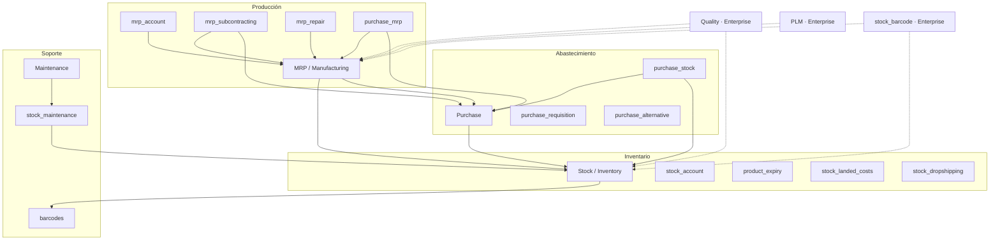
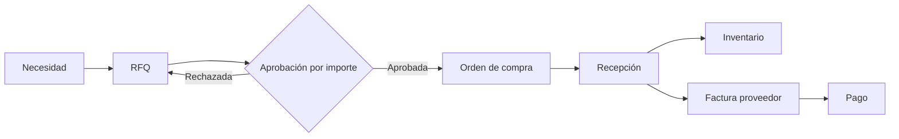
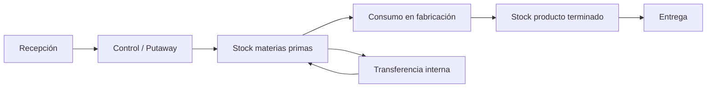
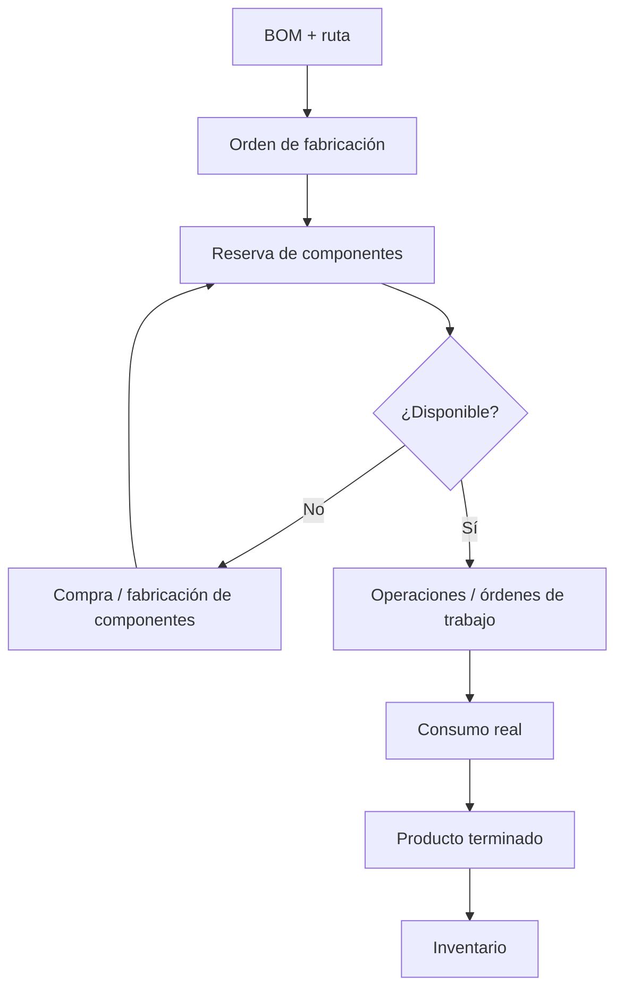
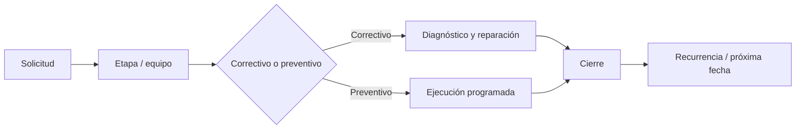
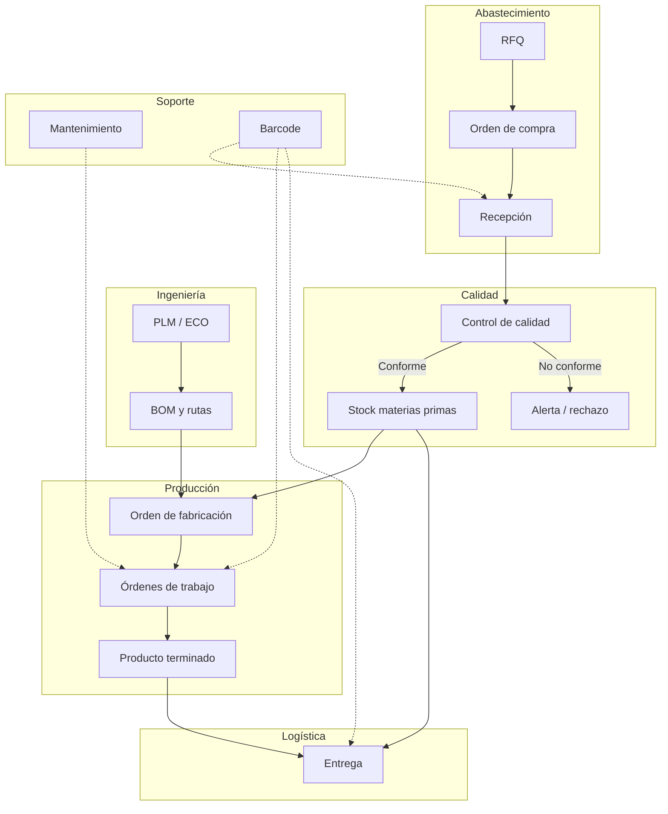

# Investigación funcional: Producción y Abastecimiento en Odoo

**Base analizada:** repositorio local `odoo` — Odoo 20.0 (Community), commit `2b504bcb3b4` (2026-08-10).
**Método:** inspección directa de manifiestos, modelos, vistas, menús y datos de los módulos presentes en `addons/`.

> **Nota importante sobre ediciones**
> Los módulos **Quality**, **PLM** y la aplicación de escaneo **Barcode** (`stock_barcode`) **no están en este repositorio**, porque son módulos **Enterprise**. En este documento se describen a nivel funcional y se marcan explícitamente como Enterprise. Todo lo demás se verificó contra el código local.

## Documentos

- **[`RESUMEN_FUNCIONALIDADES.md`](RESUMEN_FUNCIONALIDADES.md)** — documento único con todas las funcionalidades (184)
- [`01-compras-purchase.md`](01-compras-purchase.md)
- [`02-inventario-inventory.md`](02-inventario-inventory.md)
- [`03-fabricacion-mrp.md`](03-fabricacion-mrp.md)
- [`04-calidad-quality.md`](04-calidad-quality.md)
- [`05-mantenimiento-maintenance.md`](05-mantenimiento-maintenance.md)
- [`06-plm.md`](06-plm.md)
- [`07-codigos-barras-barcode.md`](07-codigos-barras-barcode.md)
- [`08-evaluacion-funcionalidades-avanzadas.md`](08-evaluacion-funcionalidades-avanzadas.md)

---

## 1. Resumen ejecutivo

| # | Módulo | Nombre técnico | Edición | Rol principal | Modelos clave |
|---|--------|----------------|---------|---------------|---------------|
| 1 | Compras | `purchase` (+ `purchase_stock`, `purchase_mrp`, `purchase_requisition`, `purchase_alternative`) | Community | Aprovisionamiento de materias primas, insumos y servicios | `purchase.order`, `purchase.order.line`, `product.supplierinfo` |
| 2 | Inventario | `stock` (+ `stock_account`, `product_expiry`, `stock_landed_costs`, `stock_dropshipping`) | Community | Almacenes, movimientos, trazabilidad y existencias | `stock.picking`, `stock.move`, `stock.quant`, `stock.lot`, `stock.warehouse.orderpoint` |
| 3 | Fabricación | `mrp` (+ `mrp_account`, `mrp_subcontracting`, `purchase_mrp`, `mrp_repair`) | Community | Transformación de materias primas en producto terminado | `mrp.bom`, `mrp.production`, `mrp.workorder`, `mrp.workcenter` |
| 4 | Calidad | `quality`, `quality_control`, `quality_mrp` | **Enterprise** | Controles, inspecciones y alertas de calidad | `quality.point`, `quality.check`, `quality.alert` |
| 5 | Mantenimiento | `maintenance` (+ `stock_maintenance`) | Community | Equipos, solicitudes y mantenimiento preventivo/correctivo | `maintenance.equipment`, `maintenance.request` |
| 6 | PLM | `mrp_plm` | **Enterprise** | Versiones de BOM y cambios de ingeniería | `mrp.eco` (Engineering Change Order) |
| 7 | Códigos de barras | `barcodes` (base) + `stock_barcode` (app) | Community + **Enterprise** | Captura de operaciones logísticas por escáner | `barcode.nomenclature`, `barcode.rule` |

---

## 2. Arquitectura funcional y dependencias

Lectura rápida:

- **Purchase** no mueve stock por sí solo; con `purchase_stock` genera recepciones (`stock.picking`).
- **Stock** es la capa transversal: todo movimiento de compra, fabricación, entrega o ajuste termina en `stock.move` / `stock.quant`.
- **MRP** consume componentes y produce terminados usando las mismas reglas de inventario.
- **Maintenance** es independiente, pero se conecta con inventario mediante `stock_maintenance` (lotes/series) y con fabricación solo en Enterprise (`mrp_maintenance`).
- **Barcode** es una capa de captura, no un módulo de planificación.

---

## 3. Purchase — Compras

### 3.1 Propósito

Gestionar el ciclo **necesidad → solicitud de cotización → orden de compra → recepción → factura**, incluyendo proveedores, precios y plazos. Es la puerta de entrada de materias primas, insumos y servicios.

### 3.2 Modelos principales

| Modelo | Función |
|--------|---------|
| `purchase.order` | Cabecera de RFQ / orden de compra |
| `purchase.order.line` | Líneas: producto, cantidad, precio, impuestos, fecha prevista |
| `product.supplierinfo` | Tarifa de proveedor: precio, cantidad mínima, plazo, moneda, vigencia, descuento |
| `res.partner` | Proveedor (`supplier_rank`), avisos de compra, tasa de entrega a tiempo |
| `purchase.requisition` | Acuerdos de compra: blanket order y plantilla de compra |
| `purchase.order.group` | Agrupación para comparar RFQ alternativas (`purchase_alternative`) |
| `purchase.bill.line.match` | Vista de conciliación línea de compra vs. línea de factura |

### 3.3 Funcionalidades

#### Solicitudes de cotización (RFQ)

- Creación manual o automática desde:
  - Reglas de reabastecimiento (`stock.warehouse.orderpoint`).
  - Faltantes de componentes de una orden de fabricación (`purchase_mrp`).
  - Necesidades de venta con ruta *Make to Order*.
- Estados: `draft` (RFQ), `sent` (RFQ enviada), `to approve` (pendiente de aprobación), `purchase` (orden confirmada), `cancel`.
- Envío por correo, impresión PDF y portal del proveedor.
- Comparación de ofertas de varios proveedores mediante `purchase_alternative`.
- Acuerdos marco: blanket orders y plantillas de compra (`purchase_requisition`).
- Multi-moneda, condiciones de pago, Incoterm, posición fiscal y distribución analítica.

#### Órdenes de compra

- Confirmación de la orden y generación de recepciones (con `purchase_stock`).
- **Aprobación por importe**: uno o dos niveles (`po_double_validation`, `po_double_validation_amount`).
- **Bloqueo de órdenes confirmadas** (`po_lock`) para impedir modificaciones.
- Control de cantidades: `qty_received`, `qty_invoiced`, `qty_to_invoice`, `receipt_status` e `invoice_status`.
- **Política de control** por producto (`purchase_method`):
  - `purchase`: se factura según lo ordenado.
  - `receive`: se factura según lo recibido.
- Backorders (recepciones parciales), cancelación y devoluciones.

#### Gestión de proveedores

- Proveedores como contactos con `supplier_rank`.
- Tarifas por producto/proveedor con:
  - Precio, cantidad mínima, descuento.
  - Plazo de entrega (`delay`).
  - Moneda, vigencia (`date_start` / `date_end`).
  - Nombre y código del producto según el proveedor.
- Avisos de compra a nivel de proveedor y de producto (`purchase_warn_msg`).
- **Tasa de entrega a tiempo** (`on_time_rate`) calculada con las recepciones (`purchase_stock`).
- Facturación de proveedor y conciliación línea a línea.

> En Community no existe un SRM completo (scorecards, homologación, portales de licitación avanzados). La “gestión de proveedores” es funcional pero acotada a contactos, tarifas, avisos y métricas básicas.

#### Recepción y seguimiento

- `purchase_stock` crea `stock.picking` de entrada al confirmar la orden.
- Recepción en 1, 2 o 3 pasos según la configuración del almacén.
- Fechas relevantes: fecha prevista (`date_planned`), fecha prometida por el proveedor (`date_promised`) y fecha real de llegada (`effective_date`).
- Estado de recepción: no recibido, parcial o completo.
- Devoluciones al proveedor y recepciones parciales con backorder.
- **3-way matching** (compra ↔ recepción ↔ factura): existe una vista de conciliación en Community; el bloqueo automático de facturas es **Enterprise** (`account_3way_match`).

#### Abastecimiento

- Rutas de aprovisionamiento: **Buy**, **Manufacture**, **Make to Order**, **Dropship**.
- Los orderpoints pueden generar RFQ automáticamente.
- Plazos de entrega del proveedor y del transporte.
- Acuerdos de compra para precios negociados.
- Compras vinculadas a fabricación (`purchase_mrp`) y a subcontratación (`mrp_subcontracting`).

### 3.4 Flujo típico

### 3.5 Configuración relevante

- Unidades de medida y empaquetados.
- Política de control (ordenado vs. recibido).
- Niveles de aprobación y umbral.
- Bloqueo de órdenes confirmadas.
- Avisos de compra.
- Recordatorio de recepción por correo.
- Acuerdos de compra, alternativas y matriz de productos.

### 3.6 Límites y observaciones

- La aprobación es por importe; no hay flujos de aprobación multinivel por categoría o centro de costo sin desarrollo.
- El 3-way match automático es Enterprise.
- No es un SRM: no incluye evaluación formal de proveedores ni licitaciones complejas.
- La recepción real ocurre en Inventario; Compras solo la origina y la controla.

---

## 4. Inventory — Inventario

### 4.1 Propósito

Controlar la ubicación, disponibilidad, movimiento y trazabilidad de materiales y productos en todo el proceso: recepción, almacenamiento, transferencia, fabricación y entrega.

### 4.2 Modelos principales

| Modelo | Función |
|--------|---------|
| `stock.warehouse` | Almacén y configuración de pasos logísticos |
| `stock.location` | Ubicaciones jerárquicas (internas, proveedor, cliente, producción, tránsito, pérdidas) |
| `stock.picking` / `stock.picking.type` | Transferencias y tipos de operación |
| `stock.move` / `stock.move.line` | Movimientos y detalle de movimientos (lote, paquete, ubicación) |
| `stock.quant` | Existencias por producto/ubicación/lote |
| `stock.lot` | Lotes y números de serie |
| `stock.route` / `stock.rule` | Rutas y reglas de aprovisionamiento |
| `stock.warehouse.orderpoint` | Punto de pedido / reabastecimiento |
| `stock.putaway.rule` | Reglas de ubicación al recibir |
| `stock.storage.category` | Categorías y capacidad de almacenamiento |
| `stock.package` / `stock.package.type` | Paquetes y tipos de paquete |
| `stock.picking.batch` | Transferencias por lote/oleada |
| `stock.scrap.reason.tag` | Motivos de desecho |
| `stock.reference` | Referencia cruzada entre documentos de stock |

### 4.3 Funcionalidades

#### Almacenes y ubicaciones

- Múltiples almacenes por compañía.
- Ubicaciones jerárquicas con tipos:
  - Internas, vista, proveedor, cliente, inventario/pérdidas, producción, tránsito.
- Configuración de recepción en **1, 2 o 3 pasos** (entrada → calidad → stock).
- Configuración de entrega en **1, 2 o 3 pasos** (pick → pack → ship).
- **Reabastecimiento entre almacenes** (`resupply_wh_ids`).
- Reglas de **putaway** para dirigir productos a ubicaciones concretas.
- Categorías de almacenamiento con capacidad y restricciones.
- Código de barras por ubicación.

#### Entradas, salidas y transferencias

- Tipos de operación: recepciones, entregas, transferencias internas y operaciones de fabricación.
- Estados de transferencia: borrador, esperando otra operación, esperando disponibilidad, listo, hecho, cancelado.
- Reserva de stock y cálculo de disponibilidad.
- Backorders, devoluciones, intercambios y división de transferencias.
- Transferencias por lotes/oleadas (`stock.picking.batch`).
- Paquetes y manipulación por paquete.
- Operaciones detalladas (`stock.move.line`) con lote/serie, paquete y ubicación.
- Impresión de etiquetas y albaranes.

#### Trazabilidad por lotes y números de serie

- Productos configurados como `lot` (lote) o `serial` (número de serie único).
- Registro de lote/serie en cada movimiento.
- Propiedades personalizadas por lote.
- Con `product_expiry`:
  - Fecha de caducidad.
  - Fecha de consumo preferente.
  - Fecha de retirada.
  - Fecha de alerta.
  - Estrategia **FEFO** (First Expiry First Out).
- **Informe de trazabilidad** hacia adelante y hacia atrás.
- `stock.reference` enlaza documentos relacionados.
- Valoración por lote/serie con `stock_account` (`lot_valuated`).

#### Reglas de reabastecimiento

- **Orderpoints** (`stock.warehouse.orderpoint`) con:
  - Cantidad mínima y máxima.
  - Disparador automático o manual.
  - Demanda diaria estimada según histórico (7 días, 30 días, 3 meses, 12 meses, etc.).
  - Plazo de entrega y fecha límite.
  - Ruta efectiva (Buy, Manufacture, etc.).
  - Cantidad a pedir calculada o manual.
- Rutas y reglas:
  - `pull` (traer desde), `push` (empujar hacia), `pull_push`.
  - Métodos: tomar de stock, disparar otra regla, o tomar de stock y si no hay disparar otra regla.
- Rutas preconfiguradas: **Buy**, **Manufacture**, **Make to Order**, **Dropship**, reabastecimiento entre almacenes.
- Orderpoint automático 0/0/1 para productos sin configuración explícita.
- Informe de reabastecimiento y previsión de stock.

#### Existencias de materias primas y productos terminados

- `stock.quant` como registro de existencia por producto, ubicación y lote.
- **Inventario físico** por ubicación/producto.
- **Inventario cíclico** por ubicación:
  - `cyclic_inventory_frequency` define la frecuencia.
  - `next_inventory_date` calcula la próxima fecha.
  - La fecha se asigna automáticamente a los quants.
- Desechos (`scrap`) con motivo etiquetado.
- Valoración de inventario:
  - Costo estándar, promedio ponderado (AVCO) y FIFO.
  - Valoración específica por lote.
- Costos landing (`stock_landed_costs`) para incorporar fletes, seguros y aranceles al costo.
- Dropshipping (`stock_dropshipping`).

#### Códigos de barras en inventario

- Nomenclaturas y reglas de códigos de barras (`barcodes`).
- Soporte GS1 (`barcodes_gs1_nomenclature`).
- Código de barras en productos, ubicaciones, paquetes y lotes.
- La **app de escaneo** para ejecutar recepciones, entregas, transferencias y conteos es **Enterprise** (`stock_barcode`).

### 4.4 Flujo típico

### 4.5 Límites y observaciones

- No es un WMS avanzado: no hay slotting automático, gestión de mano de obra ni planificación de olas compleja; sí existen batch transfers y putaway rules.
- El inventario cíclico existe, pero es una frecuencia por ubicación; no es un motor de conteo ABC.
- La trazabilidad es sólida para lotes/series, pero depende de que los productos se configuren correctamente.
- La valoración y los asientos contables requieren `stock_account` y configuración contable.

---

## 5. Manufacturing (MRP) — Fabricación

### 5.1 Propósito

Planificar y ejecutar la transformación de materias primas en productos terminados: listas de materiales, órdenes de fabricación, operaciones, consumo de componentes y registro de producción.

### 5.2 Modelos principales

| Modelo | Función |
|--------|---------|
| `mrp.bom` | Lista de materiales |
| `mrp.bom.line` | Componentes de la BOM |
| `mrp.bom.byproduct` | Coproductos / subproductos |
| `mrp.production` | Orden de fabricación (MO) |
| `mrp.workorder` | Orden de trabajo por operación |
| `mrp.routing.workcenter` | Operación de la ruta |
| `mrp.workcenter` | Centro de trabajo / máquina |
| `mrp.workcenter.capacity` | Capacidad por producto/unidad |
| `mrp.workcenter.productivity` | Registro de tiempos y pérdidas |
| `mrp.unbuild` | Orden de desensamblado |

### 5.3 Funcionalidades

#### Listas de materiales (BOM)

- Tipos:
  - `normal`: fabricar el producto.
  - `phantom`: kit (se explota en componentes, sin orden de fabricación propia).
- BOM multinivel: una línea puede referenciar otra BOM hija.
- Componentes con cantidad, unidad de medida, operación asignada y variantes.
- **Subproductos** (`mrp.bom.byproduct`).
- **Operaciones** (`mrp.routing.workcenter`) asociadas a la BOM.
- Dependencias entre operaciones.
- Tamaño de lote (`batch_size`) y fabricación continua (`continuous`).
- Preparación:
  - `produce_delay`: plazo de fabricación.
  - `days_to_prepare_mo`: días para preparar la orden.
  - `ready_to_produce`: iniciar cuando estén todos los componentes o solo los de la primera operación.
- Notas que se muestran en la orden y en el Shop Floor.
- BOM específicas por variante de producto.

#### Órdenes de fabricación (MO)

- Estados: borrador, confirmada, en progreso, por cerrar, hecha, cancelada.
- Estados de reserva: esperando, lista, esperando otra operación.
- Confirmación:
  - Genera movimientos de componentes.
  - Dispara reglas de aprovisionamiento (compra o fabricación de componentes).
- Disponibilidad de componentes y **capacidad de producción** según stock actual.
- Registro de producción:
  - Cantidad producida.
  - Lote/serie del producto terminado.
  - Subproductos.
  - Consumo real vs. teórico, con asistente de advertencia por diferencias.
- Backorders, división de órdenes y cierre.
- Desecho (`scrap`) desde la orden.
- Prioridad, fecha de inicio, fecha límite y calendario.
- Distribución analítica y costeo con `mrp_account`.

#### Rutas y operaciones

- Centros de trabajo con:
  - Capacidad por producto y unidad.
  - Tiempo de preparación, ciclo y limpieza.
  - Eficiencia y costo por hora.
  - **OEE** (Overall Equipment Effectiveness) y objetivo.
- Operaciones con:
  - Modo de tiempo: manual, calculado por histórico o por lote.
  - Duración esperada y total.
  - Dependencias y secuencia.
- Órdenes de trabajo (`mrp.workorder`):
  - Estados: bloqueada, por hacer, en progreso, hecha, cancelada.
  - Registro de tiempos productivos y pérdidas.
  - Bloqueos y desbloqueos.
  - Dependencias entre operaciones.
  - Código de barras de la orden.
- La **Shop Floor** (interfaz táctil de planta) es **Enterprise** (`mrp_workorder`); en Community las órdenes de trabajo se gestionan desde el backend.

#### Planificación de materiales y capacidad

- Explosión de BOM y cálculo de necesidades de componentes.
- Fechas de inicio/fin y plazos.
- Disponibilidad de componentes y capacidad de producción.
- Vista calendario de órdenes y planificación por centro de trabajo.
- Reabastecimiento de componentes vía orderpoints y rutas.
- **Limitación:** no hay optimización de capacidad finita ni MPS (Master Production Schedule) en Community; `mrp_mps` es Enterprise.
- La planificación es fundamentalmente hacia atrás desde la fecha límite, con ajustes manuales.

#### Registro de consumo y producción

- Movimientos de componentes (`move_raw_ids`) y de producto terminado (`move_finished_ids`).
- Consumo por lote/serie cuando el producto está trazado.
- Registro de cantidades producidas y backorder.
- Costeo de la orden:
  - Consumo de materiales.
  - Costo de operaciones/centro de trabajo.
  - Distribución analítica.
- Desensamblado (`mrp.unbuild`) para recuperar componentes.

### 5.4 Flujo típico

### 5.5 Configuración relevante

- Unidades de medida y precisión decimal.
- Centros de trabajo, calendarios y capacidades.
- Operaciones y dependencias.
- BOM normales vs. kits.
- Rutas Manufacture / Buy / MTO.
- Orderpoints para componentes.
- Política de consumo y backorders.
- Costeo (`mrp_account`) y valoración (`stock_account`).

### 5.6 Módulos complementarios

| Módulo | Aporte |
|--------|--------|
| `mrp_account` | Valoración y costeo de órdenes, centros de trabajo y análisis |
| `mrp_subcontracting` | Fabricación por subcontratistas, BOM tipo `subcontract`, ubicaciones y recepciones |
| `purchase_mrp` | Compra de componentes para órdenes de fabricación, kits comprados |
| `mrp_repair` | Vinculación de reparaciones con órdenes de fabricación |
| `stock_maintenance` | Lotes/series usados en mantenimiento |
| `mrp_product_expiry` | Fechas de caducidad en fabricación |
| `mrp_landed_costs` | Costos landing en fabricación |
| `mrp_delivery` | Integración con entregas |

### 5.7 Límites y observaciones

- Sin MPS ni planificación de capacidad finita en Community.
- Sin Shop Floor táctil (Enterprise).
- Sin integración nativa con Calidad ni Mantenimiento de centros de trabajo (Enterprise).
- La planificación de capacidad se apoya en capacidades por producto y calendarios, no en un APS.
- La exactitud del costeo depende de la configuración de valoración y de los tiempos registrados.

---

## 6. Quality — Calidad (Enterprise)

> **No está en este repositorio.** Se describe según la funcionalidad estándar de Odoo Enterprise.

### 6.1 Propósito

Definir puntos de control, ejecutar inspecciones y gestionar alertas y no conformidades durante recepciones, fabricación, entregas y mantenimiento.

### 6.2 Funcionalidades

- **Puntos de control** (`quality.point`) asociados a:
  - Producto.
  - Operación de fabricación.
  - Tipo de operación de inventario (recepción, entrega, transferencia).
- **Controles** (`quality.check`) de varios tipos:
  - Instrucciones.
  - Aprobado / rechazado.
  - Medición con tolerancias.
  - Hojas de trabajo (worksheets) en algunos flujos.
- **Criterios de aceptación** por producto/operación.
- **Alertas de calidad** (`quality.alert`):
  - Etapas y equipos de calidad.
  - Causa raíz y acciones correctivas.
  - Vinculación con la orden o transferencia afectada.
- **Equipos de calidad** y responsables.
- **Bloqueo** de operaciones hasta completar el control.
- Estadísticas y reportes de calidad.
- Integración con:
  - Órdenes de fabricación y órdenes de trabajo.
  - Recepciones y entregas.
  - Mantenimiento (en módulos Enterprise específicos).

### 6.3 Aportación al proceso

- Asegura que solo se consume/produce/entrega material conforme.
- Genera trazabilidad de la inspección.
- Permite detectar defectos y disparar acciones correctivas.

---

## 7. Maintenance — Mantenimiento

### 7.1 Propósito

Gestionar equipos y maquinaria, solicitudes de reparación y mantenimiento preventivo/correctivo, con seguimiento de averías y métricas de fiabilidad.

### 7.2 Modelos principales

| Modelo | Función |
|--------|---------|
| `maintenance.equipment` | Equipo o máquina |
| `maintenance.equipment.category` | Categoría de equipo |
| `maintenance.team` | Equipo de mantenimiento |
| `maintenance.request` | Solicitud de mantenimiento |
| `maintenance.stage` | Etapa del flujo (kanban) |
| `maintenance.mixin` | Mixin con métricas MTBF/MTTR para equipos |

### 7.3 Funcionalidades

#### Equipos y maquinaria

- Ficha de equipo con:
  - Categoría, propietario, proveedor y referencia del proveedor.
  - Modelo, número de serie, costo y fecha de garantía.
  - Fecha de asignación y fecha de baja (`scrap_date`).
  - Propiedades personalizadas por categoría.
  - Notas y documentos.
- Asignación a usuario/ubicación.
- Contadores de mantenimientos y mantenimientos abiertos.

#### Mantenimiento preventivo y correctivo

- Tipo de mantenimiento: `corrective` o `preventive`.
- **Recurrencia**:
  - `repeat_interval` + `repeat_unit` (días, semanas, meses, años).
  - `repeat_type`: indefinido o hasta una fecha.
  - Generación automática de la siguiente solicitud.
- Programación:
  - Fecha prevista (`schedule_date`).
  - Fin previsto (`schedule_end`).
  - Duración calculada.
- Etapas configurables y tablero kanban.
- Prioridad, equipo responsable, técnicos y fecha de cierre.
- Instrucciones en HTML.

#### Solicitudes de reparación y seguimiento de averías

- Solicitudes con estado: en progreso, cambios solicitados, aprobado, hecho, cancelado.
- Flujo de aprobación por etapas.
- Registro de causa, acciones y cierre.
- Historial por equipo.
- Métricas:
  - **MTBF** (Mean Time Between Failures).
  - **MTTR** (Mean Time To Repair).
  - Fecha estimada del próximo fallo.
  - Última fecha de fallo.
- Integración con inventario (`stock_maintenance`): muestra lotes/series usados en mantenimiento.
- La integración directa con centros de trabajo de fabricación es **Enterprise** (`mrp_maintenance`).

### 7.4 Flujo típico

### 7.5 Límites y observaciones

- No incluye gestión de repuestos como almacén dedicado; se apoya en Inventario.
- La vinculación con centros de trabajo y órdenes de fabricación es Enterprise.
- No es un EAM/CMMS completo: no hay gestión de activos financieros ni órdenes de trabajo de mantenimiento con mano de obra detallada.

---

## 8. PLM — Gestión del ciclo de vida del producto (Enterprise)

> **No está en este repositorio.** Se describe según la funcionalidad estándar de Odoo Enterprise (`mrp_plm`).

### 8.1 Propósito

Controlar cambios de ingeniería, versiones de listas de materiales y aprobaciones técnicas antes de llevar un cambio a producción.

### 8.2 Funcionalidades

- **Órdenes de cambio de ingeniería (ECO)** (`mrp.eco`):
  - Tipos de cambio: BOM, operaciones, producto.
  - Etapas configurables con aprobaciones.
  - Responsables y fechas de vigencia.
- **Versionado de BOM**:
  - Versiones y revisiones.
  - BOM archivadas y vigentes.
  - Fechas de efectividad.
- **Cambios de ingeniería**:
  - Modificación de componentes, cantidades, operaciones y subproductos.
  - Comparación antes/después.
  - Aplicación controlada a la BOM.
- **Aprobaciones técnicas** y trazabilidad de quién aprobó qué.
- **Gestión documental** integrada (planos, especificaciones) con `documents`.
- **Análisis de impacto** sobre órdenes de fabricación y BOM existentes.
- Historial de cambios y motivos.

### 8.3 Aportación al proceso

- Evita que cambios de ingeniería se apliquen sin control.
- Permite convivencia de versiones de producto.
- Da trazabilidad técnica y auditoría.

---

## 9. Barcode — Códigos de barras

### 9.1 Propósito

Capturar operaciones logísticas y de producción mediante escáner, reduciendo errores de digitación y acelerando recepciones, transferencias, preparación de pedidos y conteos.

### 9.2 Componentes

| Componente | Edición | Función |
|------------|---------|---------|
| `barcodes` | Community | Nomenclaturas, reglas y parseo de códigos |
| `barcodes_gs1_nomenclature` | Community | Soporte de estándar GS1 |
| `stock_barcode` | **Enterprise** | App de escaneo para inventario |
| Extensiones MRP de barcode | **Enterprise** | Escaneo en planta / órdenes de trabajo |

### 9.3 Funcionalidades

#### Base Community (`barcodes`)

- **Nomenclaturas** configurables:
  - Reglas por tipo de código (producto, peso, precio, lote, ubicación, paquete, proveedor).
  - Prefijos, longitud y secuencia.
- Parseo de códigos escaneados.
- Código de barras en:
  - Productos.
  - Ubicaciones.
  - Paquetes.
  - Lotes/series.
  - Contactos.
- Validación de formato EAN/GTIN.
- Nomenclatura GS1.

#### App Enterprise (`stock_barcode`)

- **Recepciones**:
  - Escaneo de producto, lote y ubicación.
  - Registro de cantidades.
- **Transferencias internas** y **entregas**.
- **Preparación de pedidos** (picking).
- **Conteos de inventario**.
- **Paquetes** y manipulación.
- **Lotes/series**.
- **Órdenes de fabricación y órdenes de trabajo** (con extensiones MRP).
- Interfaz móvil/táctil para operar en almacén y planta.

### 9.4 Aportación al proceso

- Reduce tiempos y errores en la ejecución.
- No planifica ni decide: **complementa** Inventario, Compras y Fabricación.
- Requiere que los datos maestros (productos, ubicaciones, lotes) tengan códigos correctos.

---

## 10. Flujo end-to-end de producción y abastecimiento

**Secuencia conceptual:**

1. **PLM** define y versiona la BOM y las operaciones.
2. **Compras** abastece materias primas e insumos.
3. **Inventario** recibe, ubica y controla existencias.
4. **Calidad** inspecciona y libera o rechaza.
5. **Fabricación** consume componentes y produce terminados.
6. **Inventario** almacena el terminado y lo prepara para entrega.
7. **Mantenimiento** asegura disponibilidad de equipos.
8. **Barcode** captura las operaciones en cada paso.

---

## 11. Cobertura frente a los requisitos planteados

| Requisito | Módulo | Cobertura | Observación |
|-----------|--------|-----------|-------------|
| Solicitudes de cotización | Purchase | ✅ Community | RFQ manual/automática, envío y portal |
| Órdenes de compra | Purchase | ✅ Community | Aprobación por importe, bloqueo, estados |
| Gestión de proveedores | Purchase / Contacts | 🟡 Parcial | Tarifas, avisos y OTD; sin SRM completo |
| Recepción y seguimiento | Purchase + Stock | ✅ Community | Recepción 1/2/3 pasos, backorders |
| Abastecimiento de MP, insumos y servicios | Purchase + Stock | ✅ Community | Rutas Buy/Manufacture/MTO/Dropship |
| Almacenes y ubicaciones | Stock | ✅ Community | Multi-almacén, jerarquía, putaway |
| Entradas, salidas y transferencias | Stock | ✅ Community | Incluye batch y paquetes |
| Trazabilidad por lotes y series | Stock + product_expiry | ✅ Community | Reporte de trazabilidad y FEFO |
| Reglas de reabastecimiento | Stock | ✅ Community | Orderpoints, rutas y reglas |
| Existencias de MP y PT | Stock | ✅ Community | Quants, inventario físico y cíclico |
| Listas de materiales (BOM) | MRP | ✅ Community | Normal/kit, multinivel, subproductos |
| Órdenes de fabricación | MRP | ✅ Community | Estados, reserva, backorder, costeo |
| Rutas y operaciones | MRP | ✅ Community | Centros de trabajo y órdenes de trabajo |
| Planificación de materiales y capacidad | MRP + Stock | 🟡 Parcial | Sin APS ni MPS; capacidad por centro |
| Registro de consumo y producción | MRP | ✅ Community | Consumo real, lotes, subproductos |
| Controles e inspecciones | Quality | 🔴 Enterprise | No incluido en Community |
| Criterios de aceptación | Quality | 🔴 Enterprise | No incluido en Community |
| Alertas de calidad | Quality | 🔴 Enterprise | No incluido en Community |
| Seguimiento de defectos | Quality | 🔴 Enterprise | No incluido en Community |
| Mantenimiento preventivo/correctivo | Maintenance | ✅ Community | Recurrencia y etapas |
| Equipos y maquinaria | Maintenance | ✅ Community | Ficha completa y métricas |
| Solicitudes de reparación | Maintenance / Repair | 🟡 Community | `repair` + `mrp_repair`; no es CMMS completo |
| Seguimiento de averías | Maintenance | ✅ Community | Historial y MTBF/MTTR |
| Revisiones de BOM | PLM | 🔴 Enterprise | `mrp_plm` |
| Cambios de ingeniería | PLM | 🔴 Enterprise | ECOs y aprobaciones |
| Versiones y aprobaciones técnicas | PLM | 🔴 Enterprise | Versionado y efectividad |
| Recepción con escáner | Barcode | 🔴 Enterprise | App `stock_barcode` |
| Transferencias con escáner | Barcode | 🔴 Enterprise | App `stock_barcode` |
| Preparación de pedidos con escáner | Barcode | 🔴 Enterprise | App `stock_barcode` |
| Registro de operaciones con escáner | Barcode | 🔴 Enterprise | App + extensiones MRP |

**Leyenda:** ✅ cubierto en Community · 🟡 parcial o con límites · 🔴 requiere Enterprise.

---

## 12. Brechas y consideraciones

### 12.1 Community vs. Enterprise

| Capacidad | Community | Enterprise |
|-----------|-----------|------------|
| Compras, inventario y MRP base | ✅ | ✅ |
| Calidad (controles, alertas) | ❌ | ✅ |
| PLM / ECOs / versionado de BOM | ❌ | ✅ |
| App de código de barras | ❌ (solo base `barcodes`) | ✅ |
| Shop Floor táctil | ❌ | ✅ |
| MPS (planificación maestra) | ❌ | ✅ |
| Capacidad finita / APS | ❌ | 🟡 Planificación por capacidad, sin APS completo |
| 3-way matching automático | ❌ | ✅ |
| Mantenimiento de centros de trabajo | ❌ | ✅ |
| Costeo y valoración | ✅ (`stock_account`, `mrp_account`) | ✅ |

### 12.2 Puntos críticos de implementación

1. **Datos maestros primero**: productos, unidades de medida, categorías, ubicaciones, almacenes y proveedores.
2. **Definir la política de trazabilidad**: lote, serie o cantidad; sin esto, la trazabilidad no funciona.
3. **Configurar correctamente las rutas**: Buy, Manufacture, MTO y Dropship; una ruta mal configurada genera compras o fabricaciones invisibles.
4. **Orderpoints y plazos**: la calidad del reabastecimiento depende de los lead times y de la demanda histórica.
5. **BOM y rutas**: validar consumo, mermas, subproductos y tiempos antes de cargar producción real.
6. **Valoración**: decidir costo estándar, AVCO o FIFO antes de operar; cambiarlo después afecta la contabilidad.
7. **Roles y aprobaciones**: definir umbrales de compra y flujos de calidad.
8. **Capacitación**: Compras, Inventario y Fabricación comparten objetos; un error de configuración se propaga.

### 12.3 Recomendación de módulos para una PyME manufacturera (Community)

**Base mínima:**

- `purchase`
- `purchase_stock`
- `stock`
- `stock_account`
- `mrp`
- `mrp_account`
- `purchase_mrp`
- `maintenance`
- `stock_maintenance`
- `product_expiry`
- `barcodes`

**Según operación:**

- `purchase_requisition` (acuerdos marco).
- `purchase_alternative` (comparación de ofertas).
- `mrp_subcontracting` (subcontratación).
- `mrp_repair` + `repair` (reparaciones).
- `stock_landed_costs` (costos de importación).
- `stock_dropshipping` (entrega directa).
- `stock_delivery` (integración con transportistas).

**Si se requieren calidad, PLM o escaneo intensivo:** evaluar Enterprise.

---

## 13. Anexo: rutas de menú y objetos clave

### Purchase

- `Compras > Órdenes > Solicitudes de cotización`
- `Compras > Órdenes > Órdenes de compra`
- `Compras > Órdenes > Proveedores`
- `Compras > Productos`
- `Compras > Configuración`
- Modelos: `purchase.order`, `purchase.order.line`, `product.supplierinfo`.

### Inventory

- `Inventario > Operaciones > Transferencias` (Recepciones, Entregas, Internas)
- `Inventario > Operaciones > Ajustes` (Inventario físico, Scrap)
- `Inventario > Operaciones > Reabastecimiento`
- `Inventario > Operaciones > Trabajos` (batch)
- `Inventario > Productos` (Productos, Lotes/series, Paquetes)
- `Inventario > Reportes` (Movimientos, Valoración, Trazabilidad)
- `Inventario > Configuración > Almacenes y ubicaciones`
- Modelos: `stock.picking`, `stock.move`, `stock.quant`, `stock.lot`, `stock.warehouse.orderpoint`.

### Manufacturing

- `Fabricación > Operaciones > Órdenes de fabricación`
- `Fabricación > Operaciones > Órdenes de trabajo` (requiere activar el grupo de órdenes de trabajo)
- `Fabricación > Planificación`
- `Fabricación > Productos > Listas de materiales`
- `Fabricación > Configuración > Centros de trabajo`
- `Fabricación > Configuración > Operaciones`
- `Fabricación > Reportes`
- Modelos: `mrp.bom`, `mrp.production`, `mrp.workorder`, `mrp.workcenter`.

### Maintenance

- `Mantenimiento > Equipos`
- `Mantenimiento > Solicitudes`
- `Mantenimiento > Equipos y solicitudes` (kanban)
- `Mantenimiento > Configuración > Etapas / Equipos / Categorías`
- Modelos: `maintenance.equipment`, `maintenance.request`.

### Barcode

- `Inventario > Configuración > Productos > Nomenclaturas de códigos de barras`
- Modelos: `barcode.nomenclature`, `barcode.rule`.

---

## 14. Conclusión

Odoo cubre de forma sólida el núcleo **compras → inventario → fabricación** en Community, con trazabilidad, reabastecimiento y costeo. La **calidad**, el **PLM** y la **app de escaneo** son las piezas que quedan fuera de Community y que, para un proceso de producción completo, suelen ser relevantes:

- **Calidad** aporta el control de conformidad y las alertas.
- **PLM** aporta el gobierno de cambios y versiones de BOM.
- **Barcode** aporta la ejecución rápida y sin errores en planta y almacén.

La decisión Community vs. Enterprise depende de si esos tres pilares son requisitos críticos o si pueden resolverse con procesos manuales/desarrollos puntuales.
