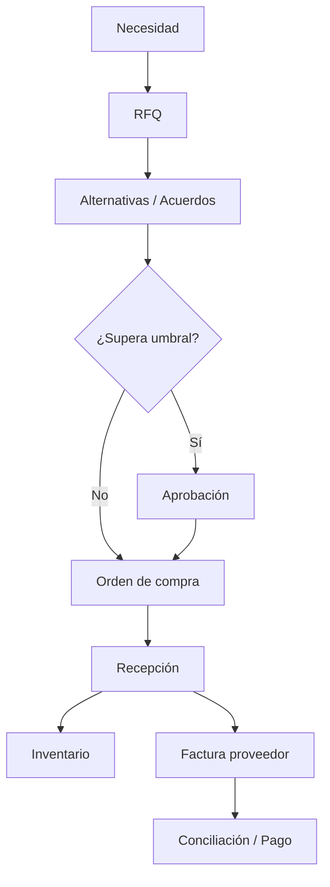

# Módulo 1 — Purchase (Compras)

> **Edición:** Community
> **Módulos técnicos:** `purchase`, `purchase_stock`, `purchase_requisition`, `purchase_alternative`, `purchase_mrp`, `purchase_edi_ubl_bis3`
> **Dependencias base:** `account`; con Inventario: `stock`; con Fabricación: `mrp`
> **Versión analizada:** Odoo 20.0 (commit `2b504bcb3b4`)

---

## 1. Ficha del módulo

**Propósito:** gestionar el ciclo de abastecimiento:

```text
Necesidad → Solicitud de cotización (RFQ) → Aprobación → Orden de compra → Recepción → Factura → Pago
```

**Modelos principales:**

| Modelo | Función |
|--------|---------|
| `purchase.order` | Cabecera de RFQ / orden de compra |
| `purchase.order.line` | Línea de producto, cantidad, precio, impuestos y fechas |
| `product.supplierinfo` | Tarifa y condiciones por proveedor/producto |
| `purchase.requisition` | Acuerdo de compra (blanket order / plantilla) |
| `purchase.order.group` | Agrupación de RFQ alternativas |
| `purchase.bill.line.match` | Vista de conciliación compra ↔ factura |

**Menús principales:**

- `Compras > Órdenes > Solicitudes de cotización`
- `Compras > Órdenes > Órdenes de compra`
- `Compras > Órdenes > Proveedores`
- `Compras > Órdenes > Acuerdos de compra` (con `purchase_requisition`)
- `Compras > Productos`
- `Compras > Reportes > Compras`
- `Compras > Configuración`

---

## 2. Mapa de funciones

| # | Función | Resultado |
|---|---------|-----------|
| F01 | Productos comprables y política de control | Define qué se compra y cuándo se factura |
| F02 | Tarifas y condiciones de proveedor | Precio, plazo, cantidad mínima y vigencia por proveedor |
| F03 | Alta y gestión de proveedores | Contacto comercial, avisos y tasa de entrega |
| F04 | Creación de RFQ | Documento de solicitud de precios |
| F05 | Generación automática de RFQ | Compras originadas por stock, MRP o MTO |
| F06 | Envío y comunicación de RFQ | Correo, PDF y portal del proveedor |
| F07 | Comparación de alternativas | Selección de proveedor por línea/plazo/precio |
| F08 | Fusión de RFQ | Unificar solicitudes del mismo proveedor |
| F09 | Acuerdos de compra | Precios negociados y plantillas recurrentes |
| F10 | Aprobación de órdenes | Validación por importe y rol |
| F11 | Confirmación de la orden | Conversión de RFQ en orden de compra |
| F12 | Bloqueo de órdenes | Impide modificaciones posteriores |
| F13 | Líneas, impuestos y analítica | Detalle económico y de gestión |
| F14 | Recepción de mercancías | Entrada real al inventario |
| F15 | Seguimiento de cantidades y estados | Control de recibido, facturado y pendiente |
| F16 | Facturación y conciliación | Factura de proveedor y matching |
| F17 | Devoluciones, cancelaciones y backorders | Gestión de excepciones |
| F18 | Recordatorios y seguimiento | Comunicación y actividades |
| F19 | Compras para fabricación y subcontratación | Componentes y servicios productivos |
| F20 | Compras EDI / UBL | Intercambio electrónico de documentos |
| F21 | Reportes y análisis | Compra por proveedor, producto y período |
| F22 | Configuración del módulo | Ajustes de operación |

---

## 3. Detalle función por función

### F01. Productos comprables y política de control

**Qué hace:** determina qué productos pueden comprarse y en qué momento se consideran facturables.

**Dónde:**
- `Compras > Productos`
- Ficha de producto, pestaña **Compra**.

**Objetos y campos:**
- `product.template.purchase_ok`: producto disponible para compra.
- `product.template.purchase_method` (política de control):
  - `purchase`: se factura según la cantidad **ordenada**.
  - `receive`: se factura según la cantidad **recibida**.
- Unidad de medida, empaquetados y proveedores del producto.

**Resultado:** el producto aparece en el catálogo de compras y el sistema calcula `qty_to_invoice` según la política elegida.

**Límites:** la política se define a nivel de producto; cambiarla afecta la facturación de órdenes abiertas.

---

### F02. Tarifas y condiciones de proveedor

**Qué hace:** registra precios y condiciones comerciales por proveedor y producto.

**Dónde:**
- `Compras > Configuración > Tarifas de proveedor`
- Ficha de producto, pestaña **Compra > Proveedores**.

**Objetos y campos (`product.supplierinfo`):**
- `partner_id`: proveedor.
- `product_id` / `product_tmpl_id`: producto o plantilla.
- `product_name` y `product_code`: nombre/código del proveedor.
- `min_qty`: cantidad mínima.
- `price`: precio unitario.
- `currency_id`: moneda.
- `date_start` / `date_end`: vigencia.
- `delay`: plazo de entrega en días.
- `discount`: descuento.
- `sequence`: prioridad de selección.

**Resultado:** al agregar un producto a una RFQ, Odoo propone el proveedor y precio según prioridad, cantidad, fecha y moneda.

**Límites:** no hay tarifas escalonadas por volumen más allá de `min_qty`; para escalas complejas se usan varias líneas o desarrollo.

---

### F03. Alta y gestión de proveedores

**Qué hace:** administra los contactos proveedores y su comportamiento comercial.

**Dónde:** `Compras > Órdenes > Proveedores`.

**Objetos y campos:**
- `res.partner.supplier_rank`: marca al contacto como proveedor.
- `purchase_warn_msg`: aviso al comprar a ese proveedor.
- `purchase_line_warn` / `purchase_line_warn_msg` en producto: aviso por producto.
- `on_time_rate` (con `purchase_stock`): porcentaje de entregas a tiempo.

**Resultado:** el proveedor queda disponible para RFQ y órdenes; los avisos aparecen al seleccionarlo.

**Límites:** no es un SRM. No incluye homologación, evaluación formal, scorecards configurables ni portal de licitación avanzado.

---

### F04. Creación de RFQ

**Qué hace:** crea una solicitud de cotización con una o varias líneas.

**Dónde:** `Compras > Órdenes > Solicitudes de cotización > Nuevo`.

**Objetos y campos:**
- `purchase.order`: proveedor, moneda, fecha, condiciones de pago, Incoterm, posición fiscal, destino, compañía.
- `purchase.order.line`: producto, descripción, cantidad, UoM, precio, impuestos, descuento, fecha prevista, distribución analítica.
- Estados: `draft` (RFQ), `sent` (enviada), `to approve`, `purchase`, `cancel`.

**Resultado:** documento en borrador listo para enviarse o compararse.

**Variantes:**
- Creación manual.
- Carga desde catálogo de productos.
- Importación de líneas.
- RFQ con proveedor único o múltiples alternativas (F07).

---

### F05. Generación automática de RFQ

**Qué hace:** crea solicitudes de cotización a partir de una necesidad calculada por el sistema.

**Orígenes:**
1. **Orderpoint / reabastecimiento** (`stock.warehouse.orderpoint`): si la previsión cae por debajo del mínimo y la ruta es *Buy*.
2. **Fabricación** (`purchase_mrp`): componentes faltantes de una orden de fabricación.
3. **Make to Order**: una venta o movimiento dispara una compra.
4. **Reglas de stock** (`stock.rule`) con acción de compra.

**Dónde:**
- `Inventario > Operaciones > Reabastecimiento`
- Orden de fabricación > componentes > compra sugerida
- Reglas de stock y rutas

**Objetos y campos:**
- `stock.rule` con ruta **Buy**.
- `purchase.order.line.orderpoint_id`: vínculo con el orderpoint.
- `purchase.order.line.move_dest_ids`: movimientos que originaron la compra.

**Resultado:** RFQ prellenada con producto, cantidad, proveedor y fecha según plazos.

**Límites:** la calidad de la sugerencia depende de lead times, orderpoints y demanda histórica bien configurados.

---

### F06. Envío y comunicación de RFQ

**Qué hace:** envía la solicitud al proveedor y registra la comunicación.

**Dónde:** botón **Enviar por correo** / **Imprimir** en la RFQ.

**Objetos y métodos:**
- `action_rfq_send`: abre el compositor de correo.
- Plantillas de correo y PDF de cotización.
- `portal.mixin`: URL del portal para el proveedor.
- `action_acknowledge`: el proveedor puede acusar recibo desde el portal (`acknowledged`).
- Chatter y actividades para seguimiento.

**Resultado:** la RFQ pasa a `sent`; el proveedor recibe el documento y puede consultarlo.

**Límites:** el portal permite consulta/acuse; no es un portal de bidding con subasta.

---

### F07. Comparación de alternativas

**Qué hace:** crea varias RFQ para el mismo requerimiento y compara ofertas para elegir la mejor combinación.

**Dónde:** pestaña **Alternativas** en la RFQ.
- **Crear alternativa** (`action_create_alternative`).
- **Comparar líneas de producto** (`action_compare_alternative_lines`).
- **Elegir** (`action_choose`) por línea.

**Objetos:**
- `purchase.order.group`: agrupa las RFQ alternativas.
- `purchase.order.purchase_group_id`.
- `purchase.order.alternative_po_ids`.

**Criterios comparables:** precio, plazo (`delay`), tasa de entrega a tiempo, subtotal en moneda de compañía y combinación por producto.

**Resultado:** se seleccionan líneas de distintos proveedores y se generan las órdenes correspondientes.

**Límites:** es un comparador operativo, no una subasta inversa ni una licitación con reglas formales.

---

### F08. Fusión de RFQ

**Qué hace:** une varias RFQ del mismo proveedor en una sola.

**Dónde:** acción **Fusionar RFQ** sobre varias solicitudes seleccionadas.

**Condiciones:**
- Solo RFQ en estado `draft` o `sent`.
- Se agrupan por proveedor.
- Se consolidan líneas y referencias.

**Resultado:** una RFQ única con el detalle consolidado.

---

### F09. Acuerdos de compra

**Qué hace:** formaliza precios y condiciones con un proveedor durante un período.

**Dónde:** `Compras > Órdenes > Acuerdos de compra` (módulo `purchase_requisition`).

**Tipos (`purchase.requisition.requisition_type`):**
- `blanket_order`: acuerdo marco con cantidades/precios.
- `purchase_template`: plantilla reutilizable para generar órdenes.

**Campos:**
- `vendor_id`, `date_start`, `date_end`, `user_id`.
- `line_ids`: productos, cantidades, precios.
- `purchase_ids`: órdenes generadas.
- Estado: `draft`, `confirmed`, `done`, `cancel`.

**Resultado:** se generan órdenes con precios negociados y se controla lo ordenado contra el acuerdo.

**Nota Odoo 20:** el tipo “tender” ya no aparece en la selección; la comparación de ofertas se cubre con `purchase_alternative`.

---

### F10. Aprobación de órdenes

**Qué hace:** exige validación adicional cuando el importe supera un umbral.

**Dónde:** `Compras > Configuración > Ajustes` y botón **Confirmar** en la orden.

**Objetos y campos:**
- `company_id.po_double_validation`: `one_step` o `two_step`.
- `company_id.po_double_validation_amount`: importe mínimo para doble validación.
- `purchase.order.state = 'to approve'`.
- `button_approve` / `_approval_allowed`.

**Flujo:**
1. Usuario confirma la RFQ.
2. Si el importe está por debajo del umbral, pasa directo a orden de compra.
3. Si supera el umbral y no tiene permisos, queda en `to approve`.
4. Un usuario autorizado la aprueba.

**Resultado:** orden aprobada y lista para recepción.

**Límites:** la aprobación es por importe; no hay flujos multinivel por categoría, centro de costo o proyecto sin desarrollo.

---

### F11. Confirmación de la orden

**Qué hace:** convierte la RFQ en orden de compra y dispara las recepciones.

**Dónde:** botón **Confirmar orden**.

**Objetos y métodos:**
- `button_confirm`: valida y aprueba según corresponda.
- `button_approve`: estado `purchase`, fecha de aprobación y bloqueo si está configurado.
- Con `purchase_stock`: creación de `stock.picking` de entrada.
- Con `purchase_mrp`: vínculo con órdenes de fabricación.
- Con `purchase_requisition`: vínculo con el acuerdo.

**Resultado:** la orden queda en `purchase`; se generan recepciones y movimientos de stock.

**Límites:** si el producto no es almacenable, la recepción puede ser manual (`action_receive`).

---

### F12. Bloqueo de órdenes confirmadas

**Qué hace:** impide modificar una orden ya confirmada.

**Dónde:** `Compras > Configuración > Ajustes > Bloquear órdenes confirmadas`; botones **Bloquear/Desbloquear**.

**Objetos y campos:**
- `company_id.po_lock`: `lock` o `edit`.
- `purchase.order.locked`: booleano.
- `button_lock` / `button_unlock`.

**Resultado:** la orden no puede editarse ni cancelarse mientras está bloqueada.

**Límites:** el desbloqueo requiere permisos; no hay bloqueo por línea.

---

### F13. Líneas, impuestos y analítica

**Qué hace:** controla el detalle económico y de gestión de cada línea.

**Dónde:** pestaña **Líneas de pedido** de la RFQ/orden.

**Campos:**
- Producto, descripción, cantidad, UoM.
- Precio unitario, descuento, impuestos.
- Fecha prevista (`date_planned`).
- Distribución analítica (`analytic_distribution`).
- Referencia del proveedor.
- Sección y nota.

**Resultado:** importes, impuestos y costos analíticos correctos en la orden y la factura.

**Límites:** la distribución analítica debe validarse; los planes analíticos mal configurados impiden confirmar.

---

### F14. Recepción de mercancías

**Qué hace:** registra la entrada física de la compra al almacén.

**Dónde:**
- `Inventario > Operaciones > Recepciones`
- Smart button **Recepciones** en la orden.

**Objetos y campos:**
- `stock.picking` de tipo `incoming`.
- `purchase.order.picking_ids`.
- `purchase.order.picking_type_id`: destino/almacén.
- `date_promised`: fecha prometida por el proveedor.
- `effective_date`: fecha real de llegada.
- `receipt_status`: no recibido, parcial, completo.

**Configuración:**
- Recepción en 1, 2 o 3 pasos en el almacén.
- Política de control por producto.
- Ubicación de destino y reglas de putaway.

**Resultado:** stock disponible en la ubicación correspondiente.

**Límites:** la recepción real se ejecuta en Inventario; Compras solo la origina y controla.

---

### F15. Seguimiento de cantidades y estados

**Qué hace:** muestra el avance de la compra.

**Campos:**
- `qty_received`: cantidad recibida.
- `qty_received_method`: manual o por movimientos de stock.
- `qty_invoiced`: cantidad facturada.
- `qty_to_invoice`: cantidad pendiente de facturar.
- `receipt_status`: estado de recepción.
- `invoice_status`: nada que facturar, pendiente, facturado.
- `state`: estado de la orden.

**Resultado:** visibilidad del ciclo orden → recepción → factura.

**Límites:** si el método es manual, la cantidad recibida no se actualiza automáticamente con el stock.

---

### F16. Facturación y conciliación

**Qué hace:** genera la factura de proveedor y concilia líneas de compra con líneas de factura.

**Dónde:**
- Botón **Crear factura** en la orden.
- `Contabilidad > Proveedores > Facturas`.
- Botón **Conciliación de facturas** (`action_bill_matching`).

**Objetos:**
- `action_create_invoice`: crea `account.move`.
- `purchase.bill.line.match`: vista de matching por proveedor/producto/cantidad/importe.
- `purchase_method`: define si se factura lo ordenado o lo recibido.

**Resultado:** factura vinculada a la orden, con control de cantidades y precios.

**Límites:** el **3-way matching automático** (bloqueo de factura si no coincide con recepción) es **Enterprise** (`account_3way_match`). En Community existe la vista de conciliación y el control manual.

---

### F17. Devoluciones, cancelaciones y backorders

**Qué hace:** gestiona excepciones del ciclo de compra.

**Funciones:**
- **Devolución al proveedor** desde la recepción.
- **Cancelación** de la orden (si no está bloqueada y no tiene facturas no canceladas).
- **Backorder**: recepción parcial y creación de la recepción pendiente.
- **Recepción manual** para productos no almacenables (`action_receive`).
- Propagación de cancelación a movimientos vinculados (`propagate_cancel`).

**Resultado:** el stock y las obligaciones con el proveedor quedan regularizados.

**Límites:** la cancelación está restringida si hay facturas o bloqueos.

---

### F18. Recordatorios y seguimiento

**Qué hace:** automatiza comunicaciones y seguimiento.

**Funciones:**
- **Recordatorio de recepción** por correo (`group_send_reminder`).
- **Actividades** y chatter en la orden.
- **Envío masivo** de RFQ.
- **Acuse de recibo** del proveedor en portal.

**Resultado:** menos olvidos y trazabilidad de la comunicación.

---

### F19. Compras para fabricación y subcontratación

**Qué hace:** conecta la compra con el proceso productivo.

**Módulos:**
- `purchase_mrp`:
  - Compra de componentes para órdenes de fabricación.
  - Compra de kits (BOM tipo `phantom`).
  - Vínculo orden de compra ↔ orden de fabricación.
- `mrp_subcontracting`:
  - Compra de servicios de subcontratación.
  - Envío de componentes al subcontratista y recepción del producto terminado.

**Resultado:** los componentes llegan a la orden de fabricación o al subcontratista.

**Límites:** la planificación de necesidades sigue dependiendo de BOM, orderpoints y plazos.

---

### F20. Compras EDI / UBL

**Qué hace:** exporta e importa órdenes de compra electrónicas en formato UBL BIS 3.

**Módulo:** `purchase_edi_ubl_bis3` (auto-instalable; depende de `account_edi_ubl_cii`).

**Funciones:**
- Exportación de la orden a XML UBL BIS 3.
- Importación de órdenes recibidas en ese formato.
- Inclusión del PDF dentro del XML.
- Uso de datos del proveedor (nombre/código de producto) en el XML.

**Resultado:** órdenes normalizadas para intercambio con proveedores.

**Límites:** requiere datos fiscales y de socio correctos; no sustituye la validación comercial ni la facturación electrónica.

---

### F21. Reportes y análisis

**Dónde:** `Compras > Reportes > Compras`.

**Objetos:**
- `purchase.report`: vista SQL de análisis.
- `purchase.order.line`: historial y comparación de compras.
- `action_purchase_comparison`: compara precios de un producto.

**Métricas típicas:**
- Compra por proveedor, producto, categoría y período.
- Importes, cantidades y descuentos.
- Comparación de precios históricos.
- Tasa de entrega a tiempo del proveedor.

**Límites:** los reportes son analíticos; no incluyen scorecards de proveedor.

---

### F22. Configuración del módulo

**Dónde:** `Compras > Configuración > Ajustes`.

**Opciones:**
- Bloqueo de órdenes confirmadas.
- Doble validación y umbral.
- Avisos de compra.
- Recordatorio de recepción.
- 3-way matching (Enterprise).
- Acuerdos de compra.
- Alternativas.
- Matriz de productos.
- Unidades y empaquetados.
- Atributos y categorías.

**Resultado:** el módulo se adapta a la política de compras de la empresa.

---

## 4. Flujo operativo



---

## 5. Configuración inicial recomendada

1. Crear productos con `purchase_ok` y política de control.
2. Cargar tarifas de proveedor con plazos reales.
3. Definir proveedores y avisos.
4. Configurar umbrales de aprobación.
5. Decidir si se bloquean órdenes confirmadas.
6. Activar acuerdos de compra si hay precios marco.
7. Activar alternativas si se licita por RFQ.
8. Configurar recepción en 1/2/3 pasos en Inventario.
9. Revisar la política de facturación (ordenado vs. recibido).
10. Definir reportes y responsables de seguimiento.

---

## 6. Reportes

| Reporte | Ubicación | Uso |
|---------|-----------|-----|
| Análisis de compras | `Compras > Reportes > Compras` | Gasto por proveedor/producto/período |
| Historial de compras | Acción `purchase.history` | Comparación de precios |
| Recepciones | `Inventario > Operaciones > Recepciones` | Seguimiento logístico |
| Facturas de proveedor | `Contabilidad > Proveedores > Facturas` | Control financiero |
| Tasa de entrega a tiempo | Ficha de proveedor | Desempeño logístico |

---

## 7. Límites y buenas prácticas

**Límites:**
- No es un SRM completo.
- Aprobación solo por importe.
- 3-way matching automático es Enterprise.
- La recepción real pertenece a Inventario.
- Los acuerdos no cubren subastas complejas.

**Buenas prácticas:**
- Mantener plazos de proveedor actualizados; impactan orderpoints y fechas.
- Usar la política `receive` para materiales críticos.
- Revisar avisos de compra antes de confirmar.
- No bloquear órdenes que aún requieren ajustes.
- Documentar el criterio de selección de alternativas.
- Conciliar facturas contra recepciones, no solo contra la orden.
