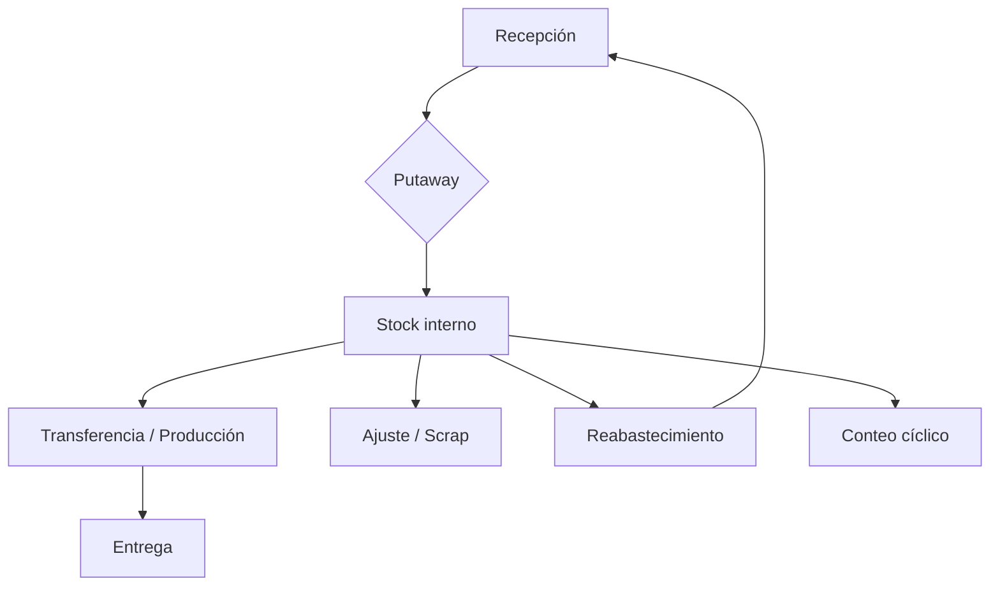

# Módulo 2 — Inventory (Inventario)

> **Edición:** Community
> **Módulos técnicos:** `stock`, `stock_account`, `product_expiry`, `stock_landed_costs`, `stock_dropshipping`, `stock_delivery`, `stock_maintenance`
> **Dependencias base:** `product`, `barcodes_gs1_nomenclature`, `digest`
> **Versión analizada:** Odoo 20.0 (commit `2b504bcb3b4`)

---

## 1. Ficha del módulo

**Propósito:** controlar la ubicación, disponibilidad, movimiento, trazabilidad y valoración de materiales y productos en todo el proceso:

```text
Recepción → Almacenamiento → Transferencia → Consumo/Producción → Entrega
```

**Modelos principales:**

| Modelo | Función |
|--------|---------|
| `stock.warehouse` | Almacén y pasos logísticos |
| `stock.location` | Ubicaciones jerárquicas |
| `stock.picking` / `stock.picking.type` | Transferencias y tipos de operación |
| `stock.move` / `stock.move.line` | Movimiento y detalle de movimiento |
| `stock.quant` | Existencia por producto/ubicación/lote |
| `stock.lot` | Lote o número de serie |
| `stock.route` / `stock.rule` | Rutas y reglas de aprovisionamiento |
| `stock.warehouse.orderpoint` | Punto de pedido / reabastecimiento |
| `stock.putaway.rule` | Regla de ubicación al recibir |
| `stock.storage.category` | Capacidad y restricciones de almacenamiento |
| `stock.package` / `stock.package.type` | Paquetes y tipos de paquete |
| `stock.picking.batch` | Transferencias agrupadas |
| `stock.reference` | Referencia cruzada entre documentos |
| `stock.scrap.reason.tag` | Motivos de desecho |

**Menús principales:**

- `Inventario > Operaciones > Transferencias` → Recepciones, Entregas, Internas
- `Inventario > Operaciones > Ajustes` → Inventario físico, Scrap
- `Inventario > Operaciones > Reabastecimiento`
- `Inventario > Operaciones > Trabajos` (batch)
- `Inventario > Productos` → Productos, Lotes/series, Paquetes
- `Inventario > Reportes`
- `Inventario > Configuración`

---

## 2. Mapa de funciones

### A. Configuración del almacén

| # | Función | Resultado |
|---|---------|-----------|
| F01 | Almacén | Define pasos de entrada/salida y rutas por defecto |
| F02 | Ubicaciones | Jerarquía física y virtual del stock |
| F03 | Tipos de operación | Recepciones, entregas, internas y fabricación |
| F04 | Rutas | Caminos de aprovisionamiento por producto/almacén |
| F05 | Reglas de stock | Pull, push y métodos de suministro |
| F06 | Putaway | Ubicación automática al recibir |
| F07 | Categorías de almacenamiento | Capacidad por producto/paquete |
| F08 | Tipos de paquete | Dimensiones, peso y uso |
| F09 | Estrategias de retiro | FIFO, LIFO, FEFO, más cercano, menos paquetes |
| F10 | Nomenclaturas de código de barras | Interpretación de códigos |

### B. Operaciones

| # | Función | Resultado |
|---|---------|-----------|
| F11 | Recepciones | Entrada de mercancía |
| F12 | Entregas | Salida hacia el cliente |
| F13 | Transferencias internas | Movimiento entre ubicaciones |
| F14 | Transferencias agrupadas | Batch / oleadas / clúster |
| F15 | Reserva y disponibilidad | Compromiso de stock |
| F16 | Backorders | Gestión de entregas parciales |
| F17 | Devoluciones e intercambios | Reverso de movimientos |
| F18 | División de transferencias | Separar una transferencia |
| F19 | Paquetes | Agrupación física de productos |
| F20 | Operaciones detalladas | Lote, paquete y ubicación por línea |
| F21 | Etiquetas e impresión | Producto, lote, paquete y albarán |

### C. Existencias y ajustes

| # | Función | Resultado |
|---|---------|-----------|
| F22 | Quants y stock por ubicación | Existencia actual y reservada |
| F23 | Inventario físico | Conteo y ajuste |
| F24 | Inventario cíclico | Conteo programado por ubicación |
| F25 | Reubicación | Mover existencia sin transferencia formal |
| F26 | Scrap / desecho | Retirar material no conforme |
| F27 | Valoración | Costo y asientos de inventario |
| F28 | Costos landing | Incorporar fletes/seguros al costo |
| F29 | Dropshipping | Entrega directa proveedor → cliente |
| F30 | Consignación | Stock de terceros |

### D. Trazabilidad

| # | Función | Resultado |
|---|---------|-----------|
| F31 | Lotes y números de serie | Identificación única |
| F32 | Fechas de caducidad | Consumo preferente, retirada y alerta |
| F33 | FEFO | Salida por fecha de retirada |
| F34 | Reporte de trazabilidad | Historial hacia adelante/atrás |
| F35 | Referencias de stock | Vínculo entre documentos |

### E. Reabastecimiento

| # | Función | Resultado |
|---|---------|-----------|
| F36 | Orderpoints | Mínimo/máximo y disparo |
| F37 | Informe de reabastecimiento | Sugerencias de compra/fabricación |
| F38 | Previsión de stock | Futuro de entradas/salidas |
| F39 | Reabastecimiento entre almacenes | Transferencia automática |
| F40 | Make to Order | Compra/fabricación bajo pedido |

### F. Reportes

| # | Función | Resultado |
|---|---------|-----------|
| F41 | Movimientos | Análisis de entradas/salidas |
| F42 | Stock por ubicación | Existencias detalladas |
| F43 | Valoración | Valor del inventario |
| F44 | Trazabilidad | Historial de lote/serie |

---

## 3. Detalle función por función

### F01. Almacén

**Qué hace:** define la estructura logística de una compañía y los pasos por defecto.

**Dónde:** `Inventario > Configuración > Almacenes`.

**Campos (`stock.warehouse`):**
- `name`, `code`.
- `reception_steps`:
  - `one_step`: recibir y almacenar.
  - `two_steps`: recibir y luego almacenar.
  - `three_steps`: recibir → control de calidad → almacenar.
- `delivery_steps`:
  - `ship_only`: entregar.
  - `pick_ship`: preparar y entregar.
  - `pick_pack_ship`: preparar, empaquetar y entregar.
- `resupply_wh_ids`: almacenes que lo abastecen.
- `route_ids`: rutas por defecto.

**Resultado:** se crean ubicaciones y tipos de operación coherentes con los pasos elegidos.

**Límites:** cambiar los pasos después de operar puede requerir reconfigurar ubicaciones y rutas.

---

### F02. Ubicaciones

**Qué hace:** modela la jerarquía física y virtual donde se almacena o transita el stock.

**Dónde:** `Inventario > Configuración > Ubicaciones`.

**Tipos (`stock.location.usage`):**
- `supplier`: origen virtual de compras.
- `view`: agrupador jerárquico, no almacena.
- `internal`: ubicación física real.
- `customer`: destino virtual de entregas.
- `inventory`: pérdidas/ajustes.
- `production`: contrapartida de fabricación.
- `transit`: tránsito entre almacenes/compañías.

**Campos relevantes:**
- `location_id`: ubicación padre.
- `barcode`: código para escaneo.
- `removal_strategy_id`: estrategia de retiro.
- `storage_category_id`: capacidad.
- `replenish_location`: habilita sugerencias de reabastecimiento.
- `cyclic_inventory_frequency`: frecuencia de conteo.
- `last_inventory_date` / `next_inventory_date`.

**Resultado:** el stock se ubica y se mueve con precisión.

**Límites:** las ubicaciones virtuales no deben contener stock físico.

---

### F03. Tipos de operación

**Qué hace:** clasifica las transferencias y define su comportamiento.

**Dónde:** `Inventario > Configuración > Tipos de operación`.

**Campos (`stock.picking.type`):**
- `code`: `incoming`, `outgoing`, `internal`; con MRP se agrega `mrp_operation`; con dropshipping, `dropship`.
- `sequence_id`: numeración.
- `default_location_src_id` / `default_location_dest_id`.
- `reservation_method`:
  - `at_confirm`: reservar al confirmar.
  - `by_date`: reservar antes de la fecha programada.
  - `manual`: reserva manual.
- `reservation_days_before` / `reservation_days_before_priority`.
- `use_create_lots` / `use_existing_lots`.
- `barcode`.
- Impresión automática: etiquetas, albarán, informe de recepción.
- `show_entire_packs`, `set_package_type`.

**Resultado:** cada operación usa la política correcta de reserva, etiquetado y ubicaciones.

---

### F04. Rutas

**Qué hace:** define el camino que sigue un producto para abastecerse o entregarse.

**Dónde:** `Inventario > Configuración > Rutas`.

**Campos (`stock.route`):**
- `name`, `sequence`, `active`.
- `rule_ids`: reglas que componen la ruta.
- `product_selectable`, `product_categ_selectable`, `warehouse_selectable`, `package_type_selectable`.
- `supplied_wh_id` / `supplier_wh_id`: reabastecimiento entre almacenes.
- `product_ids` / `categ_ids`.

**Rutas preconfiguradas:**
- **Buy** (con `purchase_stock`).
- **Manufacture** (con `mrp`).
- **Make to Order**.
- **Dropship** (con `stock_dropshipping`).
- **Resupply** entre almacenes.

**Resultado:** al confirmar una necesidad, el sistema ejecuta la ruta y genera las transferencias u órdenes correspondientes.

**Límites:** las rutas se combinan por prioridad; una configuración contradictoria puede generar movimientos inesperados.

---

### F05. Reglas de stock

**Qué hace:** implementa la lógica de una ruta: de dónde a dónde y cómo abastecer.

**Dónde:** `Inventario > Configuración > Reglas de stock` (requiere rutas multietapa).

**Campos (`stock.rule`):**
- `action`: `pull`, `push`, `pull_push`.
- `procure_method`:
  - `make_to_stock`: tomar de stock.
  - `make_to_order`: disparar otra regla.
  - `mts_else_mto`: tomar de stock y, si no hay, disparar otra regla.
- `location_src_id` / `location_dest_id`.
- `picking_type_id`.
- `delay`: plazo.
- `route_id`.
- `propagate_cancel`: cancelar movimientos siguientes.
- `partner_address_id`: dirección de entrega (dropshipping).
- `auto`: aplicar automáticamente o manualmente.

**Resultado:** se crean movimientos y documentos según la necesidad.

---

### F06. Putaway

**Qué hace:** decide la ubicación de destino al recibir o mover productos.

**Dónde:** `Inventario > Configuración > Reglas de putaway`.

**Campos (`stock.putaway.rule`):**
- `product_id` o `category_id`.
- `location_in_id`: ubicación de llegada.
- `location_out_id`: sububicación de destino.
- `package_type_ids`.
- `storage_category_id`.
- `sublocation`: comportamiento ante sububicaciones.
- `sequence`.

**Resultado:** el stock se almacena en el lugar correcto sin intervención manual.

**Límites:** no optimiza espacio ni “slotting” dinámico; aplica reglas estáticas.

---

### F07. Categorías de almacenamiento

**Qué hace:** define capacidad y restricciones de una ubicación.

**Dónde:** `Inventario > Configuración > Categorías de almacenamiento`.

**Campos (`stock.storage.category`):**
- `max_weight`.
- `capacity_ids`: capacidad por producto o tipo de paquete.
- `allow_new_product`: permitir mezclar productos.
- `location_ids`.

**Resultado:** el sistema advierte o bloquea si se excede la capacidad.

**Límites:** requiere ubicaciones y productos bien medidos (peso/volumen).

---

### F08. Tipos de paquete

**Qué hace:** modela contenedores físicos (caja, palé, contenedor).

**Dónde:** `Inventario > Configuración > Tipos de paquete`.

**Campos (`stock.package.type`):**
- `name`, `sequence`.
- `height`, `width`, `packaging_length`, `base_weight`, `max_weight`.
- `barcode`.
- `package_use`: recepción, entrega, interna, etc.
- `route_ids`.
- `storage_category_capacity_ids`.

**Resultado:** los paquetes se identifican, pesan y pueden tener rutas propias.

---

### F09. Estrategias de retiro

**Qué hace:** decide qué lote/ubicación se toma primero al reservar.

**Dónde:** `Inventario > Configuración > Estrategias de retiro`; se asigna en ubicación o categoría.

**Métodos (`product.removal`):**
- **FIFO**: primero en entrar, primero en salir.
- **LIFO**: último en entrar, primero en salir.
- **FEFO**: primero en caducar, primero en salir (requiere `product_expiry`).
- **Closest Location**: ubicación más cercana al destino.
- **Least Packages**: paquete con menor cantidad.

**Resultado:** la reserva respeta la política logística.

---

### F10. Nomenclaturas de código de barras

**Qué hace:** interpreta códigos escaneados.

**Dónde:** `Inventario > Configuración > Productos > Nomenclaturas de códigos de barras`.

**Objetos:**
- `barcode.nomenclature`.
- `barcode.rule`.
- Nomenclatura por compañía (`res.company.nomenclature_id`).

**Resultado:** el sistema identifica producto, ubicación, lote, paquete o peso.

**Nota:** el detalle está en [`07-codigos-barras-barcode.md`](07-codigos-barras-barcode.md).

---

### F11. Recepciones

**Qué hace:** registra la entrada de mercancía al almacén.

**Dónde:** `Inventario > Operaciones > Recepciones`.

**Funciones:**
- Crear recepción manual o desde compra.
- Confirmar, reservar y validar.
- Recepción en 1, 2 o 3 pasos.
- Registrar lote/serie y paquete.
- Aplicar putaway.
- Imprimir etiquetas y albarán.
- Generar backorder si es parcial.

**Resultado:** stock disponible en la ubicación de destino.

**Límites:** la calidad del putaway depende de las reglas configuradas.

---

### F12. Entregas

**Qué hace:** registra la salida de productos hacia el cliente.

**Dónde:** `Inventario > Operaciones > Entregas`.

**Funciones:**
- Reserva de stock según política.
- Preparación, empaquetado y entrega (1/2/3 pasos).
- Control de disponibilidad.
- Impresión de albarán y etiquetas.
- Devoluciones e intercambios.

**Resultado:** salida documentada y stock actualizado.

---

### F13. Transferencias internas

**Qué hace:** mueve stock entre ubicaciones internas.

**Dónde:** `Inventario > Operaciones > Transferencias > Internas`.

**Funciones:**
- Origen y destino.
- Reserva y validación.
- Lote/serie y paquete.
- Movimiento por operaciones detalladas.

**Resultado:** stock reubicado sin afectar compras/ventas.

---

### F14. Transferencias agrupadas (batch / oleadas / clúster)

**Qué hace:** agrupa varias transferencias para ejecutarlas juntas.

**Dónde:** `Inventario > Operaciones > Trabajos`.

**Objetos (`stock.picking.batch`):**
- `picking_ids`, `move_ids`, `move_line_ids`.
- `user_id`, `priority`, `picking_type_id`.
- Estado: `draft`, `in_progress`, `done`, `cancel`.

**Funciones:**
- Agregar/quitar transferencias.
- Reservar y validar en conjunto.
- Asignar responsable.
- Imprimir documentación consolidada.

**Resultado:** menor tiempo de preparación y mejor control de la operación.

**Límites:** no es un sistema de gestión de mano de obra ni de slotting.

---

### F15. Reserva y disponibilidad

**Qué hace:** compromete stock para una transferencia.

**Funciones:**
- **Reservar** (`action_assign`) según método del tipo de operación.
- **Liberar reserva** (`do_unreserve`).
- Estados: esperando, listo, esperando otra operación.
- Indicador de disponibilidad: disponible, esperado, retrasado.
- Informe de asignación (`action_view_allocation_report`).

**Resultado:** el stock queda comprometido y visible.

**Límites:** la reserva no garantiza disponibilidad futura si no se planifica.

---

### F16. Backorders

**Qué hace:** gestiona transferencias parciales.

**Funciones:**
- Al validar con cantidades menores, Odoo pregunta si crear backorder.
- El backorder conserva la demanda pendiente.
- Se puede ver la cadena de backorders.

**Resultado:** la parte no atendida queda pendiente y trazable.

---

### F17. Devoluciones e intercambios

**Qué hace:** revierte una entrega o recepción.

**Dónde:** botón **Devolver** en la transferencia validada.

**Funciones:**
- `action_return`: crea transferencia inversa.
- `action_return_all`: devuelve todas las cantidades.
- `action_exchange`: devolución + nueva entrega.
- Vinculación con la transferencia original (`return_id`).

**Resultado:** stock y documentación regularizados.

---

### F18. División de transferencias

**Qué hace:** separa una transferencia en varias.

**Dónde:** acción **Dividir** (`action_split_transfer`).

**Funciones:**
- Divide líneas/cantidades.
- Permite atender parcialmente o priorizar.
- Conserva la trazabilidad.

**Resultado:** varias transferencias con la misma demanda original.

---

### F19. Paquetes

**Qué hace:** agrupa productos en un contenedor físico.

**Dónde:** `Inventario > Productos > Paquetes`; botón **Poner en paquete**.

**Objetos:**
- `stock.package`: referencia, tipo, ubicación, peso, SSCC, jerarquía.
- `stock.package.type`.
- `stock.package.history`.

**Funciones:**
- Crear paquete y asignar contenido.
- Mover paquete completo.
- Anidar paquetes.
- Imprimir etiqueta.
- Historial de movimientos.

**Resultado:** manipulación y trazabilidad por bulto.

---

### F20. Operaciones detalladas

**Qué hace:** registra el detalle fino de un movimiento.

**Dónde:** botón **Operaciones detalladas** en la transferencia.

**Objetos (`stock.move.line`):**
- Producto, cantidad, UoM.
- Ubicación origen/destino.
- Lote/serie.
- Paquete.
- Propietario (consignación).

**Resultado:** trazabilidad exacta por línea.

**Límites:** demasiadas líneas pueden afectar el rendimiento; usar paquetes cuando aplique.

---

### F21. Etiquetas e impresión

**Qué hace:** genera documentos y etiquetas.

**Funciones:**
- Etiqueta de producto.
- Etiqueta de lote/serie.
- Etiqueta de paquete.
- Albarán de entrega.
- Informe de recepción.
- Impresión automática por tipo de operación.

**Resultado:** documentación física coherente con el sistema.

---

### F22. Quants y stock por ubicación

**Qué hace:** muestra la existencia real por producto, ubicación y lote.

**Dónde:** `Inventario > Reportes > Stock por ubicación`.

**Objetos (`stock.quant`):**
- `quantity`: cantidad física.
- `reserved_quantity`: cantidad reservada.
- `available_quantity`: disponible.
- `lot_id`, `package_id`, `owner_id`.
- `inventory_quantity`, `inventory_diff_quantity`, `inventory_date`.

**Resultado:** visibilidad del stock y de sus compromisos.

---

### F23. Inventario físico

**Qué hace:** permite contar y ajustar existencias.

**Dónde:** `Inventario > Operaciones > Ajustes > Inventario físico`.

**Funciones:**
- Modo inventario: ingresar cantidad contada.
- **Establecer cantidad actual**.
- **Establecer a cero**.
- **Aplicar inventario** (`action_apply_inventory`).
- Historial de ajustes (`action_inventory_history`).
- Ajuste por ubicación/producto/lote.

**Resultado:** stock corregido con movimiento de ajuste y trazabilidad.

**Límites:** el ajuste genera movimiento; no edita el quant directamente.

---

### F24. Inventario cíclico

**Qué hace:** programa conteos periódicos por ubicación.

**Dónde:** ficha de ubicación, campo **Frecuencia de inventario**.

**Campos:**
- `stock.location.cyclic_inventory_frequency`.
- `next_inventory_date`.
- `last_inventory_date`.
- `stock.quant.inventory_date`.
- `res.company.annual_inventory_month` / `annual_inventory_day`.

**Funciones:**
- Asigna fecha de próximo conteo a los quants de la ubicación.
- Si no hay frecuencia, usa el inventario anual de la compañía.
- Permite filtrar quants por fecha programada.

**Resultado:** conteos distribuidos en el tiempo.

**Límites:** no es un motor ABC; la frecuencia es por ubicación.

---

### F25. Reubicación

**Qué hace:** mueve existencia de una ubicación a otra sin crear una transferencia formal.

**Dónde:** acción **Reubicar** sobre un quant (`action_stock_quant_relocate`).

**Resultado:** movimiento interno simplificado.

**Límites:** para operaciones complejas se recomienda transferencia interna.

---

### F26. Scrap / desecho

**Qué hace:** retira material dañado, obsoleto o no conforme.

**Dónde:** `Inventario > Operaciones > Ajustes > Scrap`; botón **Desechar** en transferencias y órdenes de fabricación.

**Modelo en Odoo 20:** el desecho se representa como un `stock.move` con:
- `is_scrap = True`.
- `scrap_reason_tag_ids`: motivo.
- `should_replenish_scrapped`: reponer automáticamente.
- Ubicación de destino: ubicación de pérdidas de la compañía.

**Funciones:**
- Desechar desde stock, transferencia u orden de fabricación.
- Asistente si no hay cantidad suficiente (`stock.warn.insufficient.qty.scrap`).
- Reporte de scrap.

**Resultado:** stock reducido y motivo registrado.

**Nota:** en Odoo 20 ya no existe el modelo clásico `stock.scrap`; el desecho es un movimiento marcado.

---

### F27. Valoración

**Qué hace:** calcula el valor del inventario y genera asientos.

**Dónde:** `Inventario > Reportes > Valoración`; configuración en categoría de producto.

**Métodos (`cost_method`):**
- **Costo estándar**.
- **AVCO** (promedio ponderado).
- **FIFO**.

**Funciones:**
- Valoración por producto y por lote (`lot_valuated`).
- Ajustes de valoración (`product.value`).
- Asientos contables de inventario.
- Costo anglosajón (`anglo_saxon_accounting`).
- Reporte de valoración.

**Resultado:** inventario valorado y contabilizado.

**Límites:** cambiar el método de costo afecta la contabilidad; definir antes de operar.

---

### F28. Costos landing

**Qué hace:** incorpora fletes, seguros y aranceles al costo de los productos recibidos.

**Dónde:** `Inventario > Operaciones > Ajustes > Costos landing`.

**Objetos:**
- `stock.landed.cost`: proveedor, fecha, transferencias, líneas, estado.
- `stock.landed.cost.lines`: producto de costo, importe, método de reparto.
- `stock.valuation.adjustment.lines`: ajuste por producto.

**Métodos de reparto:**
- Igual (`equal`).
- Por cantidad (`by_quantity`).
- Por costo actual (`by_current_cost_price`).
- Por peso (`by_weight`).
- Por volumen (`by_volume`).

**Funciones:**
- Crear costo, seleccionar recepciones y calcular.
- Validar y generar asiento.
- Aplicar solo a productos AVCO/FIFO.

**Resultado:** costo real de importación reflejado en el inventario.

**Límites:** no aplica a costo estándar; el reparto debe revisarse.

---

### F29. Dropshipping

**Qué hace:** entrega directa del proveedor al cliente sin pasar por el almacén.

**Dónde:** ruta **Dropship**; tipo de operación `dropship`.

**Funciones:**
- Ruta y regla preconfiguradas.
- Origen: proveedor; destino: cliente.
- Se activa en producto/categoría.
- Genera una transferencia de dropshipping.

**Resultado:** venta atendida sin inventario propio.

**Límites:** requiere control de proveedor y plazos; no hay recepción física.

---

### F30. Consignación

**Qué hace:** controla stock de propiedad de terceros.

**Dónde:** ajuste **Consignación** (`group_stock_tracking_owner`).

**Funciones:**
- Asignar propietario (`owner_id`) a quants y movimientos.
- Filtrar stock por propietario.
- Reportar existencias en consignación.

**Resultado:** separación entre stock propio y de terceros.

---

### F31. Lotes y números de serie

**Qué hace:** identifica unidades o grupos de producto.

**Dónde:** `Inventario > Productos > Lotes/series`; configuración en producto (`tracking`).

**Tipos:**
- `lot`: lote (agrupa varias unidades).
- `serial`: número de serie único.

**Campos (`stock.lot`):**
- `name`, `ref`, `product_id`, `company_id`.
- `quant_ids`, `product_qty`.
- `note`, `lot_properties`.
- `delivery_ids`, `partner_ids`.
- `location_id`, `is_scrap`.

**Funciones:**
- Asignar lote/serie en recepción, transferencia y fabricación.
- Generar series automáticamente.
- Consultar existencias por lote.
- Imprimir etiquetas.
- Ver entregas asociadas.

**Resultado:** trazabilidad unitaria o por lote.

**Límites:** si el producto no está configurado con tracking, no se solicita lote.

---

### F32. Fechas de caducidad

**Qué hace:** gestiona la vida útil del producto.

**Dónde:** módulo `product_expiry`; pestaña de lote.

**Campos:**
- `expiration_date`: caducidad.
- `use_date`: consumo preferente.
- `removal_date`: retirada.
- `alert_date`: alerta.
- `product_expiry_alert`: aviso de caducidad.

**Funciones:**
- Calcular fechas desde la recepción/fabricación.
- Alertar antes del vencimiento.
- Bloquear o priorizar salida.

**Resultado:** control de productos perecederos.

---

### F33. FEFO

**Qué hace:** prioriza la salida del lote con fecha de retirada más próxima.

**Dónde:** estrategia de retiro de la ubicación/categoría.

**Requisitos:**
- `product_expiry` instalado.
- Producto con tracking.
- Estrategia **FEFO** asignada.

**Resultado:** rotación correcta y reducción de mermas.

**Límites:** sin fechas cargadas, FEFO no puede priorizar.

---

### F34. Reporte de trazabilidad

**Qué hace:** reconstruye el historial de un lote/serie.

**Dónde:** `Inventario > Reportes > Trazabilidad`; botón en lote/movimiento.

**Funciones:**
- Trazabilidad hacia adelante (a quién se entregó).
- Trazabilidad hacia atrás (de dónde vino).
- Movimientos, transferencias y documentos vinculados.

**Resultado:** auditoría completa del producto.

---

### F35. Referencias de stock

**Qué hace:** enlaza documentos relacionados con un movimiento.

**Objetos (`stock.reference`):**
- `name`.
- `move_ids`.
- `picking_ids` (calculado).

**Uso:** agrupar movimientos de distintos documentos bajo una referencia común.

**Resultado:** trazabilidad documental entre procesos.

---

### F36. Orderpoints

**Qué hace:** define cuándo y cuánto reabastecer.

**Dónde:** `Inventario > Operaciones > Reabastecimiento`; también en producto.

**Campos (`stock.warehouse.orderpoint`):**
- `product_id`, `location_id`, `warehouse_id`.
- `product_min_qty`, `product_max_qty`.
- `trigger`: `auto` o `manual`.
- `daily_demand` y `min_max_based_on` (7 días, 30 días, 3 meses, 12 meses, etc.).
- `lead_days`, `lead_horizon_date`.
- `route_id` / `effective_route_id`.
- `qty_on_hand`, `qty_forecast`, `qty_to_order`.
- `snoozed_until`.

**Funciones:**
- Calcular cantidad a pedir.
- Generar RFQ o fabricación según ruta.
- Snooze (solo manual).
- Archivar/activar.

**Resultado:** reposición automática o sugerida.

**Límites:** depende de demanda histórica y plazos correctos.

---

### F37. Informe de reabastecimiento

**Qué hace:** muestra sugerencias y permite ejecutarlas.

**Dónde:** `Inventario > Operaciones > Reabastecimiento`.

**Funciones:**
- Ver orderpoints y cantidades a pedir.
- Ordenar por ruta/proveedor.
- Generar órdenes de compra o fabricación.
- Ajustar manualmente la cantidad.
- Snooze de orderpoints manuales.

**Resultado:** reposición controlada por el planificador.

---

### F38. Previsión de stock

**Qué hace:** proyecta existencias futuras.

**Dónde:** botón **Previsión** en producto/transferencia.

**Funciones:**
- Entradas y salidas previstas.
- Stock proyectado por fecha.
- Disponibilidad para comprometer.
- Alertas de faltantes.

**Resultado:** decisión de compra/venta con visibilidad.

---

### F39. Reabastecimiento entre almacenes

**Qué hace:** abastece un almacén desde otro.

**Dónde:** ficha de almacén, campo **Reabastecer desde**.

**Funciones:**
- Crear rutas de reabastecimiento.
- Generar transferencias internas.
- Considerar plazos y prioridades.

**Resultado:** red logística multi-almacén coordinada.

---

### F40. Make to Order

**Qué hace:** dispara compra o fabricación por una necesidad concreta.

**Dónde:** ruta **Make to Order** en producto/categoría.

**Funciones:**
- No toma stock disponible; genera una cadena de suministro.
- Se usa en ventas, fabricación o transferencias.
- Puede combinarse con Buy/Manufacture.

**Resultado:** el producto se aprovisiona específicamente para el pedido.

**Límites:** no es adecuado para productos de stock; aumenta plazos.

---

### F41. Movimientos

**Dónde:** `Inventario > Reportes > Movimientos`.

**Objetos:** `stock.move`, `stock.move.line`.

**Funciones:**
- Filtrar por producto, ubicación, fecha, estado, lote.
- Analizar entradas/salidas por documento.
- Ver movimientos detallados.
- Exportar a Excel/PDF.

**Resultado:** auditoría y análisis de flujo.

---

### F42. Stock por ubicación

**Dónde:** `Inventario > Reportes > Stock por ubicación`.

**Funciones:**
- Existencia por producto/ubicación/lote.
- Cantidad reservada y disponible.
- Filtros por propietario y paquete.
- Exportación.

**Resultado:** fotografía del inventario.

---

### F43. Valoración

**Dónde:** `Inventario > Reportes > Valoración`.

**Funciones:**
- Valor por producto/categoría.
- Detalle por lote (si aplica).
- Ajustes de valoración.
- Exportación contable.

**Resultado:** control financiero del inventario.

---

### F44. Trazabilidad

**Dónde:** `Inventario > Reportes > Trazabilidad`.

**Funciones:**
- Historial de lote/serie.
- Movimientos y documentos.
- Trazabilidad hacia adelante/atrás.

**Resultado:** evidencia para auditoría y retiros.

---

## 4. Flujo operativo



---

## 5. Configuración inicial recomendada

1. Crear almacén y definir pasos de recepción/entrega.
2. Crear ubicaciones internas, de entrada, calidad, salida y empaque.
3. Configurar tipos de operación y numeraciones.
4. Definir rutas y reglas.
5. Configurar putaway y categorías de almacenamiento.
6. Definir estrategias de retiro.
7. Activar lotes/series y caducidad si aplica.
8. Configurar orderpoints y plazos.
9. Definir valoración (estándar/AVCO/FIFO).
10. Configurar nomenclaturas de código de barras.
11. Definir política de reserva y backorders.
12. Activar paquetes, consignación y dropshipping según necesidad.

---

## 6. Reportes

| Reporte | Ubicación | Uso |
|---------|-----------|-----|
| Movimientos | `Inventario > Reportes > Movimientos` | Auditoría de flujo |
| Stock por ubicación | `Inventario > Reportes > Stock por ubicación` | Existencias |
| Valoración | `Inventario > Reportes > Valoración` | Valor contable |
| Trazabilidad | `Inventario > Reportes > Trazabilidad` | Lote/serie |
| Scrap | `Inventario > Operaciones > Ajustes > Scrap` | Mermas |
| Previsión | Producto / transferencia | Futuro de stock |

---

## 7. Límites y buenas prácticas

**Límites:**
- No es un WMS avanzado (slotting, labor management, olas complejas).
- El inventario cíclico es por frecuencia de ubicación, no ABC.
- La trazabilidad depende del tracking configurado.
- La valoración afecta contabilidad; no se cambia sin plan.
- El putaway es estático.

**Buenas prácticas:**
- Definir primero la estructura física y luego las rutas.
- No mezclar productos sin control en ubicaciones.
- Medir peso/volumen para usar capacidades.
- Usar lotes/series en productos críticos.
- Revisar orderpoints mensualmente.
- Auditar movimientos y ajustes.
- Documentar la política de valoración.
- Probar el flujo completo en un entorno de staging.
