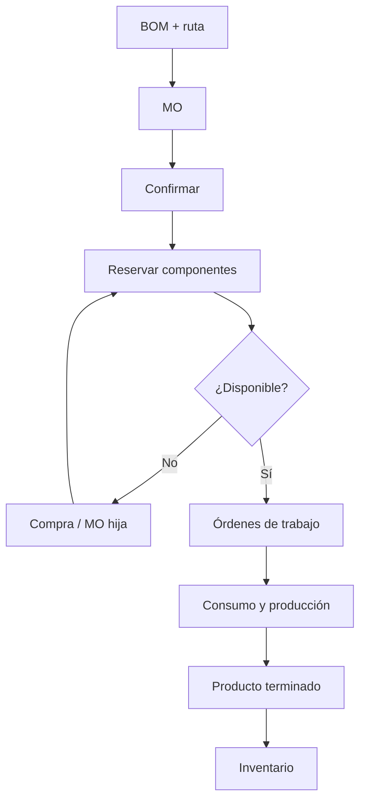

# Módulo 3 — Manufacturing (MRP / Fabricación)

> **Edición:** Community (con complementos Enterprise)
> **Módulos técnicos:** `mrp`, `mrp_account`, `mrp_subcontracting`, `purchase_mrp`, `mrp_repair`, `mrp_product_expiry`, `mrp_landed_costs`, `mrp_delivery`
> **Dependencias base:** `product`, `stock`, `resource`
> **Versión analizada:** Odoo 20.0 (commit `2b504bcb3b4`)

---

## 1. Ficha del módulo

**Propósito:** planificar y ejecutar la transformación de materias primas en productos terminados:

```text
BOM + ruta → Orden de fabricación → Reserva → Operaciones → Consumo → Producto terminado
```

**Modelos principales:**

| Modelo | Función |
|--------|---------|
| `mrp.bom` | Lista de materiales |
| `mrp.bom.line` | Componentes |
| `mrp.bom.byproduct` | Subproductos |
| `mrp.production` | Orden de fabricación (MO) |
| `mrp.production.group` | Agrupación de MO multinivel |
| `mrp.workorder` | Orden de trabajo por operación |
| `mrp.routing.workcenter` | Operación de la ruta |
| `mrp.workcenter` | Centro de trabajo / máquina |
| `mrp.workcenter.capacity` | Capacidad por producto/unidad |
| `mrp.workcenter.productivity` | Registro de tiempos y pérdidas |
| `mrp.unbuild` | Orden de desensamblado |

**Menús principales:**

- `Fabricación > Operaciones > Órdenes de fabricación`
- `Fabricación > Operaciones > Órdenes de trabajo` (requiere activar órdenes de trabajo)
- `Fabricación > Operaciones > Órdenes de desensamblado`
- `Fabricación > Planificación`
- `Fabricación > Productos > Listas de materiales`
- `Fabricación > Reportes`
- `Fabricación > Configuración`

---

## 2. Mapa de funciones

### A. Listas de materiales

| # | Función | Resultado |
|---|---------|-----------|
| F01 | BOM normal | Define componentes para fabricar |
| F02 | BOM tipo kit (phantom) | Explota componentes sin MO propia |
| F03 | BOM multinivel | Subensambles con BOM hija |
| F04 | Componentes y variantes | Cantidades por producto/variante |
| F05 | Subproductos | Coproductos del proceso |
| F06 | Operaciones y rutas | Secuencia de trabajo |
| F07 | Dependencias de operaciones | Orden obligatorio entre operaciones |
| F08 | Lote y producción continua | Tamaño de lote y desbloqueo automático |
| F09 | Plazos y preparación | Lead time y días de preparación |

### B. Órdenes de fabricación

| # | Función | Resultado |
|---|---------|-----------|
| F10 | Creación de MO | Orden manual o automática |
| F11 | Confirmación | Explosión de componentes y reserva |
| F12 | Reserva y disponibilidad | Estado de componentes |
| F13 | Capacidad de producción | Cuánto se puede fabricar con stock |
| F14 | Registro de producción | Cantidad producida y lotes |
| F15 | Consumo y advertencias | Consumo real vs. teórico |
| F16 | Backorders | Producción parcial |
| F17 | División y fusión | Separar/unir órdenes |
| F18 | Bloqueo de cantidades | Protección contra cambios |
| F19 | Scrap | Desecho de componentes/terminado |
| F20 | Cierre | Finalización de la orden |
| F21 | Desensamblado | Recuperar componentes |

### C. Operaciones y centros de trabajo

| # | Función | Resultado |
|---|---------|-----------|
| F22 | Órdenes de trabajo | Ejecución por operación |
| F23 | Centros de trabajo | Máquinas y recursos |
| F24 | Capacidad por producto | Piezas por ciclo |
| F25 | Tiempos y productividad | Duración real vs. esperada |
| F26 | Pérdidas y OEE | Eficiencia del centro |
| F27 | Dependencias y bloqueos | Flujo entre operaciones |
| F28 | Centros alternativos | Sustitución de máquina |

### D. Planificación

| # | Función | Resultado |
|---|---------|-----------|
| F29 | Fechas y calendario | Programación de la MO |
| F30 | Planificación de capacidad | Carga por centro |
| F31 | Necesidades de componentes | Faltantes y compras |
| F32 | Reabastecimiento | Orderpoints y rutas |

### E. Costeo

| # | Función | Resultado |
|---|---------|-----------|
| F33 | Costo de la MO | Materiales + operaciones |
| F34 | Costo de operaciones | Horas y tarifa |
| F35 | Analítica | Distribución por cuenta analítica |
| F36 | WIP | Producción en proceso contabilizada |

### F. Extensiones

| # | Función | Resultado |
|---|---------|-----------|
| F37 | Subcontratación | Producción externa |
| F38 | Reparación | Reparaciones vinculadas |
| F39 | Compras para fabricación | Componentes y kits |
| F40 | Reportes | Análisis de producción |
| F41 | Configuración | Ajustes del módulo |

---

## 3. Detalle función por función

### F01. BOM normal

**Qué hace:** define los componentes y cantidades necesarios para fabricar un producto.

**Dónde:** `Fabricación > Productos > Listas de materiales`.

**Campos (`mrp.bom`):**
- `code`: referencia.
- `type = normal`: fabricar el producto.
- `product_tmpl_id` / `product_id`: producto o variante.
- `product_qty` / `uom_id`: cantidad base.
- `bom_line_ids`: componentes.
- `operation_ids`: operaciones.
- `picking_type_id`: tipo de operación de fabricación.
- `produce_delay`: plazo de fabricación.
- `days_to_prepare_mo`: días de preparación.
- `ready_to_produce`: todos los componentes o solo los de la primera operación.
- `batch_size` / `enable_batch_size`.
- `continuous`.
- `note`.

**Resultado:** la MO explota la BOM y genera movimientos de componentes.

**Límites:** una BOM por producto/variante y compañía; la selección depende de secuencia y variantes.

---

### F02. BOM tipo kit (phantom)

**Qué hace:** trata un producto como conjunto de componentes que se mueven juntos, sin orden de fabricación propia.

**Dónde:** BOM con `type = phantom`.

**Funciones:**
- Al vender/comprar el kit, se explotan sus componentes.
- No se genera MO para el kit.
- Puede usarse en compras (`purchase_mrp`).

**Resultado:** logística simplificada de conjuntos.

**Límites:** no hay trazabilidad de fabricación del kit como unidad.

---

### F03. BOM multinivel

**Qué hace:** permite que un componente tenga su propia BOM (subensamble).

**Funciones:**
- `child_bom_id` en la línea.
- Explosión recursiva de componentes.
- Generación de MO hijas (`mrp.production.group`).
- Vista de estructura de BOM.

**Resultado:** fabricación jerárquica de productos complejos.

**Límites:** los niveles deben estar bien definidos para evitar ciclos; Odoo valida ciclos.

---

### F04. Componentes y variantes

**Qué hace:** define qué y cuánto se consume.

**Campos (`mrp.bom.line`):**
- `product_id`, `product_qty`, `uom_id`.
- `operation_id`: operación donde se consume.
- `bom_product_template_attribute_value_ids`: variantes.
- `child_bom_id`.
- `sequence`.

**Funciones:**
- Componentes opcionales con cantidad 0.
- Consumo por operación.
- BOM específica por variante.

**Resultado:** consumo preciso por producto/variante.

---

### F05. Subproductos

**Qué hace:** registra productos adicionales que se generan en el proceso.

**Dónde:** pestaña **Subproductos** de la BOM (requiere activar el ajuste).

**Campos (`mrp.bom.byproduct`):**
- `product_id`, `product_qty`, `uom_id`.
- `operation_id`: operación donde se genera.
- `cost_share`: porcentaje del costo asignado.

**Funciones:**
- Generar movimientos de subproducto al producir.
- Repartir costo entre producto principal y subproductos.

**Resultado:** costeo y stock de coproductos.

**Límites:** la suma de `cost_share` no debe superar 100 %.

---

### F06. Operaciones y rutas

**Qué hace:** define la secuencia de trabajo para fabricar el producto.

**Dónde:** pestaña **Operaciones** de la BOM; `Fabricación > Configuración > Operaciones`.

**Campos (`mrp.routing.workcenter`):**
- `name`, `workcenter_id`, `sequence`.
- `time_mode`: `manual` (fijo) o `auto` (calculado con histórico).
- `time_cycle_manual`: duración manual en minutos.
- `time_cycle`, `cycle_number`, `time_total`.
- `time_mode_batch`: base de cálculo.
- `cost_mode`: tiempo real o estimado.
- `blocked_by_operation_ids` / `needed_by_operation_ids`.

**Resultado:** se generan órdenes de trabajo al confirmar la MO.

**Límites:** requiere activar el grupo de órdenes de trabajo (`group_mrp_routings`).

---

### F07. Dependencias de operaciones

**Qué hace:** obliga a que una operación espere a otra.

**Dónde:** BOM, campo **Dependencias personalizadas**; operación, campo **Bloqueado por**.

**Funciones:**
- Definir predecesoras y sucesoras.
- Validar ciclos.
- Bloquear/desbloquear órdenes de trabajo.

**Resultado:** secuencia de planta respetada.

**Límites:** solo aplica cuando las órdenes de trabajo están activas.

---

### F08. Lote y producción continua

**Qué hace:** ajusta el tamaño de las órdenes y el flujo entre operaciones.

**Campos:**
- `batch_size`: cantidad por lote automático.
- `enable_batch_size`: activa el lote.
- `continuous`: al registrar producción en una operación, desbloquea la siguiente.

**Resultado:** órdenes dimensionadas y flujo continuo.

---

### F09. Plazos y preparación

**Qué hace:** calcula cuándo iniciar la fabricación.

**Campos:**
- `produce_delay`: días de fabricación.
- `days_to_prepare_mo`: días para preparar componentes.
- `ready_to_produce`:
  - `all_available`: esperar todos los componentes.
  - `asap`: iniciar con los de la primera operación.

**Resultado:** fechas realistas y arranque controlado.

---

### F10. Creación de MO

**Qué hace:** genera una orden de fabricación.

**Dónde:** `Fabricación > Operaciones > Órdenes de fabricación > Nuevo`.

**Orígenes:**
- Manual.
- Orderpoint con ruta **Manufacture**.
- Venta con ruta MTO.
- Necesidad de otro MO (subensamble).
- Subcontratación.

**Campos:**
- Producto, BOM, cantidad, UoM.
- Fecha de inicio, fecha límite, prioridad.
- Origen (`origin`).
- Ubicación de origen/destino.
- Tipo de operación.
- Responsable.

**Resultado:** MO en borrador.

---

### F11. Confirmación

**Qué hace:** valida la MO y genera la demanda de componentes.

**Dónde:** botón **Confirmar**.

**Funciones (`action_confirm`):**
- Explota la BOM.
- Crea movimientos de componentes (`move_raw_ids`).
- Crea movimientos de producto terminado (`move_finished_ids`).
- Crea subproductos.
- Dispara reglas de aprovisionamiento.
- Cambia a estado `confirmed`.

**Resultado:** MO lista para reservar/producir.

---

### F12. Reserva y disponibilidad

**Qué hace:** compromete componentes y muestra si se puede producir.

**Dónde:** botón **Reservar** / **Liberar**.

**Campos y estados:**
- `reservation_state`: esperando, listo, esperando otra operación.
- `components_availability`: disponible, esperado, retrasado, no disponible.
- `components_availability_state`.
- `move_raw_ids` con cantidades reservadas.

**Funciones:**
- `action_assign`: reserva componentes.
- `do_unreserve`: libera.
- Informe de asignación.

**Resultado:** visibilidad de faltantes antes de iniciar.

---

### F13. Capacidad de producción

**Qué hace:** calcula cuánto se puede producir con el stock actual.

**Campo:** `production_capacity`.

**Resultado:** cantidad máxima producible con los componentes disponibles.

**Límites:** no considera capacidad de máquina; es capacidad por materiales.

---

### F14. Registro de producción

**Qué hace:** registra la cantidad realmente producida.

**Dónde:** pestaña **Producción** / botón **Producir**.

**Campos:**
- `qty_producing`: cantidad a producir.
- `qty_produced`: cantidad ya producida.
- `lot_producing_ids`: lote/serie del terminado.

**Funciones:**
- Ajustar cantidad producida.
- Asignar lote/serie.
- Registrar subproductos.
- Generar movimientos de terminado.

**Resultado:** stock de producto terminado actualizado.

---

### F15. Consumo y advertencias

**Qué hace:** compara consumo real con el teórico.

**Funciones:**
- Movimientos de componentes consumidos.
- Asistente de advertencia si el consumo difiere (`mrp.consumption.warning`).
- Ajuste manual de cantidades.
- Configuración de bloqueo de cantidades (`is_locked`).

**Resultado:** control de mermas y desvíos.

**Límites:** el ajuste de cantidades puede requerir permisos según el ajuste **Desbloquear órdenes de fabricación**.

---

### F16. Backorders

**Qué hace:** gestiona producción parcial.

**Funciones:**
- Al cerrar con cantidad menor, se crea una MO pendiente.
- Se conserva la secuencia de backorder.
- Se puede consultar la cadena.

**Resultado:** demanda pendiente trazable.

---

### F17. División y fusión

**Qué hace:** separa o une órdenes de fabricación.

**Dónde:** acciones **Dividir** (`action_split`) y **Fusionar** (`action_merge`).

**Condiciones:**
- Misma producto/BOM para fusionar.
- Misma compañía.
- Estados compatibles.

**Resultado:** órdenes ajustadas a la planificación real.

---

### F18. Bloqueo de cantidades

**Qué hace:** impide modificar cantidades de una MO.

**Campos:**
- `is_locked`.
- `action_toggle_is_locked`.
- Ajuste `group_unlocked_by_default`.

**Resultado:** integridad de la orden durante la ejecución.

---

### F19. Scrap

**Qué hace:** registra desecho de componentes o producto terminado.

**Dónde:** botón **Desechar** en la MO.

**Funciones:**
- Desechar componente no conforme.
- Desechar producto terminado.
- Registrar motivo (con Inventario).
- Reponer si está configurado.

**Resultado:** stock y costo ajustados.

---

### F20. Cierre

**Qué hace:** finaliza la orden y consolida movimientos.

**Dónde:** botón **Marcar como hecho** (`button_mark_done`).

**Funciones:**
- Consolida consumo y producción.
- Genera backorder si aplica.
- Calcula costos.
- Cambia a estado `done`.

**Resultado:** orden cerrada y trazable.

---

### F21. Desensamblado

**Qué hace:** descompone un producto terminado en sus componentes.

**Dónde:** `Fabricación > Operaciones > Órdenes de desensamblado`.

**Objetos (`mrp.unbuild`):**
- Producto, cantidad, BOM.
- MO de origen (opcional).
- Lote/serie.
- Ubicación origen/destino.
- Líneas de consumo y producción.
- Estado: `draft`, `done`.

**Resultado:** componentes recuperados y stock actualizado.

---

### F22. Órdenes de trabajo

**Qué hace:** ejecuta cada operación de la ruta.

**Dónde:** `Fabricación > Operaciones > Órdenes de trabajo`.

**Objetos (`mrp.workorder`):**
- `production_id`, `operation_id`, `workcenter_id`.
- `state`: bloqueada, por hacer, en progreso, hecha, cancelada.
- `date_start`, `date_finished`.
- `duration_expected`, `duration`, `progress`.
- `qty_producing`, `qty_produced`.
- `blocked_by_workorder_ids`.
- `working_user_ids`, `time_ids`.

**Funciones:**
- Iniciar (`button_start`).
- Pausar (`button_pending`).
- Finalizar (`button_finish`).
- Bloquear/desbloquear.
- Reprogramar.
- Registrar tiempos.

**Resultado:** ejecución controlada por operación.

**Límites:** la interfaz táctil **Shop Floor** es Enterprise (`mrp_workorder`).

---

### F23. Centros de trabajo

**Qué hace:** representa máquinas, celdas o recursos productivos.

**Dónde:** `Fabricación > Configuración > Centros de trabajo`.

**Campos (`mrp.workcenter`):**
- `name`, `code`, `sequence`.
- `resource_calendar_id`: calendario.
- `time_efficiency`: eficiencia.
- `costs_hour`: costo por hora.
- `time_start` / `time_stop`: preparación y limpieza.
- `capacity_ids`.
- `alternative_workcenter_ids`.
- `tag_ids`.
- `oee`, `oee_target`, `performance`, `workcenter_load`.
- `barcode`.

**Resultado:** capacidad y costo por recurso.

---

### F24. Capacidad por producto

**Qué hace:** define cuántas piezas se procesan por ciclo.

**Dónde:** centro de trabajo, pestaña **Capacidades**.

**Objetos (`mrp.workcenter.capacity`):**
- `product_id` (o todos).
- `uom_id`.
- `capacity`.
- `time_start` / `time_stop`.

**Resultado:** cálculo de duración más preciso.

**Límites:** si no hay capacidad específica, se usa la capacidad por defecto.

---

### F25. Tiempos y productividad

**Qué hace:** registra tiempos reales y calcula eficiencia.

**Objetos (`mrp.workcenter.productivity`):**
- `workcenter_id`, `workorder_id`, `user_id`.
- `loss_id`, `loss_type`.
- `date_start`, `date_end`, `duration`.

**Funciones:**
- Iniciar/pausar trabajo.
- Registrar pérdidas.
- Comparar duración real vs. esperada.
- Calcular progreso.

**Resultado:** indicadores de productividad.

---

### F26. Pérdidas y OEE

**Qué hace:** mide efectividad del centro de trabajo.

**Categorías de pérdida:**
- `availability`: disponibilidad.
- `performance`: rendimiento.
- `quality`: calidad.
- `productive`: tiempo productivo.

**Campos:**
- `oee`: efectividad global.
- `oee_target`: objetivo.
- `blocked_time`, `productive_time`.
- `performance`.

**Resultado:** OEE y análisis de pérdidas.

**Límites:** depende de que los tiempos se registren con disciplina.

---

### F27. Dependencias y bloqueos

**Qué hace:** controla el orden entre órdenes de trabajo.

**Funciones:**
- `blocked_by_workorder_ids` / `needed_by_workorder_ids`.
- Bloqueo manual con motivo.
- Desbloqueo al completar la predecesora.
- Validación de ciclos.

**Resultado:** flujo de planta sin saltos.

---

### F28. Centros alternativos

**Qué hace:** permite sustituir un centro por otro.

**Campo:** `alternative_workcenter_ids`.

**Funciones:**
- Planificar en centro alternativo.
- Mantener capacidad y calendario propios.

**Resultado:** flexibilidad ante saturación o avería.

---

### F29. Fechas y calendario

**Qué hace:** programa la orden en el tiempo.

**Campos:**
- `date_start`, `date_finished`, `date_deadline`.
- `duration_expected`, `duration`.
- `priority`.
- `delay_alert_date`.

**Funciones:**
- Planificar (`button_plan`).
- Desplanificar (`button_unplan`).
- Vista calendario.
- Alertas de retraso.

**Resultado:** órdenes ubicadas en el calendario.

**Límites:** no hay Gantt avanzado ni optimización automática en Community.

---

### F30. Planificación de capacidad

**Qué hace:** muestra carga por centro de trabajo.

**Dónde:** centros de trabajo (kanban/planning), órdenes de trabajo.

**Funciones:**
- Carga por centro (`workcenter_load`).
- Órdenes listas, en progreso, bloqueadas y retrasadas.
- Planificación manual por fecha.

**Resultado:** detección de saturación.

**Límites:** no es un APS de capacidad finita; el MPS es Enterprise (`mrp_mps`).

---

### F31. Necesidades de componentes

**Qué hace:** calcula faltantes para fabricar.

**Funciones:**
- Disponibilidad por componente.
- Fechas esperadas de llegada.
- Generación de compras (`purchase_mrp`) o MO hijas.
- Informe de previsión.

**Resultado:** componentes asegurados antes de producir.

---

### F32. Reabastecimiento

**Qué hace:** repone componentes según reglas.

**Funciones:**
- Orderpoints con ruta **Buy** o **Manufacture**.
- Reglas MTO/MTS.
- Plazos y cantidades.

**Resultado:** stock disponible para las órdenes.

---

### F33. Costo de la MO

**Qué hace:** calcula el costo del producto fabricado.

**Dónde:** pestaña **Valoración** (con `mrp_account`).

**Componentes del costo:**
- Materiales consumidos.
- Horas de operación.
- Costos adicionales (`extra_cost`).
- Subproductos.

**Resultado:** costo unitario y asiento de valoración.

---

### F34. Costo de operaciones

**Qué hace:** valoriza el tiempo de máquina/mano de obra.

**Campos:**
- `workcenter.costs_hour`.
- `workorder.duration`.
- `cost_mode`: real o estimado.
- `cost`.

**Resultado:** costo de operación imputado a la MO.

---

### F35. Analítica

**Qué hace:** distribuye costos a cuentas analíticas.

**Funciones:**
- Distribución analítica en la MO.
- Líneas analíticas por operación.
- Costos de materiales y mano de obra.

**Resultado:** rentabilidad por producto/proyecto.

---

### F36. WIP

**Qué hace:** contabiliza producción en proceso.

**Dónde:** con `mrp_account`.

**Campos:**
- `wip_move_ids`, `wip_move_count`.
- `action_view_move_wip`.

**Resultado:** asientos de trabajo en proceso.

**Límites:** requiere configuración contable y política de cierre.

---

### F37. Subcontratación

**Qué hace:** delega total o parcialmente la fabricación a un tercero.

**Dónde:** módulo `mrp_subcontracting`.

**Funciones:**
- BOM tipo `subcontract`.
- Subcontratistas (`subcontractor_ids`).
- Ubicación de subcontratación.
- Envío de componentes y recepción del terminado.
- Portal del subcontratista.
- Costos y compras asociadas.

**Resultado:** producción externa controlada.

**Límites:** requiere configuración de ubicaciones, rutas y proveedor.

---

### F38. Reparación

**Qué hace:** gestiona reparaciones de productos.

**Módulos:** `repair` (órdenes de reparación) y `mrp_repair` (vínculo con MO).

**Funciones:**
- Orden de reparación con producto, lote/serie, ubicación.
- Piezas y servicios.
- Movimientos de stock.
- Facturación.
- Vínculo con órdenes de fabricación.

**Resultado:** reparación trazable y facturable.

---

### F39. Compras para fabricación

**Qué hace:** conecta componentes con compras.

**Módulo:** `purchase_mrp`.

**Funciones:**
- Compra de componentes faltantes.
- Compra de kits.
- Vínculo MO ↔ orden de compra.
- Costo de componentes en la MO.

**Resultado:** abastecimiento alineado a producción.

---

### F40. Reportes

**Dónde:** `Fabricación > Reportes`.

**Reportes:**
- **Órdenes de fabricación** (listado/análisis).
- **Órdenes de trabajo** (análisis).
- **OEE** por centro.
- **Pérdidas de productividad**.
- **Estructura de BOM** (`report.mrp.report_bom_structure`).
- **Resumen de MO** (`report.mrp.report_mo_overview`).
- **Trazabilidad** (con Inventario).

**Resultado:** control de eficiencia, costos y cumplimiento.

---

### F41. Configuración

**Dónde:** `Fabricación > Configuración > Ajustes`.

**Opciones:**
- **Órdenes de trabajo** (`group_mrp_routings`).
- **Subproductos** (`group_mrp_byproducts`).
- **Desbloquear órdenes de fabricación** (`group_unlocked_by_default`).
- **Subcontratación** (`module_mrp_subcontracting`).
- **MPS** (Enterprise, `module_mrp_mps`).
- **PLM** (Enterprise, `module_mrp_plm`).
- **Quality** (Enterprise, `module_quality_control`).
- **Barcode para fabricación** (Enterprise, `module_stock_barcode`).

**Resultado:** el módulo se adapta al modelo productivo.

---

## 4. Flujo operativo



---

## 5. Configuración inicial recomendada

1. Definir unidades de medida y precisión.
2. Crear centros de trabajo con calendario y costo.
3. Definir operaciones y dependencias.
4. Crear BOM normales y kits.
5. Activar subproductos si aplica.
6. Configurar plazos de fabricación y preparación.
7. Definir política de reserva y consumo.
8. Configurar rutas Manufacture/Buy/MTO.
9. Configurar orderpoints de componentes.
10. Definir valoración y costeo.
11. Activar subcontratación/reparación si aplica.
12. Probar una orden completa en staging.

---

## 6. Reportes

| Reporte | Ubicación | Uso |
|---------|-----------|-----|
| Órdenes de fabricación | `Fabricación > Reportes` | Cumplimiento y volumen |
| Órdenes de trabajo | `Fabricación > Reportes` | Carga y ejecución |
| OEE | Centro de trabajo | Eficiencia |
| Pérdidas | Centro de trabajo | Causas de paro |
| Estructura BOM | BOM / reporte | Composición y costo |
| Resumen MO | MO | Consumo y producción |
| Trazabilidad | Inventario | Lote/serie |

---

## 7. Límites y buenas prácticas

**Límites:**
- Sin MPS ni capacidad finita en Community.
- Sin Shop Floor táctil (Enterprise).
- Sin integración nativa con Calidad (Enterprise).
- Sin mantenimiento de centros de trabajo (Enterprise).
- La planificación es manual/por fechas.

**Buenas prácticas:**
- Validar BOM y rutas antes de producir.
- Medir tiempos reales para mejorar capacidad.
- Definir políticas de consumo y bloqueo.
- Usar subproductos solo si el costo se reparte correctamente.
- Revisar disponibilidad antes de confirmar.
- Documentar criterios de backorder.
- Mantener centros y calendarios actualizados.
- Probar costeo en un período controlado.
