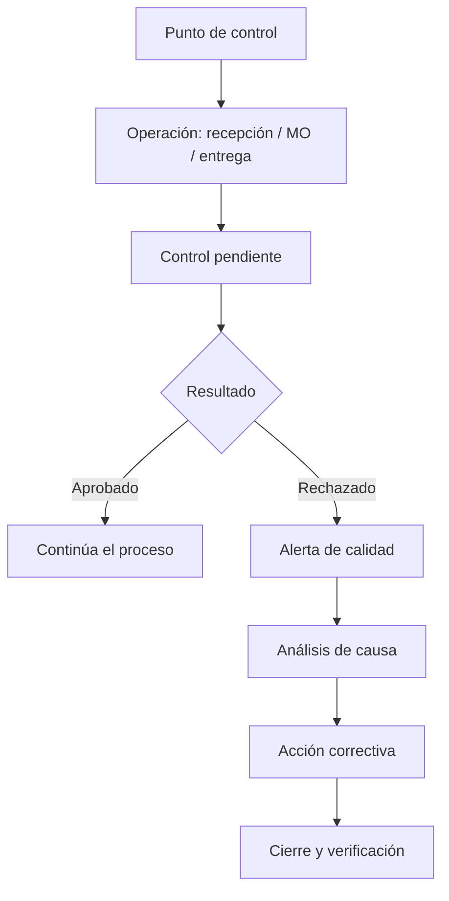

# Módulo 4 — Quality (Calidad)

> **Edición:** Enterprise
> **Módulos técnicos:** `quality` (base), `quality_control`, `quality_mrp` (y variantes para órdenes de trabajo/hojas de trabajo)
> **Dependencias:** `stock`, `mrp` (para la integración de fabricación)
> **Versión de referencia:** Odoo 20 Enterprise

> ⚠️ **Este módulo no está en el repositorio local** (`addons/` solo contiene la edición Community). La descripción se basa en la funcionalidad estándar documentada de Odoo Enterprise. Los nombres exactos de menús y campos pueden variar ligeramente según la versión y los módulos instalados.

---

## 1. Ficha del módulo

**Propósito:** definir puntos de control, ejecutar inspecciones y gestionar no conformidades durante recepciones, fabricación, entregas y mantenimiento.

```text
Punto de control → Inspección → Resultado (aprobado/rechazado/medida) → Alerta → Acción correctiva
```

**Modelos principales:**

| Modelo | Función |
|--------|---------|
| `quality.point` | Punto de control |
| `quality.check` | Inspección o control ejecutado |
| `quality.alert` | Alerta de calidad / no conformidad |
| `quality.alert.stage` | Etapa de la alerta |
| `quality.alert.team` | Equipo de calidad |
| `quality.alert.tag` | Etiqueta de alerta |

**Menús principales (referenciales):**

- `Calidad > Puntos de control`
- `Calidad > Controles de calidad`
- `Calidad > Alertas de calidad`
- `Calidad > Reportes`
- `Calidad > Configuración`

---

## 2. Mapa de funciones

| # | Función | Resultado |
|---|---------|-----------|
| F01 | Puntos de control | Define qué inspeccionar y cuándo |
| F02 | Tipos de control | Instrucciones, aprobado/rechazado, medición |
| F03 | Criterios de aceptación | Tolerancias y límites |
| F04 | Controles en recepciones | Inspección de compras |
| F05 | Controles en entregas/transferencias | Inspección de salidas |
| F06 | Controles en fabricación | Inspección de operaciones |
| F07 | Hojas de trabajo | Registro estructurado de la inspección |
| F08 | Ejecución de controles | Registro del resultado |
| F09 | Resultado y bloqueo | Aprobación o rechazo |
| F10 | Alertas de calidad | No conformidades |
| F11 | Etapas de alerta | Flujo de gestión |
| F12 | Equipos de calidad | Responsables |
| F13 | Causa raíz y acciones | Corrección y prevención |
| F14 | Trazabilidad | Historial de inspecciones |
| F15 | Reportes | Análisis de calidad |
| F16 | Configuración | Ajustes del módulo |
| F17 | Integraciones | Stock, MRP, mantenimiento |
| F18 | Límites | Alcance |

---

## 3. Detalle función por función

### F01. Puntos de control

**Qué hace:** define una regla que indica qué producto/operación debe inspeccionarse y con qué frecuencia.

**Configuración:**
- Nombre y descripción.
- Producto o categoría.
- Operación de fabricación o tipo de operación de inventario.
- Equipo de calidad responsable.
- Frecuencia de control.
- Tipo de control.
- Instrucciones.

**Resultado:** al ejecutarse la operación, se genera un control pendiente.

**Límites:** si el punto de control no está bien asociado, no se dispara.

---

### F02. Tipos de control

**Qué hace:** define cómo se ejecuta la inspección.

**Tipos habituales:**
1. **Instrucciones**: solo muestra indicaciones; el operario confirma.
2. **Aprobado / rechazado**: el operario decide si cumple.
3. **Medición**: registra un valor numérico y lo compara con tolerancias.
4. **Hoja de trabajo**: formulario con varios campos.

**Resultado:** el control se adapta al tipo de verificación.

---

### F03. Criterios de aceptación

**Qué hace:** establece los límites para aprobar o rechazar.

**Funciones:**
- Valor mínimo y máximo.
- Unidad de medida.
- Tolerancia.
- Valores predefinidos.
- Instrucciones de medición.

**Resultado:** el sistema determina automáticamente si el control pasa o falla.

**Límites:** para criterios complejos se usan hojas de trabajo o desarrollo.

---

### F04. Controles en recepciones

**Qué hace:** inspecciona mercancía recibida de proveedores.

**Configuración:**
- Punto de control asociado al tipo de operación de recepción.
- Producto/categoría.
- Control obligatorio u opcional.

**Funciones:**
- Generar control al validar/recibir.
- Aprobar, rechazar o medir.
- Bloquear la recepción si el control falla.
- Registrar lote/serie inspeccionado.

**Resultado:** solo entra stock conforme.

**Límites:** requiere que la recepción esté configurada para generar controles.

---

### F05. Controles en entregas/transferencias

**Qué hace:** inspecciona productos antes de salir o moverse.

**Funciones:**
- Puntos de control por tipo de operación (entrega, transferencia).
- Verificación de cantidad, empaque, etiquetado o documentación.
- Bloqueo de la salida si no se aprueba.

**Resultado:** control de calidad en logística de salida.

---

### F06. Controles en fabricación

**Qué hace:** inspecciona el proceso productivo.

**Módulo:** `quality_mrp`.

**Funciones:**
- Punto de control por operación de la BOM.
- Control en la orden de fabricación u orden de trabajo.
- Verificación de primera pieza, en proceso o final.
- Bloqueo de la operación hasta aprobar.
- Registro de lote/serie producido.

**Resultado:** producto conforme antes de continuar o cerrar.

**Límites:** requiere órdenes de trabajo y configuración de operaciones.

---

### F07. Hojas de trabajo (worksheets)

**Qué hace:** permite formularios de inspección personalizados.

**Funciones:**
- Campos configurables.
- Secciones y firmas.
- Adjuntar fotos/documentos.
- Registro estructurado por control.

**Resultado:** evidencia detallada de la inspección.

**Límites:** disponibles según módulo Enterprise de worksheets.

---

### F08. Ejecución de controles

**Dónde:** `Calidad > Controles de calidad`; también desde la transferencia, MO u orden de trabajo.

**Funciones:**
- Ver control pendiente.
- Leer instrucciones.
- Registrar resultado.
- Adjuntar evidencia.
- Cerrar el control.

**Resultado:** control con estado y responsable.

---

### F09. Resultado y bloqueo

**Qué hace:** determina el efecto del control.

**Resultados:**
- **Aprobado**: la operación continúa.
- **Rechazado**: se bloquea o se genera alerta.
- **Medición fuera de tolerancia**: rechazo automático.

**Funciones:**
- Bloqueo de la recepción, entrega, MO u operación.
- Generación de alerta.
- Registro de cantidad conforme/no conforme.

**Resultado:** el proceso no avanza con material no conforme.

---

### F10. Alertas de calidad

**Qué hace:** gestiona no conformidades y defectos.

**Dónde:** `Calidad > Alertas de calidad`.

**Campos:**
- Nombre y descripción.
- Producto y lote/serie.
- Equipo responsable.
- Etapa.
- Prioridad.
- Causa raíz.
- Acción correctiva.
- Documento origen (recepción, MO, entrega).

**Funciones:**
- Crear alerta manual o desde un control fallido.
- Asignar responsable.
- Adjuntar evidencia.
- Cerrar con acción correctiva.

**Resultado:** seguimiento formal del defecto.

---

### F11. Etapas de alerta

**Qué hace:** define el flujo de gestión de la no conformidad.

**Funciones:**
- Etapas configurables (nueva, análisis, acción, cerrada).
- Kanban de alertas.
- Transiciones y responsables.
- Fechas y recordatorios.

**Resultado:** proceso uniforme de resolución.

---

### F12. Equipos de calidad

**Qué hace:** agrupa responsables de calidad.

**Funciones:**
- Miembros.
- Correo/alias.
- Asignación de puntos de control y alertas.
- Filtros por equipo.

**Resultado:** responsabilidad clara.

---

### F13. Causa raíz y acciones correctivas

**Qué hace:** documenta el análisis y la solución.

**Funciones:**
- Categoría de causa.
- Descripción del problema.
- Acción inmediata.
- Acción correctiva/preventiva.
- Verificación de eficacia.
- Cierre.

**Resultado:** mejora continua y trazabilidad.

---

### F14. Trazabilidad

**Qué hace:** vincula la inspección con el producto y el documento.

**Funciones:**
- Lote/serie inspeccionado.
- Recepción/MO/entrega asociada.
- Responsable y fecha.
- Resultado y evidencia.
- Historial por producto/proveedor.

**Resultado:** auditoría de calidad completa.

---

### F15. Reportes

**Dónde:** `Calidad > Reportes`.

**Reportes típicos:**
- Controles por producto/operación.
- Tasa de aprobación/rechazo.
- Alertas por etapa/equipo.
- Defectos por causa.
- Evolución temporal.

**Resultado:** indicadores para decisiones.

---

### F16. Configuración

**Opciones:**
- Activar Quality.
- Activar hojas de trabajo.
- Equipos y etapas.
- Puntos de control.
- Tipos de control.
- Criterios de aceptación.
- Integración con inventario y fabricación.

---

### F17. Integraciones

| Módulo | Integración |
|--------|-------------|
| `stock` | Controles en recepciones, entregas y transferencias |
| `mrp` | Controles en operaciones y órdenes de fabricación |
| `mrp_workorder` | Controles en órdenes de trabajo / Shop Floor |
| `maintenance` | Alertas y controles de equipos (según módulo) |
| `documents` | Evidencia documental |
| `stock_barcode` | Ejecución de controles desde escáner |

---

### F18. Límites

- Es un módulo **Enterprise**; no está en Community.
- No es un sistema LIMS de laboratorio.
- Los criterios complejos requieren worksheets o desarrollo.
- La efectividad depende de la disciplina de registro.
- La integración con mantenimiento varía según módulos contratados.

---

## 4. Flujo operativo



---

## 5. Configuración inicial recomendada

1. Definir equipos y responsables de calidad.
2. Configurar etapas de alerta.
3. Crear puntos de control por producto/operación.
4. Definir tipos de control y tolerancias.
5. Asociar controles a recepciones, entregas y operaciones.
6. Configurar bloqueos y alertas.
7. Definir criterios de cierre.
8. Capacitar en registro de evidencias.
9. Revisar indicadores periódicamente.

---

## 6. Reportes

| Reporte | Uso |
|---------|-----|
| Controles por producto | Cumplimiento |
| Tasa de rechazo | Calidad de proveedor/proceso |
| Alertas por etapa | Gestión de no conformidades |
| Defectos por causa | Mejora continua |
| Historial por lote | Auditoría |

---

## 7. Límites y buenas prácticas

**Límites:**
- Es un módulo Enterprise; no está en Community.
- No es un LIMS de laboratorio.
- Los criterios complejos requieren worksheets o desarrollo.
- La integración con mantenimiento depende de los módulos contratados.

**Buenas prácticas:**

- No crear puntos de control innecesarios; saturan la operación.
- Definir tolerancias realistas y medibles.
- Usar hojas de trabajo para inspecciones complejas.
- Vincular siempre el lote/serie.
- Cerrar alertas con acción correctiva verificada.
- Revisar la tasa de rechazo por proveedor.
- Integrar calidad con compras y fabricación, no como proceso aislado.
