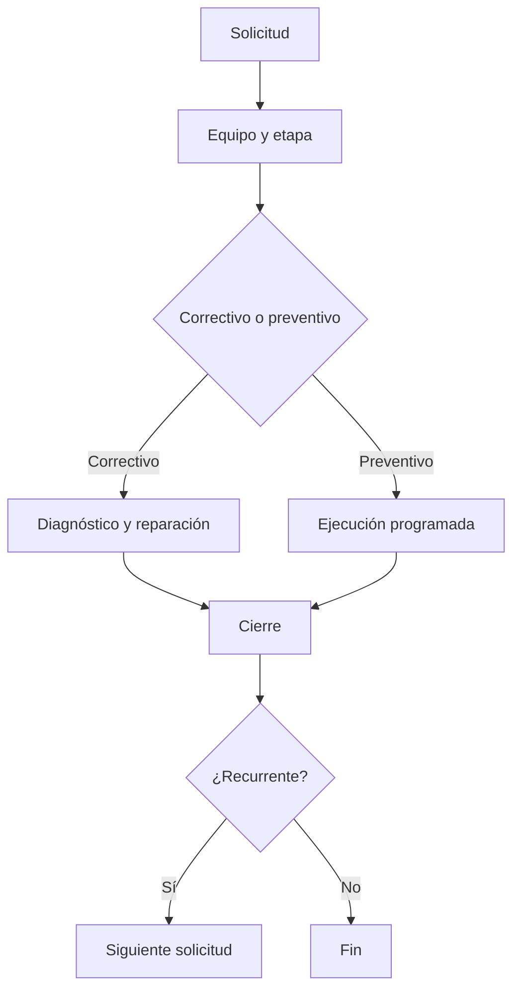

# Módulo 5 — Maintenance (Mantenimiento)

> **Edición:** Community (algunas integraciones son Enterprise)
> **Módulos técnicos:** `maintenance`, `stock_maintenance`; complementos: `repair`, `mrp_repair`
> **Dependencias base:** `mail`
> **Versión analizada:** Odoo 20.0 (commit `2b504bcb3b4`)

---

## 1. Ficha del módulo

**Propósito:** gestionar equipos y maquinaria, solicitudes de reparación y mantenimiento preventivo/correctivo, con seguimiento de averías y métricas de fiabilidad.

```text
Equipo → Solicitud → Etapa → Ejecución → Cierre → Recurrencia / métricas
```

**Modelos principales:**

| Modelo | Función |
|--------|---------|
| `maintenance.equipment` | Equipo o máquina |
| `maintenance.equipment.category` | Categoría de equipo |
| `maintenance.team` | Equipo de mantenimiento |
| `maintenance.request` | Solicitud de mantenimiento |
| `maintenance.stage` | Etapa del flujo |
| `maintenance.mixin` | Métricas MTBF/MTTR para elementos mantenidos |

**Menús principales:**

- `Mantenimiento > Dashboard`
- `Mantenimiento > Mantenimiento > Solicitudes`
- `Mantenimiento > Equipo`
- `Mantenimiento > Reportes`
- `Mantenimiento > Configuración`

---

## 2. Mapa de funciones

| # | Función | Resultado |
|---|---------|-----------|
| F01 | Ficha de equipo | Identificación y datos del activo |
| F02 | Categorías de equipo | Agrupación y propiedades |
| F03 | Equipos de mantenimiento | Responsables y alias |
| F04 | Etapas | Flujo kanban de solicitudes |
| F05 | Solicitudes | Registro de trabajos |
| F06 | Mantenimiento correctivo | Reparación de fallas |
| F07 | Mantenimiento preventivo | Trabajo planificado |
| F08 | Recurrencia | Generación periódica |
| F09 | Programación | Fechas y duración |
| F10 | Kanban / pipeline | Gestión visual |
| F11 | Prioridad y asignación | Orden y responsables |
| F12 | Instrucciones y notas | Información de ejecución |
| F13 | Cierre, cancelación y reapertura | Ciclo de vida |
| F14 | MTBF / MTTR | Indicadores de fiabilidad |
| F15 | Asignación y ubicación | Dónde y quién usa el equipo |
| F16 | Garantía y costo | Datos económicos |
| F17 | Propiedades personalizadas | Campos por categoría |
| F18 | Dashboard | Vista por equipo de mantenimiento |
| F19 | Reportes | Análisis de solicitudes |
| F20 | Integración con inventario | Lote/serie y ubicación |
| F21 | Integración con reparaciones | Órdenes de reparación |
| F22 | Configuración | Ajustes del módulo |
| F23 | Límites | Alcance |

---

## 3. Detalle función por función

### F01. Ficha de equipo

**Qué hace:** registra un activo mantenible.

**Dónde:** `Mantenimiento > Equipo`.

**Campos (`maintenance.equipment`):**
- `name`: nombre.
- `category_id`: categoría.
- `owner_user_id`: propietario/responsable.
- `maintenance_team_id`: equipo de mantenimiento.
- `technician_user_id`: técnico.
- `partner_id`, `partner_ref`: proveedor y referencia.
- `model`, `serial_no`: modelo y número de serie.
- `effective_date`: fecha efectiva (base para MTBF).
- `cost`: costo.
- `warranty_date`: vencimiento de garantía.
- `assign_date`: fecha de asignación.
- `scrap_date`: fecha de baja.
- `note`: descripción.
- `equipment_properties`: propiedades por categoría.
- `location_id` (con `stock_maintenance`): ubicación de uso.

**Resultado:** activo identificado y vinculado a responsables.

**Límites:** no es un activo financiero; el costo es informativo.

---

### F02. Categorías de equipo

**Qué hace:** agrupa equipos y define propiedades comunes.

**Dónde:** `Mantenimiento > Configuración > Categorías de equipo`.

**Campos (`maintenance.equipment.category`):**
- `name`.
- `technician_user_id`: responsable por defecto.
- `equipment_ids`.
- `maintenance_ids`.
- `equipment_properties_definition`: campos personalizados.
- `fold`: plegado en kanban.

**Resultado:** clasificación uniforme y campos específicos por tipo de equipo.

---

### F03. Equipos de mantenimiento

**Qué hace:** define los grupos que atienden solicitudes.

**Dónde:** `Mantenimiento > Configuración > Equipos de mantenimiento`.

**Campos (`maintenance.team`):**
- `name`, `active`.
- `member_ids`: miembros.
- `alias_id`: correo para crear solicitudes.
- Contadores: solicitudes pendientes, programadas, de alta prioridad, con cambios solicitados, sin programar.
- `equipment_ids`, `request_ids`.

**Resultado:** asignación y recepción de solicitudes por correo.

---

### F04. Etapas

**Qué hace:** define el flujo de las solicitudes.

**Dónde:** `Mantenimiento > Configuración > Etapas`.

**Campos (`maintenance.stage`):**
- `name`, `sequence`.
- `fold`: plegada en kanban.
- `maintenance_team_ids`: aplica a determinados equipos.

**Resultado:** pipeline configurable por tipo de mantenimiento.

---

### F05. Solicitudes

**Qué hace:** registra una solicitud de mantenimiento.

**Dónde:** `Mantenimiento > Mantenimiento > Solicitudes`.

**Campos (`maintenance.request`):**
- `name`: asunto.
- `equipment_id`: equipo (obligatorio).
- `maintenance_type`: correctivo o preventivo.
- `maintenance_team_id`, `user_ids`: equipo y técnicos.
- `stage_id`: etapa.
- `priority`: muy baja, baja, normal, alta.
- `description`, `instruction_text`.
- `schedule_date`, `schedule_end`, `duration`.
- `close_date`.
- `state`: en progreso, cambios solicitados, aprobado, hecho, cancelado.
- `equipment_req_properties`: propiedades del equipo.
- `recurring_maintenance`, `repeat_interval`, `repeat_unit`, `repeat_type`, `repeat_until`.

**Resultado:** trabajo registrado y asignado.

**Límites:** el equipo es obligatorio; no hay solicitudes “generales” sin activo.

---

### F06. Mantenimiento correctivo

**Qué hace:** atiende fallas o reparaciones no planificadas.

**Configuración:** `maintenance_type = corrective`.

**Funciones:**
- Registrar síntoma y prioridad.
- Asignar técnico/equipo.
- Ejecutar y documentar.
- Cerrar con fecha.
- Alimentar MTBF/MTTR.

**Resultado:** avería atendida y registrada.

---

### F07. Mantenimiento preventivo

**Qué hace:** programa trabajos para evitar fallas.

**Configuración:** `maintenance_type = preventive`.

**Funciones:**
- Planificar fecha y duración.
- Definir instrucciones.
- Asignar equipo/técnico.
- Ejecutar y cerrar.
- Generar siguiente ocurrencia si es recurrente.

**Resultado:** mantenimiento planificado y recurrente.

---

### F08. Recurrencia

**Qué hace:** genera solicitudes periódicas automáticamente.

**Campos:**
- `recurring_maintenance`: activa.
- `repeat_interval`: cada cuántas unidades.
- `repeat_unit`: días, semanas, meses, años.
- `repeat_type`: indefinido (`forever`) o hasta (`until`).
- `repeat_until`: fecha final.

**Funciones:**
- Crear la siguiente solicitud al cerrar la actual.
- Detener la recurrencia al cancelar.
- Reabrir una solicitud cancelada.

**Resultado:** plan de mantenimiento sin intervención manual.

**Límites:** la recurrencia es simple (intervalo fijo); no maneja calendarios complejos.

---

### F09. Programación

**Qué hace:** ubica la solicitud en el tiempo.

**Campos:**
- `schedule_date`: fecha/hora planificada.
- `schedule_end`: fin previsto.
- `duration`: duración calculada en horas.
- `close_date`: fecha real de cierre.

**Funciones:**
- Vista calendario.
- Validación de intervalo (`schedule_end > schedule_date`).
- Alertas de vencimiento.

**Resultado:** agenda de mantenimiento.

---

### F10. Kanban / pipeline

**Qué hace:** gestiona visualmente las solicitudes.

**Dónde:** vista kanban de solicitudes y dashboard.

**Funciones:**
- Columnas por etapa.
- Arrastrar y soltar para cambiar de etapa.
- Colores por prioridad/equipo.
- Filtros por técnico, equipo, tipo y fecha.

**Resultado:** control operativo diario.

---

### F11. Prioridad y asignación

**Qué hace:** ordena el trabajo y asigna responsables.

**Campos:**
- `priority`: 0 a 3.
- `user_ids`: técnicos.
- `maintenance_team_id`: equipo.
- `technician_user_id` en equipo.

**Resultado:** carga de trabajo distribuida.

---

### F12. Instrucciones y notas

**Qué hace:** documenta cómo ejecutar el trabajo.

**Campos:**
- `description`: notas internas.
- `instruction_text`: instrucciones HTML.
- Chatter para historial.

**Resultado:** ejecución consistente y trazable.

---

### F13. Cierre, cancelación y reapertura

**Qué hace:** administra el ciclo de vida.

**Funciones:**
- **Cerrar**: estado `done` y fecha de cierre.
- **Cancelar**: `cancel_equipment_request`; detiene recurrencia.
- **Reabrir**: `reset_equipment_request`; vuelve a la primera etapa.
- **Cambios solicitados**: la solicitud requiere ajustes antes de aprobar.

**Resultado:** control del estado real del trabajo.

---

### F14. MTBF / MTTR

**Qué hace:** mide fiabilidad y tiempo de reparación.

**Campos (en `maintenance.equipment` / `maintenance.mixin`):**
- `expected_mtbf`: MTBF esperado.
- `mtbf`: tiempo medio entre fallas (días).
- `mttr`: tiempo medio de reparación (días).
- `estimated_next_failure`: próximo fallo estimado.
- `latest_failure_date`: última falla.

**Cálculo:**
- MTBF a partir de mantenimientos correctivos cerrados.
- MTTR como promedio entre fecha de falla y cierre.

**Resultado:** indicadores para decisiones de reemplazo/mantenimiento.

**Límites:** dependen de que las fechas y cierres se registren correctamente.

---

### F15. Asignación y ubicación

**Qué hace:** indica quién usa y dónde está el equipo.

**Funciones:**
- `owner_user_id`: responsable.
- `assign_date`: fecha de asignación.
- `location_id` (con `stock_maintenance`): ubicación interna.
- `equipment_assign_to`: tipo de asignación (extensible).
- Botón de equipos por ubicación.

**Resultado:** trazabilidad de uso y localización.

---

### F16. Garantía y costo

**Qué hace:** registra información económica y de cobertura.

**Campos:**
- `cost`: costo del equipo.
- `warranty_date`: vencimiento de garantía.
- `scrap_date`: fecha de baja.
- `partner_id`, `partner_ref`: proveedor.

**Resultado:** control de garantías y valor del activo.

**Límites:** no genera asientos contables ni depreciación.

---

### F17. Propiedades personalizadas

**Qué hace:** agrega campos específicos por categoría.

**Funciones:**
- Definir propiedades en la categoría (`equipment_properties_definition`).
- Capturar valores en el equipo (`equipment_properties`).
- Definir propiedades en la solicitud (`equipment_req_properties`).

**Resultado:** flexibilidad sin desarrollo.

---

### F18. Dashboard

**Dónde:** `Mantenimiento > Dashboard`.

**Funciones:**
- Tarjetas por equipo de mantenimiento.
- Solicitudes pendientes, programadas, de alta prioridad, con cambios solicitados, sin programar.
- Acceso rápido a solicitudes.

**Resultado:** visión global de la carga.

---

### F19. Reportes

**Dónde:** `Mantenimiento > Reportes > Análisis de solicitudes`.

**Funciones:**
- Solicitudes por equipo, técnico, etapa y tipo.
- Tiempos y prioridades.
- Historial por activo.
- Exportación a Excel/PDF.

**Nota:** los reportes de OEE y pérdidas de los menús de mantenimiento se completan con la integración Enterprise de fabricación/mantenimiento.

---

### F20. Integración con inventario

**Módulo:** `stock_maintenance`.

**Funciones:**
- Agregar `location_id` al equipo.
- Ver equipos por ubicación (`equipment_count`).
- Botón **Número de serie** que abre el lote/serie coincidente (`match_serial`, `action_open_matched_serial`).
- Trazabilidad entre activo y lote/serie.

**Resultado:** vínculo entre mantenimiento y stock.

**Límites:** no gestiona repuestos como almacén dedicado; usa Inventario.

---

### F21. Integración con reparaciones

**Módulos:** `repair`, `mrp_repair`.

**Funciones:**
- Orden de reparación (`repair.order`) con producto, lote/serie, ubicación y piezas.
- Movimientos de stock para piezas y producto.
- Facturación.
- Vínculo con órdenes de fabricación.
- Contador de reparaciones en la MO.

**Resultado:** reparación ejecutada y facturada con trazabilidad.

**Límites:** es un módulo de reparación, no un CMMS completo.

---

### F22. Configuración

**Dónde:** `Mantenimiento > Configuración`.

**Opciones:**
- Equipos de mantenimiento y alias de correo.
- Categorías y propiedades.
- Etapas.
- Ajustes generales.
- Hojas de trabajo personalizadas (Enterprise, `maintenance_worksheet`).

---

### F23. Límites

- No es un EAM/CMMS completo.
- Sin gestión de repuestos como almacén dedicado.
- Sin planificación de capacidad de técnicos.
- Sin vinculación nativa con centros de trabajo en Community (`mrp_maintenance` es Enterprise).
- Sin contabilidad de activos ni depreciación.
- La recurrencia es por intervalo fijo.

---

## 4. Flujo operativo



---

## 5. Configuración inicial recomendada

1. Crear equipos de mantenimiento y alias de correo.
2. Definir etapas del pipeline.
3. Crear categorías y propiedades.
4. Cargar equipos con número de serie y ubicación.
5. Definir responsables y técnicos.
6. Configurar planes preventivos recurrentes.
7. Definir prioridades y SLA (manual).
8. Vincular equipos con lotes/series si aplica.
9. Configurar reparaciones si se usan.
10. Revisar indicadores mensualmente.

---

## 6. Reportes

| Reporte | Ubicación | Uso |
|---------|-----------|-----|
| Análisis de solicitudes | `Mantenimiento > Reportes` | Carga y cumplimiento |
| Historial por equipo | Ficha de equipo | Auditoría |
| MTBF / MTTR | Ficha de equipo | Fiabilidad |
| Próximo fallo estimado | Ficha de equipo | Planificación |
| Reparaciones | `Reparaciones > Reportes` | Costo y volumen |

---

## 7. Límites y buenas prácticas

**Límites:**
- No es un EAM/CMMS completo.
- Sin gestión de repuestos como almacén dedicado.
- Sin planificación de capacidad de técnicos.
- Sin vinculación nativa con centros de trabajo en Community.
- Sin contabilidad de activos ni depreciación.

**Buenas prácticas:**

- Registrar siempre el equipo y el síntoma.
- Cerrar con fecha real para que MTBF/MTTR sean útiles.
- Usar recurrencia para planes preventivos.
- Asignar técnicos y equipos de forma explícita.
- Vincular el activo a su lote/serie cuando exista.
- Revisar equipos con MTBF bajo o MTTR alto.
- No usar mantenimiento como sustituto de órdenes de reparación complejas.
- Documentar instrucciones de trabajo.
