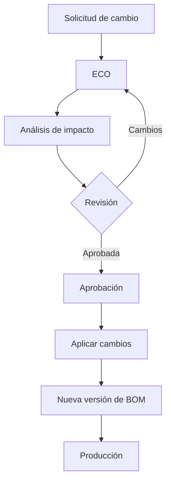

# Módulo 6 — PLM (Product Lifecycle Management)

> **Edición:** Enterprise
> **Módulo técnico:** `mrp_plm`
> **Dependencias:** `mrp`, `mail`; integración con `documents`
> **Versión de referencia:** Odoo 20 Enterprise

> ⚠️ **Este módulo no está en el repositorio local** (`addons/` solo contiene la edición Community). La descripción se basa en la funcionalidad estándar documentada de Odoo Enterprise. Los nombres exactos de menús y campos pueden variar según la versión.

---

## 1. Ficha del módulo

**Propósito:** controlar el ciclo de vida técnico del producto: cambios de ingeniería, versiones de listas de materiales y aprobaciones antes de llevar un cambio a producción.

```text
Necesidad de cambio → ECO → Análisis → Aprobación → Nueva versión de BOM → Producción
```

**Modelos principales (referenciales):**

| Modelo | Función |
|--------|---------|
| `mrp.eco` | Orden de cambio de ingeniería |
| `mrp.eco.stage` | Etapa del ECO |
| `mrp.eco.type` | Tipo de cambio |
| `mrp.bom` | BOM versionada |
| `mrp.bom.line` | Componentes de la versión |
| `mrp.routing.workcenter` | Operaciones de la versión |

**Menús principales (referenciales):**

- `Fabricación > Ingeniería > Órdenes de cambio de ingeniería`
- `Fabricación > Ingeniería > Tipos de ECO`
- `Fabricación > Ingeniería > Etapas de ECO`
- `Fabricación > Productos > Listas de materiales` (versiones)
- `Fabricación > Reportes`

---

## 2. Mapa de funciones

| # | Función | Resultado |
|---|---------|-----------|
| F01 | Orden de cambio de ingeniería (ECO) | Documento de cambio controlado |
| F02 | Tipos de ECO | Clasificación del cambio |
| F03 | Etapas del ECO | Flujo de trabajo |
| F04 | Aprobaciones | Validación técnica |
| F05 | Versiones de BOM | Nueva versión del producto |
| F06 | Revisiones | Historial de cambios |
| F07 | Cambios en componentes | Modificación de materiales |
| F08 | Cambios en operaciones | Modificación de rutas |
| F09 | Fechas de efectividad | Vigencia del cambio |
| F10 | Archivo de versiones | BOM anteriores conservadas |
| F11 | Análisis de impacto | BOM/MO afectadas |
| F12 | Gestión documental | Planos y especificaciones |
| F13 | Trazabilidad y auditoría | Quién cambió qué y cuándo |
| F14 | Reportes | Análisis de cambios |
| F15 | Configuración | Ajustes del módulo |
| F16 | Límites | Alcance |

---

## 3. Detalle función por función

### F01. Orden de cambio de ingeniería (ECO)

**Qué hace:** documenta y controla un cambio técnico.

**Dónde:** `Fabricación > Ingeniería > Órdenes de cambio de ingeniería`.

**Campos típicos (`mrp.eco`):**
- `name`: referencia.
- `type_id`: tipo de cambio.
- `product_tmpl_id` / `bom_id`: producto/BOM afectada.
- `stage_id`: etapa.
- `user_id`: responsable.
- `priority`.
- `description`: motivo y alcance.
- `date_start` / `date_end`: vigencia.
- `tag_ids`.
- `is_approved`, `approval_date`, `approval_user_id`.

**Resultado:** cambio registrado y sujeto a flujo.

**Límites:** no reemplaza un PLM de diseño CAD; gestiona el cambio en Odoo.

---

### F02. Tipos de ECO

**Qué hace:** clasifica el cambio para aplicar reglas distintas.

**Dónde:** `Fabricación > Ingeniería > Tipos de ECO`.

**Campos típicos (`mrp.eco.type`):**
- `name`.
- `sequence`.
- Configuración de etapas aplicables.

**Tipos habituales:**
- Cambio de BOM.
- Cambio de producto.
- Cambio de operaciones/ruta.
- Cambio de documentación.

**Resultado:** flujo y responsables según el tipo.

---

### F03. Etapas del ECO

**Qué hace:** define el flujo de aprobación y ejecución.

**Dónde:** `Fabricación > Ingeniería > Etapas de ECO`.

**Campos típicos (`mrp.eco.stage`):**
- `name`, `sequence`.
- `fold`: plegada en kanban.
- `approval`: requiere aprobación.

**Funciones:**
- Kanban de ECOs por etapa.
- Avance controlado.
- Bloqueo hasta aprobación.

**Resultado:** proceso uniforme de cambio.

---

### F04. Aprobaciones

**Qué hace:** valida técnicamente el cambio antes de aplicarlo.

**Funciones:**
- Etapa con aprobación obligatoria.
- Botón **Aprobar**.
- Registro de usuario y fecha.
- Rechazo o solicitud de cambios.
- Historial de aprobaciones.

**Resultado:** cambio autorizado y auditable.

**Límites:** el flujo de aprobación es por etapas; no es un workflow BPM genérico.

---

### F05. Versiones de BOM

**Qué hace:** crea una nueva versión de la lista de materiales al aplicar el cambio.

**Dónde:** BOM, pestaña/versiones; ECO.

**Funciones:**
- Versionado de BOM.
- Copia de la versión anterior.
- Aplicación de cambios de componentes y operaciones.
- Asociación ECO ↔ versión.
- Selección de versión vigente.

**Resultado:** convivencia controlada de versiones.

**Límites:** la gestión de versiones es de Odoo; no sustituye un sistema de configuración (configurator) avanzado.

---

### F06. Revisiones

**Qué hace:** mantiene el historial de revisiones técnicas.

**Funciones:**
- Número/revisión de BOM.
- Fecha de creación y responsable.
- Cambios asociados.
- Comparación antes/después.

**Resultado:** trazabilidad técnica del producto.

---

### F07. Cambios en componentes

**Qué hace:** modifica la composición del producto.

**Funciones:**
- Agregar, quitar o cambiar componentes.
- Ajustar cantidades y unidades.
- Cambiar variantes aplicables.
- Modificar subproductos.
- Asociar el cambio a una operación.

**Resultado:** nueva versión de BOM con componentes actualizados.

---

### F08. Cambios en operaciones

**Qué hace:** modifica la ruta de fabricación.

**Funciones:**
- Agregar/quitar operaciones.
- Cambiar centro de trabajo.
- Ajustar tiempos y dependencias.
- Modificar instrucciones.

**Resultado:** nueva versión de la ruta.

---

### F09. Fechas de efectividad

**Qué hace:** define desde cuándo aplica el cambio.

**Funciones:**
- Fecha de inicio de vigencia.
- Fecha de fin (si aplica).
- Selección de versión vigente por fecha.
- Coordinación con órdenes de fabricación.

**Resultado:** cambio aplicado en el momento correcto.

**Límites:** la planificación de efectividad debe coordinarse con compras y producción.

---

### F10. Archivo de versiones

**Qué hace:** conserva versiones anteriores.

**Funciones:**
- BOM archivadas.
- Consulta histórica.
- Reactivación controlada.
- No eliminar trazabilidad.

**Resultado:** historial completo sin perder información.

---

### F11. Análisis de impacto

**Qué hace:** identifica qué se ve afectado por el cambio.

**Funciones:**
- BOM afectadas.
- Órdenes de fabricación abiertas.
- Componentes y operaciones impactados.
- Costos estimados del cambio.

**Resultado:** decisión informada antes de aplicar.

**Límites:** el análisis es operativo; no simula escenarios financieros complejos.

---

### F12. Gestión documental

**Qué hace:** vincula planos, especificaciones y evidencias.

**Funciones:**
- Adjuntos en el ECO.
- Integración con `documents`.
- Control de versiones documentales.
- Acceso desde el producto/BOM.

**Resultado:** expediente técnico completo.

---

### F13. Trazabilidad y auditoría

**Qué hace:** registra el historial del cambio.

**Funciones:**
- Quién creó, revisó y aprobó.
- Fechas de cada etapa.
- Cambios aplicados.
- Chatter y actividades.
- Versión resultante.

**Resultado:** auditoría técnica y cumplimiento.

---

### F14. Reportes

**Dónde:** `Fabricación > Reportes` / vistas de ECO.

**Reportes típicos:**
- ECOs por etapa, tipo y responsable.
- Tiempo de ciclo del cambio.
- Cambios por producto.
- Versiones vigentes.
- Impacto en BOM.

**Resultado:** control del proceso de ingeniería.

---

### F15. Configuración

**Opciones:**
- Activar PLM (`module_mrp_plm`).
- Tipos de ECO.
- Etapas y aprobaciones.
- Secuencias.
- Integración documental.
- Permisos por rol.

---

### F16. Límites

- Es un módulo **Enterprise**; no está en Community.
- No es un CAD/PDM completo.
- No gestiona configuraciones de producto tipo “configurador” avanzado.
- La efectividad y el impacto dependen de la disciplina de proceso.
- Requiere BOM y rutas bien mantenidas.

---

## 4. Flujo operativo



---

## 5. Configuración inicial recomendada

1. Activar PLM.
2. Definir tipos de ECO.
3. Configurar etapas y aprobaciones.
4. Definir roles y permisos.
5. Establecer nomenclatura de versiones.
6. Definir política de efectividad.
7. Integrar documentos si se usan planos.
8. Capacitar en el flujo de cambio.
9. Revisar impacto antes de aplicar.
10. Auditar periódicamente versiones vigentes.

---

## 6. Reportes

| Reporte | Uso |
|---------|-----|
| ECOs por etapa | Seguimiento del flujo |
| ECOs por tipo | Clasificación de cambios |
| Tiempo de ciclo | Eficiencia del proceso |
| Versiones por producto | Control de vigencia |
| Impacto en BOM/MO | Riesgo del cambio |

---

## 7. Límites y buenas prácticas

**Límites:**
- Es un módulo Enterprise; no está en Community.
- No es un CAD/PDM completo.
- No es un configurador de producto avanzado.
- Requiere disciplina de proceso y BOM bien mantenidas.

**Buenas prácticas:**

- Un ECO por cambio lógico, no por cada línea.
- Documentar el motivo y el alcance.
- Analizar impacto en órdenes abiertas.
- Aprobar antes de aplicar.
- Mantener una única versión vigente por producto/fecha.
- No borrar versiones anteriores.
- Coordinar con compras y planificación.
- Revisar costos después del cambio.
