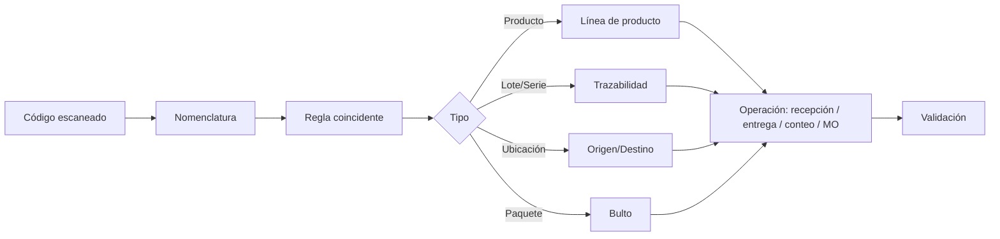

# Módulo 7 — Barcode (Códigos de barras)

> **Edición:** Community (base `barcodes`) + Enterprise (app `stock_barcode`)
> **Módulos técnicos:** `barcodes`, `barcodes_gs1_nomenclature`, `stock_barcode` (Enterprise), extensiones MRP de barcode (Enterprise)
> **Dependencias base:** `web`; con Inventario: `stock`
> **Versión analizada:** Odoo 20.0 (commit `2b504bcb3b4`) para la base Community

---

## 1. Ficha del módulo

**Propósito:** capturar operaciones logísticas y de producción mediante escáner, reduciendo errores de digitación y acelerando recepciones, transferencias, preparación de pedidos y conteos.

```text
Código escaneado → Nomenclatura → Regla → Tipo + valor → Acción en Odoo
```

**Modelos principales:**

| Modelo | Función |
|--------|---------|
| `barcode.nomenclature` | Conjunto de reglas de interpretación |
| `barcode.rule` | Regla individual (patrón, tipo, alias) |
| `res.company.nomenclature_id` | Nomenclatura por compañía |

**Menús principales:**

- `Inventario > Configuración > Productos > Nomenclaturas de códigos de barras`
- `Barcode` (app Enterprise): operaciones, inventario, ajustes.

---

## 2. Mapa de funciones

### A. Base Community (`barcodes`)

| # | Función | Resultado |
|---|---------|-----------|
| F01 | Nomenclatura | Define cómo se interpretan los códigos |
| F02 | Reglas | Patrón, tipo, secuencia y alias |
| F03 | Tipos de regla | Producto, peso, ubicación, lote, paquete, alias |
| F04 | Parseo | Convierte el código en tipo + valor |
| F05 | GS1 | Interpreta estándar GS1-128 y URI |
| F06 | Código de producto | Identifica producto y cantidad |
| F07 | Código de ubicación | Identifica ubicación |
| F08 | Código de lote/serie | Identifica lote o serie |
| F09 | Código de paquete | Identifica paquete/SSCC |
| F10 | Código de contacto | Identifica proveedor/cliente |
| F11 | Validación EAN/GTIN | Verifica formato |

### B. App Enterprise (`stock_barcode`)

| # | Función | Resultado |
|---|---------|-----------|
| F12 | Recepciones | Registrar entrada por escáner |
| F13 | Transferencias internas | Mover stock escaneando |
| F14 | Entregas / picking | Preparar pedidos |
| F15 | Conteo de inventario | Contar y ajustar |
| F16 | Paquetes | Crear/mover paquetes |
| F17 | Lotes/series | Escanear y asignar |
| F18 | Fabricación | Procesar MO/órdenes de trabajo |
| F19 | Etiquetas | Imprimir códigos |
| F20 | Configuración | Ajustes de la app |

---

## 3. Detalle función por función

### F01. Nomenclatura

**Qué hace:** agrupa las reglas que interpretan los códigos de una compañía.

**Dónde:** `Inventario > Configuración > Productos > Nomenclaturas de códigos de barras`.

**Campos (`barcode.nomenclature`):**
- `name`.
- `rule_ids`.
- `upc_ean_conv`: conversión UPC/EAN.

**Funciones:**
- Asignar nomenclatura a la compañía (`res.company.nomenclature_id`).
- Crear nomenclaturas específicas por operación/país.
- Ordenar reglas por secuencia.

**Resultado:** el sistema sabe interpretar cada código.

**Límites:** una compañía usa una nomenclatura por defecto; se puede cambiar.

---

### F02. Reglas

**Qué hace:** define cómo se reconoce un código.

**Campos (`barcode.rule`):**
- `name`.
- `barcode_nomenclature_id`.
- `sequence`: prioridad (menor primero).
- `encoding`: `any`, `ean13`, `ean8`, `upca`, `gs1-128`.
- `type`: tipo de código.
- `pattern`: expresión regular con contenido numérico `{N...D...}`.
- `alias`: valor al que se convierte.

**Funciones:**
- Coincidencia por prefijo/patrón.
- Extracción de valor numérico (peso, precio, cantidad).
- Conversión a código base.

**Resultado:** el código se clasifica y se extrae su valor.

**Límites:** las reglas se evalúan en orden; una regla mal priorizada captura códigos indebidos.

---

### F03. Tipos de regla

**Qué hace:** determina qué representa el código.

**Tipos en Community:**
- `alias`: redirige a otro código.
- `product`: producto unitario.
- `weight`: producto pesado (el código incluye peso).
- `location`: ubicación.
- `lot`: lote/serie.
- `package`: paquete.

**Tipos GS1 adicionales:**
- `quantity`: cantidad.
- `location_dest`: ubicación destino.
- `use_date`: consumo preferente.
- `expiration_date`: caducidad.
- `package_type`: tipo de paquete.
- `pack_date`: fecha de empaque.

**Resultado:** cada código ejecuta la acción correcta.

---

### F04. Parseo

**Qué hace:** convierte el código escaneado en una estructura utilizable.

**Métodos (`barcode.nomenclature`):**
- `parse_barcode`: punto de entrada.
- `parse_nomenclature_barcode`: aplica reglas.
- `match_pattern`: valida patrón y extrae valor.
- `parse_uri`: interpreta URIs GS1.

**Resultado:**
- `code`: código original.
- `type`: tipo detectado.
- `value`: valor numérico extraído.
- `base_code`: código sin la parte variable.
- `encoding`.

**Límites:** si ninguna regla coincide, el tipo es `error`.

---

### F05. GS1

**Qué hace:** interpreta códigos GS1-128 y URIs.

**Módulo:** `barcodes_gs1_nomenclature`.

**Funciones:**
- Nomenclatura GS1 (`is_gs1_nomenclature`).
- Separador FNC1 (`gs1_separator_fnc1`).
- Reglas con Application Identifier (AI).
- Tipos de contenido: fecha, medida, identificador y alfanumérico.
- URIs soportadas: `lgtin`, `sgtin`, `sgtin-96`, `sgtin-198`, `sscc`, `sscc-96`.
- Conversión de fechas GS1 (`yymmdd`).

**Resultado:** lectura de estándares industriales.

**Límites:** requiere que el hardware/etiqueta use GS1 correctamente.

---

### F06. Código de producto

**Qué hace:** identifica un producto al escanear.

**Campos:**
- `product.product.barcode`.
- `product.template.barcode`.
- `product.uom.barcode`.

**Funciones:**
- Buscar producto por código.
- Validar EAN/GTIN.
- Usar código de empaque/unidad.

**Resultado:** producto seleccionado en la operación.

---

### F07. Código de ubicación

**Qué hace:** identifica una ubicación.

**Campos:**
- `stock.location.barcode`.
- Unicidad por compañía.

**Funciones:**
- Escanear origen/destino.
- Validar que la ubicación exista.
- Usar en putaway y transferencias.

**Resultado:** ubicación seleccionada sin digitar.

---

### F08. Código de lote/serie

**Qué hace:** identifica un lote o número de serie.

**Campos:**
- `stock.lot.name` (código escaneado).
- `stock.lot.ref` (referencia interna).

**Funciones:**
- Asignar lote/serie en recepción, transferencia o producción.
- Buscar lote por nombre.
- Imprimir etiqueta.

**Resultado:** trazabilidad capturada por escáner.

---

### F09. Código de paquete

**Qué hace:** identifica un paquete o contenedor.

**Campos:**
- `stock.package.name`.
- `valid_sscc`: valida formato SSCC.
- `stock.package.type.barcode`.

**Funciones:**
- Crear/mover paquete.
- Anidar paquetes.
- Imprimir etiqueta SSCC.
- Mover paquete completo.

**Resultado:** manipulación por bulto.

---

### F10. Código de contacto

**Qué hace:** identifica proveedores/clientes.

**Campos:**
- `res.partner.barcode` (campo base, dependiente de compañía).

**Funciones:**
- Seleccionar proveedor/cliente en una operación.
- Validar unicidad.

**Resultado:** socio identificado por escáner.

---

### F11. Validación EAN/GTIN

**Qué hace:** verifica que el código tenga formato válido.

**Funciones:**
- `check_barcode_encoding` para GTIN/EAN.
- `valid_ean` en producto.
- `valid_sscc` en paquete.
- Dígito de control.

**Resultado:** evita códigos inválidos.

---

### F12. Recepciones (Enterprise)

**Qué hace:** ejecuta la recepción escaneando productos, lotes y ubicaciones.

**Dónde:** app `Barcode > Operaciones > Recepciones`.

**Funciones:**
- Seleccionar transferencia pendiente.
- Escanear producto.
- Ingresar cantidad.
- Escanear lote/serie.
- Escanear ubicación de destino.
- Validar recepción.
- Crear backorder si es parcial.

**Resultado:** recepción rápida y trazable.

**Límites:** requiere `stock_barcode` (Enterprise).

---

### F13. Transferencias internas (Enterprise)

**Qué hace:** mueve stock entre ubicaciones escaneando.

**Funciones:**
- Escanear origen y destino.
- Escanear producto/lote/paquete.
- Confirmar cantidades.
- Validar transferencia.

**Resultado:** movimiento interno ágil.

---

### F14. Entregas / picking (Enterprise)

**Qué hace:** prepara pedidos de salida.

**Funciones:**
- Seleccionar entrega.
- Escanear ubicación y producto.
- Confirmar cantidad picada.
- Escanear paquete.
- Validar entrega.
- Generar backorder.

**Resultado:** preparación sin papeles y con control.

---

### F15. Conteo de inventario (Enterprise)

**Qué hace:** cuenta existencias con escáner.

**Funciones:**
- Escanear ubicación.
- Escanear producto/lote.
- Ingresar cantidad contada.
- Aplicar ajuste.
- Repetir por ubicación.

**Resultado:** inventario físico más rápido y con menos errores.

---

### F16. Paquetes (Enterprise)

**Qué hace:** gestiona bultos durante la operación.

**Funciones:**
- Crear paquete.
- Asignar productos.
- Mover paquete completo.
- Imprimir etiqueta.
- Anidar paquetes.

**Resultado:** logística por bulto.

---

### F17. Lotes/series (Enterprise)

**Qué hace:** captura trazabilidad en la operación.

**Funciones:**
- Escanear lote/serie existente.
- Crear lote/serie nuevo.
- Asignar a línea.
- Validar disponibilidad.

**Resultado:** trazabilidad sin digitación.

---

### F18. Fabricación (Enterprise)

**Qué hace:** procesa órdenes de fabricación y trabajo desde el escáner.

**Funciones:**
- Seleccionar MO/orden de trabajo.
- Escanear componentes.
- Registrar consumo.
- Escanear producto terminado/lote.
- Registrar producción.
- Cerrar operación.

**Resultado:** ejecución de planta ágil.

**Límites:** requiere `stock_barcode` y la integración MRP de Enterprise.

---

### F19. Etiquetas

**Qué hace:** imprime códigos para productos, lotes, paquetes y ubicaciones.

**Funciones:**
- Formatos de etiqueta por tipo de operación.
- Impresión automática.
- Etiquetas GS1.
- Etiquetas ZPL para impresoras industriales.

**Resultado:** identificación física coherente.

---

### F20. Configuración

**Opciones:**
- Nomenclatura por compañía.
- Reglas y secuencias.
- GS1.
- Tipos de operación con barcode.
- Impresión automática.
- App Barcode (Enterprise).
- Barcode Lookup (Enterprise, base de datos de códigos).

---

## 4. Flujo operativo



---

## 5. Configuración inicial recomendada

1. Definir la nomenclatura de la compañía.
2. Crear reglas para productos y ubicaciones.
3. Configurar GS1 si el proveedor lo exige.
4. Asignar códigos a productos, ubicaciones, lotes y paquetes.
5. Configurar tipos de operación con escaneo.
6. Definir formatos de etiqueta.
7. Activar la app Barcode (Enterprise).
8. Capacitar al personal en el flujo.
9. Probar con códigos reales.
10. Revisar reglas y prioridades periódicamente.

---

## 6. Reportes

| Reporte | Ubicación | Uso |
|---------|-----------|-----|
| Movimientos | Inventario | Ver operaciones escaneadas |
| Inventario físico | Inventario | Conteos |
| Transferencias | Inventario | Recepciones/entregas |
| Etiquetas | Operación | Reimpresión |
| Barcode Lookup | App Enterprise | Consulta de códigos |

---

## 7. Límites y buenas prácticas

**Límites:**
- La app de escaneo es **Enterprise**; Community solo interpreta códigos.
- No planifica ni decide; complementa Inventario, Compras y Fabricación.
- Requiere datos maestros correctos.
- La lectura depende del hardware y de la calidad de impresión.
- Las reglas mal ordenadas generan interpretaciones erróneas.

**Buenas prácticas:**
- Usar una nomenclatura estándar y documentarla.
- Evitar códigos duplicados.
- Probar reglas con códigos reales.
- Mantener etiquetas legibles.
- Usar GS1 cuando el socio lo requiera.
- Asignar códigos a ubicaciones y paquetes, no solo a productos.
- Revisar la secuencia de reglas al agregar nuevas.
- Capacitar en el uso del escáner y en la resolución de errores.
