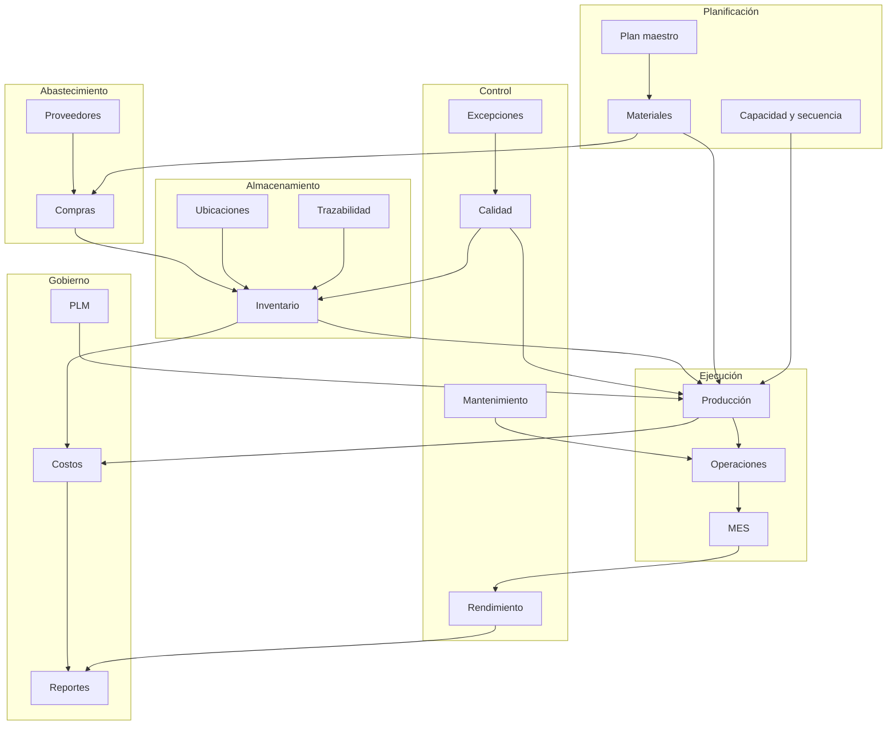

# Sistema de Producción y Abastecimiento

## Especificación funcional completa

**Propósito del documento:** describir, de forma neutral respecto a proveedor, todas las funcionalidades que debe contemplar el sistema de producción y abastecimiento, organizadas por módulo y detalladas función por función.

**Alcance:** compras y abastecimiento, inventario y almacenes, producción, calidad, mantenimiento, gestión del ciclo de vida del producto, captura por códigos de barras, planificación avanzada, ejecución y supervisión de planta (MES), trazabilidad integral, rendimiento y eficiencia, control de procesos y excepciones, integración industrial e IoT, costos industriales y funcionalidades transversales.

**Uso previsto:** definición de alcance, análisis funcional, diseño, estimación, priorización, validación con usuarios y criterios de aceptación.

---

## 0. Convenciones

### 0.1 Niveles de obligatoriedad

| Nivel | Significado |
|-------|-------------|
| **Obligatorio** | Debe estar disponible para que el proceso funcione. |
| **Recomendado** | Aporta valor y cubre operaciones habituales; puede implementarse por fases. |
| **Opcional** | Depende del grado de automatización, regulación o madurez de la empresa. |

### 0.2 Códigos de función

Cada módulo tiene un prefijo y sus funciones se numeran de forma consecutiva:

| Módulo | Prefijo |
|--------|---------|
| Compras y abastecimiento | `ABT` |
| Inventario y almacenes | `INV` |
| Producción | `PRD` |
| Calidad | `CAL` |
| Mantenimiento | `MNT` |
| Gestión del ciclo de vida del producto | `PLM` |
| Captura y códigos de barras | `CAP` |
| Planificación avanzada | `PLA` |
| Ejecución y supervisión de planta (MES) | `MES` |
| Trazabilidad integral | `TRA` |
| Rendimiento y eficiencia | `REN` |
| Control de procesos y excepciones | `EXC` |
| Integración industrial e IoT | `IOT` |
| Costos industriales | `COS` |
| Transversales | `TRV` |

### 0.3 Actores típicos

- **Comprador:** crea solicitudes, compara ofertas y gestiona proveedores.
- **Jefe de compras:** aprueba, negocia acuerdos y controla presupuesto.
- **Almacenista:** recibe, ubica, transfiere y cuenta existencias.
- **Planificador:** elabora el plan maestro, calcula materiales y programa capacidad.
- **Supervisor de producción:** libera y supervisa órdenes.
- **Operario:** ejecuta operaciones, registra cantidades y tiempos.
- **Calidad:** define controles, inspecciona y gestiona no conformidades.
- **Mantenimiento:** gestiona equipos, solicitudes y planes preventivos.
- **Ingeniería:** mantiene listas de materiales, rutas y cambios de producto.
- **Finanzas:** valora inventarios, costos y facturas.
- **Gerencia:** consulta indicadores y aprueba excepciones.

---

## 1. Mapa de módulos

| # | Módulo | Propósito | Prioridad |
|---|--------|-----------|-----------|
| 1 | Compras y abastecimiento | Adquirir materias primas, insumos y servicios en las condiciones correctas | Obligatorio |
| 2 | Inventario y almacenes | Controlar ubicación, movimiento, existencia y valor de los materiales | Obligatorio |
| 3 | Producción | Transformar materiales en productos terminados de forma planificada y controlada | Obligatorio |
| 4 | Calidad | Asegurar que materiales, procesos y productos cumplan los criterios | Recomendado / Obligatorio si hay regulación |
| 5 | Mantenimiento | Mantener equipos disponibles y reducir fallas | Recomendado |
| 6 | Gestión del ciclo de vida del producto | Controlar versiones, cambios de ingeniería y aprobaciones técnicas | Recomendado |
| 7 | Captura y códigos de barras | Registrar operaciones de forma rápida y sin errores | Recomendado |
| 8 | Planificación avanzada | Decidir qué, cuánto, cuándo y en qué recurso producir | Recomendado / Obligatorio si hay restricciones de capacidad |
| 9 | Ejecución y supervisión de planta (MES) | Saber qué está ocurriendo realmente en la planta | Recomendado |
| 10 | Trazabilidad integral | Conocer el origen y destino de cada lote o producto | Obligatorio en industrias reguladas |
| 11 | Rendimiento y eficiencia | Medir disponibilidad, rendimiento, calidad y cumplimiento | Recomendado |
| 12 | Control de procesos y excepciones | Gestionar desviaciones, no conformidades y acciones correctivas | Recomendado / Obligatorio si hay regulación |
| 13 | Integración industrial e IoT | Conectar máquinas, sensores y sistemas de planta | Opcional |
| 14 | Costos industriales | Conocer el costo real y las variaciones de producción | Recomendado |

---

## 2. Arquitectura funcional



**Lectura del flujo:**

1. Compras abastece materiales según las necesidades.
2. Inventario recibe, ubica y controla existencias.
3. Planificación decide qué producir, con qué materiales y en qué recursos.
4. Producción ejecuta y consume materiales.
5. MES registra lo que ocurre en planta.
6. Calidad y mantenimiento protegen la conformidad y disponibilidad.
7. Trazabilidad reconstruye la historia.
8. Costos y reportes consolidan el resultado.

---

# 3. Módulos y funcionalidades

---

## 3.1 Módulo de Compras y Abastecimiento (`ABT`)

### 3.1.1 Objetivo

Gestionar el ciclo completo de abastecimiento, desde la detección de la necesidad hasta la recepción, la facturación y el pago, asegurando precio, plazo, calidad y trazabilidad.

### 3.1.2 Alcance

Incluye materias primas, insumos, repuestos, servicios y compras vinculadas a producción o subcontratación. Cubre proveedores, solicitudes de cotización, órdenes, recepciones, facturas y acuerdos marco.

### 3.1.3 Actores

Comprador, jefe de compras, almacenista, responsable de calidad, finanzas y proveedor.

### 3.1.4 Funcionalidades

**ABT-01. Catálogo de productos comprables**
El sistema debe permitir definir qué productos o servicios pueden comprarse, su unidad de medida, empaque, proveedores admitidos y política de facturación. Cada artículo debe indicar si se controla por cantidad, lote o serie, y si su recepción es obligatoria antes de facturar.

**ABT-02. Condiciones y tarifas de proveedor**
Debe registrar, por proveedor y producto, el precio, la cantidad mínima, el plazo de entrega, la moneda, la vigencia, el descuento y el código o nombre que usa el proveedor. El sistema debe seleccionar automáticamente la condición vigente y prioritaria al crear una solicitud u orden.

**ABT-03. Gestión de proveedores**
Debe permitir alta, modificación e inactivación de proveedores con datos fiscales, contactos, condiciones comerciales, avisos y evaluación de desempeño. La evaluación debe considerar al menos cumplimiento de entrega, calidad, precio y capacidad de respuesta.

**ABT-04. Solicitud de cotización**
Debe permitir crear solicitudes con una o varias líneas, producto, cantidad, fecha requerida, lugar de entrega, condiciones de pago, moneda, impuestos y centro de costo. La solicitud debe poder enviarse a uno o varios proveedores y conservar el historial de comunicaciones.

**ABT-05. Generación automática de necesidades de compra**
El sistema debe generar sugerencias de compra a partir de necesidades de inventario, consumo histórico, órdenes de producción, ventas comprometidas o planes de demanda. Cada sugerencia debe indicar origen, cantidad sugerida, fecha requerida y prioridad.

**ABT-06. Envío y comunicación con proveedores**
Debe permitir enviar solicitudes y órdenes por correo, generar documentos en PDF y habilitar un portal o canal de consulta para el proveedor. Debe registrarse el envío, el acuse de recibo y cualquier respuesta o contraoferta.

**ABT-07. Comparación de ofertas y alternativas**
El sistema debe permitir crear varias solicitudes para la misma necesidad, comparar precios, plazos, condiciones, calidad y desempeño de los proveedores, y seleccionar la mejor combinación por línea o por proveedor. La decisión debe quedar documentada con su justificación.

**ABT-08. Consolidación de solicitudes**
Debe permitir agrupar solicitudes compatibles del mismo proveedor o de la misma necesidad para reducir el número de órdenes y mejorar la negociación.

**ABT-09. Acuerdos marco y plantillas**
Debe permitir definir acuerdos de compra con precios y cantidades comprometidas por un período, así como plantillas reutilizables para pedidos recurrentes. El sistema debe controlar el consumo del acuerdo y alertar cuando se alcance el límite.

**ABT-10. Aprobaciones por importe y nivel**
Debe permitir configurar niveles de aprobación por importe, categoría, centro de costo o proyecto. Toda orden que supere el umbral debe quedar pendiente de aprobación y registrar quién aprobó, cuándo y con qué observaciones.

**ABT-11. Confirmación de la orden**
Al confirmar, el sistema debe generar el compromiso con el proveedor, las recepciones previstas y los movimientos de inventario correspondientes. La orden debe tener un identificador único y un estado verificable.

**ABT-12. Bloqueo y control de cambios**
Debe permitir bloquear órdenes confirmadas para impedir modificaciones no autorizadas. Cualquier cambio posterior debe requerir desbloqueo, motivo y trazabilidad.

**ABT-13. Líneas, impuestos, descuentos y analítica**
Cada línea debe soportar producto, descripción, cantidad, unidad, precio, descuento, impuestos, fecha prevista, centro de costo, proyecto y cuenta analítica. El sistema debe calcular subtotales, impuestos y totales con precisión.

**ABT-14. Recepción y seguimiento**
Debe permitir recepciones totales o parciales, selección de ubicación, registro de lote o serie, control de calidad y generación de pendientes. La recepción debe actualizar el inventario y el estado de la orden.

**ABT-15. Control de cantidades y estados**
El sistema debe mostrar, por orden y por línea, cantidad pedida, recibida, facturada, pendiente de recepción y pendiente de facturación. Los estados deben reflejar la realidad del documento y no solo una marca manual.

**ABT-16. Facturación y conciliación triple**
Debe permitir generar la factura del proveedor y conciliarla con la orden y la recepción. El sistema debe detectar diferencias de cantidad, precio o impuestos y bloquear o alertar según la política definida.

**ABT-17. Devoluciones, cancelaciones y pendientes**
Debe permitir devolver total o parcialmente una recepción, cancelar órdenes con las validaciones correspondientes y gestionar entregas pendientes o saldos abiertos. Toda devolución debe generar el movimiento inverso y el documento de ajuste.

**ABT-18. Recordatorios y seguimiento**
Debe generar recordatorios de recepción, alertas de retraso, actividades de seguimiento y escalamiento. El comprador debe poder consultar qué órdenes están vencidas y qué acciones están pendientes.

**ABT-19. Compras vinculadas a producción y subcontratación**
El sistema debe vincular la compra de componentes a órdenes de producción, kits o servicios de subcontratación. Debe informar qué material falta, para qué orden y con qué fecha límite.

**ABT-20. Intercambio electrónico de documentos**
Debe permitir importar y exportar órdenes, facturas y documentos comerciales en formatos electrónicos estándar, con validación de estructura y registro de errores.

**ABT-21. Reportes y análisis**
Debe ofrecer análisis de gasto por proveedor, producto, categoría, centro de costo y período; evolución de precios; cumplimiento de entrega; ahorro obtenido; órdenes abiertas y retrasos.

**ABT-22. Configuración y parámetros**
Debe permitir configurar políticas de compra, umbrales de aprobación, bloqueo de órdenes, avisos, recordatorios, acuerdos, alternativas, unidades de medida, empaques y permisos.

### 3.1.5 Reglas de negocio del módulo

- No se debe recepcionar una orden no aprobada, salvo excepción autorizada.
- No se debe facturar una cantidad mayor a la recibida cuando la política sea “facturar por recepción”.
- Todo cambio posterior a la confirmación debe quedar auditado.
- Las órdenes bloqueadas no pueden editarse ni cancelarse.
- Los acuerdos marco no pueden exceder la cantidad o el importe comprometido sin autorización.
- Las diferencias de conciliación deben tener responsable y resolución.
- Toda devolución debe afectar inventario y finanzas.

### 3.1.6 Ciclo de vida del documento

```text
Borrador → Solicitada → En aprobación → Aprobada/Confirmada
→ Parcialmente recibida → Recibida → Facturada → Cerrada
                    ↘ Cancelada
```

### 3.1.7 Integraciones

- Inventario: recepciones, devoluciones y existencias.
- Producción: necesidades de componentes y subcontratación.
- Calidad: inspección de recepción.
- Finanzas: facturas, impuestos, pagos y centros de costo.
- Proveedores: portal, correo y documentos electrónicos.

### 3.1.8 Reportes

- Gasto por proveedor, producto y período.
- Órdenes abiertas, retrasadas y pendientes de recepción.
- Cumplimiento de entrega por proveedor.
- Comparación de precios y ahorro.
- Diferencias de conciliación.
- Compras por centro de costo o proyecto.

### 3.1.9 Criterios de aceptación

- Una necesidad puede convertirse en orden y recepción sin reingreso manual.
- El sistema impide facturar por encima de la política configurada.
- Toda orden muestra cantidades pedidas, recibidas y facturadas.
- Las aprobaciones y bloqueos son auditables.
- Los reportes cuadran con los documentos de origen.

---

## 3.2 Módulo de Inventario y Almacenes (`INV`)

### 3.2.1 Objetivo

Controlar la ubicación, disponibilidad, movimiento, trazabilidad y valor de materiales y productos en todo el proceso, desde la recepción hasta la entrega.

### 3.2.2 Alcance

Incluye almacenes, ubicaciones, tipos de operación, rutas, reglas de abastecimiento, recepciones, entregas, transferencias, inventario físico y cíclico, lotes y series, valoración, costos de importación, entrega directa y consignación.

### 3.2.3 Actores

Almacenista, supervisor de almacén, planificador, comprador, calidad, producción y finanzas.

### 3.2.4 Funcionalidades de configuración

**INV-01. Almacén**
El sistema debe permitir definir uno o varios almacenes con su código, dirección, calendario, pasos de recepción y pasos de entrega. Cada almacén debe tener rutas por defecto y reglas de reabastecimiento.

**INV-02. Ubicaciones**
Debe permitir crear una jerarquía de ubicaciones con tipos: internas, virtuales, de proveedor, de cliente, de pérdidas, de producción y de tránsito. Cada ubicación debe tener código, capacidad, estrategia de retiro y, si aplica, frecuencia de inventario.

**INV-03. Tipos de operación**
Debe permitir configurar tipos de operación para recepciones, entregas, transferencias internas, producción y entrega directa. Cada tipo debe definir ubicaciones por defecto, numeración, política de reserva, etiquetas e impresión.

**INV-04. Rutas de abastecimiento**
Debe permitir definir rutas de compra, fabricación, fabricación bajo pedido, entrega directa y reabastecimiento entre almacenes. Las rutas deben poder asignarse a productos, categorías, almacenes o tipos de empaque.

**INV-05. Reglas de abastecimiento**
Debe permitir configurar reglas de extracción, empuje y combinación, con métodos de suministro: tomar de stock, generar otra operación o tomar de stock y generar otra operación si no hay disponibilidad. Cada regla debe tener plazo, origen, destino y tipo de operación.

**INV-06. Reglas de ubicación**
Debe permitir definir dónde almacenar cada producto al recibirlo, considerando producto, categoría, tipo de empaque, capacidad y sububicación.

**INV-07. Categorías de almacenamiento**
Debe permitir definir capacidad máxima por peso, volumen, producto o tipo de paquete, y si se permite mezclar productos en una ubicación.

**INV-08. Tipos de paquete**
Debe permitir definir cajas, palés y contenedores con dimensiones, peso, peso máximo, código y uso previsto. El sistema debe poder calcular el peso y validar la capacidad.

**INV-09. Estrategias de retiro**
Debe permitir seleccionar la existencia a retirar según FIFO, LIFO, FEFO, ubicación más cercana o menor cantidad de paquetes. La estrategia debe poder definirse por ubicación o categoría.

**INV-10. Nomenclaturas de captura**
Debe permitir configurar reglas de interpretación de códigos para producto, peso, ubicación, lote, paquete y contacto, con patrones, prioridades y validaciones.

### 3.2.5 Funcionalidades de operación

**INV-11. Recepciones**
Debe permitir recibir total o parcialmente, seleccionar ubicación, registrar lote o serie, crear paquetes, aplicar reglas de ubicación y generar pendientes. La recepción debe actualizar existencias y estados.

**INV-12. Entregas**
Debe permitir reservar, preparar, empacar y entregar productos, con control de disponibilidad, documentación y trazabilidad. Debe soportar entregas parciales y pendientes.

**INV-13. Transferencias internas**
Debe permitir mover productos entre ubicaciones internas con origen, destino, cantidad, lote, paquete y responsable.

**INV-14. Transferencias agrupadas**
Debe permitir agrupar varias transferencias para prepararlas y ejecutarlas en conjunto, asignar un responsable y controlar su avance.

**INV-15. Reserva y disponibilidad**
Debe permitir reservar existencias al confirmar, antes de la fecha programada o de forma manual. El sistema debe mostrar cantidad física, reservada, disponible y comprometida.

**INV-16. Pendientes y entregas parciales**
Cuando no se atienda toda la cantidad, el sistema debe generar un pendiente con la demanda restante y conservar la trazabilidad con el documento original.

**INV-17. Devoluciones e intercambios**
Debe permitir devolver total o parcialmente una entrega o recepción, generar el movimiento inverso y, si corresponde, crear una nueva entrega de intercambio.

**INV-18. División de transferencias**
Debe permitir separar una transferencia en varias para atender prioridades, clientes o fechas distintas.

**INV-19. Paquetes**
Debe permitir crear paquetes, asignar contenido, mover paquetes completos, anidar contenedores, imprimir etiquetas y consultar su historial.

**INV-20. Operaciones detalladas**
Cada movimiento debe poder registrarse con producto, cantidad, unidad, ubicación de origen y destino, lote o serie, paquete y propietario.

**INV-21. Etiquetas e impresión**
Debe permitir imprimir etiquetas de producto, lote, serie, paquete y ubicación, además de albaranes e informes de recepción. La impresión debe poder automatizarse por tipo de operación.

### 3.2.6 Funcionalidades de existencias y ajustes

**INV-22. Existencias por ubicación**
El sistema debe mostrar la existencia física, reservada y disponible por producto, ubicación, lote, paquete y propietario.

**INV-23. Inventario físico**
Debe permitir contar existencias, ingresar la cantidad contada, calcular la diferencia, aplicar el ajuste y conservar el historial.

**INV-24. Inventario cíclico**
Debe permitir programar conteos periódicos por ubicación, calcular la próxima fecha y asignar la fecha a las existencias. Debe existir un inventario anual de respaldo para ubicaciones sin frecuencia.

**INV-25. Reubicación**
Debe permitir mover existencia de una ubicación a otra sin crear una transferencia formal, registrando el motivo y el responsable.

**INV-26. Desecho**
Debe permitir retirar material dañado, obsoleto o no conforme, indicando producto, cantidad, lote, motivo y si corresponde reponerlo.

**INV-27. Valoración**
Debe permitir valorar el inventario por costo estándar, costo promedio ponderado o FIFO, con posibilidad de valoración por lote. Debe generar los asientos contables correspondientes y permitir ajustes de valoración.

**INV-28. Costos de importación**
Debe permitir incorporar fletes, seguros, aranceles y otros costos al valor de los productos recibidos, con reparto por igual, cantidad, costo actual, peso o volumen.

**INV-29. Entrega directa**
Debe permitir que un proveedor entregue directamente al cliente sin pasar por el almacén, generando la documentación y la trazabilidad correspondientes.

**INV-30. Consignación**
Debe permitir controlar existencias de propiedad de terceros, separarlas de las propias y reportar por propietario.

### 3.2.7 Funcionalidades de trazabilidad

**INV-31. Lotes y números de serie**
Debe permitir identificar productos por lote o número de serie, asignarlos en recepción, transferencia y producción, y consultar su existencia y movimientos.

**INV-32. Fechas de caducidad**
Debe permitir registrar fecha de caducidad, consumo preferente, retirada y alerta, y emitir avisos antes del vencimiento.

**INV-33. FEFO**
Debe permitir retirar primero el lote con fecha de retirada más próxima, cuando la estrategia esté configurada.

**INV-34. Reporte de trazabilidad**
Debe reconstruir la historia de un lote o serie hacia atrás y hacia adelante, mostrando movimientos, documentos, proveedores y clientes.

**INV-35. Referencias documentales**
Debe permitir agrupar movimientos de distintos documentos bajo una referencia común para auditoría y seguimiento.

### 3.2.8 Funcionalidades de reabastecimiento

**INV-36. Puntos de pedido**
Debe permitir definir mínimo, máximo, consumo diario, plazo, ruta y cantidad a pedir por producto y ubicación. El sistema debe calcular la necesidad y generar sugerencias.

**INV-37. Informe de reabastecimiento**
Debe mostrar productos bajo mínimo, cantidad sugerida, origen de la necesidad y acción recomendada (comprar, fabricar o transferir).

**INV-38. Previsión de existencias**
Debe proyectar entradas, salidas y stock futuro por fecha, y alertar sobre faltantes o excesos.

**INV-39. Reabastecimiento entre almacenes**
Debe permitir abastecer un almacén desde otro mediante rutas y transferencias automáticas.

**INV-40. Producción o compra bajo pedido**
Debe permitir que una necesidad concreta dispare una compra o una orden de producción sin tomar stock disponible.

### 3.2.9 Funcionalidades de reportes

**INV-41. Análisis de movimientos**
Debe permitir analizar entradas y salidas por producto, ubicación, fecha, documento, lote y responsable.

**INV-42. Stock por ubicación**
Debe mostrar existencias detalladas con filtros por producto, ubicación, lote, paquete y propietario.

**INV-43. Valoración del inventario**
Debe mostrar el valor por producto, categoría, ubicación y período, y permitir exportar la información contable.

**INV-44. Trazabilidad**
Debe permitir consultar el historial completo de un lote o serie y exportarlo para auditoría.

### 3.2.10 Reglas de negocio del módulo

- Ninguna salida puede dejar stock negativo sin autorización.
- Toda recepción debe tener ubicación de destino válida.
- Los productos trazados deben registrar lote o serie en cada movimiento.
- Las existencias reservadas no pueden asignarse a otra operación.
- Los ajustes de inventario deben tener motivo y responsable.
- La valoración no puede cambiarse sin impacto contable controlado.
- Los vencimientos deben bloquear o priorizar la salida según la política.

### 3.2.11 Integraciones

- Compras: recepciones y devoluciones.
- Producción: consumo de componentes y entrada de terminados.
- Calidad: inspección de recepción, cuarentena y liberación.
- Ventas: reservas, entregas y devoluciones.
- Finanzas: valoración, costos y asientos.
- Captura: códigos de barras y dispositivos.

### 3.2.12 Criterios de aceptación

- Toda entrada y salida genera un movimiento trazable.
- El stock disponible coincide con la existencia física menos la reservada.
- Los lotes y series se pueden rastrear hacia atrás y hacia adelante.
- Los conteos cíclicos generan ajustes auditables.
- La valoración cuadra con contabilidad.
- Las reglas de ubicación y reabastecimiento se ejecutan sin intervención manual.

---

## 3.3 Módulo de Producción (`PRD`)

### 3.3.1 Objetivo

Planificar y ejecutar la transformación de materias primas en productos terminados, controlando materiales, operaciones, tiempos, cantidades, calidad y costos.

### 3.3.2 Alcance

Incluye listas de materiales, rutas, centros de trabajo, órdenes de fabricación, órdenes de trabajo, consumo, producción, subproductos, desensamblado, subcontratación, reparación, costeo y reportes.

### 3.3.3 Actores

Ingeniería, planificador, supervisor de producción, operario, calidad, mantenimiento y finanzas.

### 3.3.4 Funcionalidades de ingeniería de producto

**PRD-01. Lista de materiales normal**
Debe permitir definir los componentes y cantidades necesarios para fabricar un producto, con unidad de medida, merma, operación de consumo, subproductos, plazos y observaciones.

**PRD-02. Lista de materiales tipo kit**
Debe permitir definir productos compuestos que se explotan en componentes sin generar una orden de fabricación propia.

**PRD-03. Lista de materiales multinivel**
Debe permitir que un componente tenga su propia lista de materiales y que el sistema explote la estructura completa, generando órdenes hijas cuando corresponda.

**PRD-04. Componentes y variantes**
Debe permitir definir componentes por variante de producto, componentes opcionales, cantidades variables y componentes asignados a una operación específica.

**PRD-05. Subproductos**
Debe permitir registrar productos adicionales generados en el proceso, con cantidad, unidad, operación y participación en el costo.

**PRD-06. Operaciones y rutas**
Debe permitir definir la secuencia de operaciones, centro de trabajo, duración fija o calculada, tiempo de preparación, tiempo de ciclo, limpieza y costo.

**PRD-07. Dependencias entre operaciones**
Debe permitir indicar qué operación debe terminar antes de iniciar otra, validando ciclos y respetando la secuencia.

**PRD-08. Tamaño de lote y producción continua**
Debe permitir definir el tamaño de lote y, si aplica, desbloquear automáticamente la siguiente operación al registrar producción.

**PRD-09. Plazos y preparación**
Debe permitir definir el plazo de fabricación, los días de preparación y la condición para iniciar: con todos los componentes o con los de la primera operación.

### 3.3.5 Funcionalidades de órdenes de fabricación

**PRD-10. Creación de órdenes**
Debe permitir crear órdenes manualmente o a partir de una necesidad de stock, venta, plan maestro, subensamble o subcontratación.

**PRD-11. Confirmación**
Al confirmar, el sistema debe explotar la lista de materiales, generar la demanda de componentes, crear los movimientos de producto terminado y disparar el abastecimiento.

**PRD-12. Reserva y disponibilidad**
Debe permitir reservar componentes, liberar reservas y mostrar si la orden está lista, esperando material o esperando otra operación.

**PRD-13. Capacidad de producción**
Debe calcular cuánto se puede producir con el stock actual de componentes y mostrar las restricciones.

**PRD-14. Registro de producción**
Debe permitir registrar cantidad producida, lote o serie, subproductos, mermas y movimientos de terminado.

**PRD-15. Consumo y advertencias**
Debe comparar consumo real con teórico, alertar diferencias y permitir su justificación o ajuste según permisos.

**PRD-16. Pendientes y producción parcial**
Debe permitir cerrar una orden con cantidad menor y generar un pendiente con la demanda restante.

**PRD-17. División y fusión de órdenes**
Debe permitir separar o unir órdenes compatibles para ajustar la planificación.

**PRD-18. Bloqueo de cantidades**
Debe permitir bloquear cantidades para impedir cambios durante la ejecución y requerir autorización para modificarlas.

**PRD-19. Desecho**
Debe permitir desechar componentes o producto terminado con motivo, cantidad y responsable.

**PRD-20. Cierre**
Debe permitir finalizar la orden, consolidar consumo y producción, calcular costos y generar el pendiente si corresponde.

**PRD-21. Desensamblado**
Debe permitir descomponer un producto terminado en sus componentes, recuperando stock y trazabilidad.

### 3.3.6 Funcionalidades de operaciones y centros

**PRD-22. Órdenes de trabajo**
Debe permitir crear una orden por operación, asignarla a un centro y a un responsable, y controlar su estado: bloqueada, por hacer, en progreso, hecha o cancelada.

**PRD-23. Centros de trabajo**
Debe permitir definir máquinas, celdas o recursos con calendario, eficiencia, costo por hora, tiempos de preparación y limpieza, capacidad y etiquetas.

**PRD-24. Capacidad por producto**
Debe permitir definir cuántas piezas se procesan por ciclo según producto o unidad, con tiempos de inicio y fin.

**PRD-25. Tiempos y productividad**
Debe registrar inicio, pausa, reanudación y fin de cada operación, con usuario, duración real y duración esperada.

**PRD-26. Pérdidas y eficiencia**
Debe permitir registrar paradas y pérdidas por disponibilidad, rendimiento, calidad o tiempo productivo, y calcular indicadores de eficiencia.

**PRD-27. Dependencias y bloqueos**
Debe permitir bloquear una orden de trabajo hasta que termine su predecesora y desbloquearla automáticamente.

**PRD-28. Centros alternativos**
Debe permitir sustituir un centro por otro cuando haya saturación, mantenimiento o avería.

### 3.3.7 Funcionalidades de planificación

**PRD-29. Fechas y calendario**
Debe permitir programar inicio, fin y fecha límite, visualizar las órdenes en calendario y alertar retrasos.

**PRD-30. Planificación de capacidad**
Debe mostrar la carga por centro, las órdenes listas, en progreso, bloqueadas y retrasadas, y permitir ajustar la programación.

**PRD-31. Necesidades de componentes**
Debe calcular faltantes, fechas esperadas de llegada y acciones de compra o fabricación.

**PRD-32. Reabastecimiento**
Debe generar compras u órdenes de fabricación según puntos de pedido, rutas y prioridades.

### 3.3.8 Funcionalidades de costeo

**PRD-33. Costo de la orden**
Debe calcular el costo de materiales, operaciones, costos adicionales y subproductos, y registrar el valor del producto terminado.

**PRD-34. Costo de operaciones**
Debe valorizar el tiempo real o estimado de cada operación según la tarifa del centro.

**PRD-35. Distribución analítica**
Debe permitir imputar costos a centros de costo, proyectos o cuentas analíticas.

**PRD-36. Producción en proceso (WIP)**
Debe permitir contabilizar el trabajo en curso y consultar su valor por orden o período.

### 3.3.9 Funcionalidades complementarias

**PRD-37. Subcontratación**
Debe permitir delegar total o parcialmente la fabricación, enviar componentes al subcontratista, recibir el producto terminado y controlar costos y trazabilidad.

**PRD-38. Reparación**
Debe permitir crear órdenes de reparación con producto, lote, piezas, servicios, movimientos de stock, facturación y vínculo con producción.

**PRD-39. Compras para producción**
Debe permitir comprar componentes y kits para una orden de fabricación, con vínculo entre necesidad, compra y consumo.

**PRD-40. Reportes de producción**
Debe ofrecer análisis de órdenes, operaciones, eficiencia, pérdidas, estructura de materiales, consumo, producción y cumplimiento.

**PRD-41. Configuración**
Debe permitir activar órdenes de trabajo, subproductos, desbloqueo de cantidades, subcontratación y parámetros de planificación y costeo.

### 3.3.10 Reglas de negocio del módulo

- No se puede producir sin lista de materiales vigente.
- Los componentes deben estar reservados o disponibles antes de iniciar, según la política.
- El consumo real debe justificarse si difiere del teórico.
- El producto terminado debe registrar lote o serie si está trazado.
- Las operaciones deben respetar dependencias y secuencia.
- El cierre debe consolidar costos y movimientos.
- Las órdenes bloqueadas no pueden modificarse sin autorización.

### 3.3.11 Integraciones

- Inventario: componentes, terminados, subproductos y desechos.
- Compras: componentes y subcontratación.
- Calidad: controles en operaciones y producto terminado.
- Mantenimiento: disponibilidad de centros y equipos.
- PLM: versiones de listas de materiales y rutas.
- Costos y finanzas: valoración y asientos.

### 3.3.12 Criterios de aceptación

- Una orden de fabricación consume y produce exactamente lo registrado.
- La trazabilidad de componentes y terminado es completa.
- Los tiempos y paradas se registran por operación.
- El costo de la orden cuadra con materiales, operaciones y costos adicionales.
- La planificación muestra carga y disponibilidad.
- Los pendientes conservan la demanda original.

---

## 3.4 Módulo de Calidad (`CAL`)

### 3.4.1 Objetivo

Asegurar que materiales, procesos y productos cumplan criterios definidos, detectando desviaciones y gestionando acciones correctivas.

### 3.4.2 Alcance

Incluye puntos de control, inspecciones, criterios de aceptación, controles en recepción, producción y entrega, alertas, no conformidades, causas y acciones correctivas.

### 3.4.3 Actores

Responsable de calidad, inspector, supervisor de producción, almacén, compras y dirección técnica.

### 3.4.4 Funcionalidades

**CAL-01. Puntos de control**
Debe permitir definir qué producto, operación o tipo de movimiento debe inspeccionarse, con qué frecuencia, por qué equipo y con qué instrucciones.

**CAL-02. Tipos de control**
Debe permitir controles de instrucciones, aprobado/rechazado, medición numérica y formularios o hojas de trabajo.

**CAL-03. Criterios de aceptación**
Debe permitir definir valores mínimos, máximos, tolerancias, unidades y valores predefinidos para aprobar o rechazar.

**CAL-04. Controles en recepción**
Debe generar controles al recibir mercancía, permitir aprobar, rechazar o medir, y bloquear el ingreso si el resultado no es conforme.

**CAL-05. Controles en entrega y transferencia**
Debe permitir verificar producto, cantidad, empaque, etiquetado o documentación antes de la salida.

**CAL-06. Controles en producción**
Debe permitir controles por operación, primera pieza, proceso o producto final, bloqueando la operación hasta el resultado.

**CAL-07. Hojas de trabajo**
Debe permitir formularios configurables con secciones, campos, firmas, fotos y documentos adjuntos.

**CAL-08. Ejecución de controles**
Debe mostrar los controles pendientes, las instrucciones, el formulario, el responsable y la evidencia.

**CAL-09. Resultado y bloqueo**
Debe registrar aprobado, rechazado o fuera de tolerancia, y bloquear la operación, lote o documento cuando corresponda.

**CAL-10. Alertas de calidad**
Debe permitir crear alertas por no conformidad con producto, lote, cantidad, origen, prioridad, causa y acción.

**CAL-11. Etapas de alerta**
Debe permitir configurar un flujo de etapas, responsables, transiciones y fechas para gestionar la alerta.

**CAL-12. Equipos de calidad**
Debe permitir definir equipos, miembros, responsables y asignación de puntos de control y alertas.

**CAL-13. Causa raíz y acciones**
Debe permitir documentar el análisis de causa, la acción inmediata, la acción correctiva, la acción preventiva y la verificación de eficacia.

**CAL-14. Trazabilidad de la inspección**
Debe vincular cada control con producto, lote, orden, operación, responsable, fecha y evidencia.

**CAL-15. Reportes**
Debe ofrecer controles por producto, tasa de aprobación y rechazo, alertas por etapa, defectos por causa y evolución temporal.

**CAL-16. Configuración**
Debe permitir activar el módulo, definir equipos, etapas, puntos de control, tipos de control y criterios.

**CAL-17. Integraciones**
Debe integrarse con inventario, producción, mantenimiento, documentos y captura por escáner.

**CAL-18. Gestión documental**
Debe permitir adjuntar especificaciones, planos, certificados y evidencias a controles, alertas y lotes.

### 3.4.5 Reglas de negocio del módulo

- Un control obligatorio no puede omitirse.
- Un resultado rechazado debe bloquear o generar alerta.
- Toda alerta debe tener responsable y estado.
- Las acciones correctivas deben verificarse antes de cerrar.
- La evidencia debe conservarse y ser auditable.
- Los criterios de aceptación deben estar aprobados y versionados.

### 3.4.6 Integraciones

- Compras e inventario: recepción y cuarentena.
- Producción: operaciones y producto terminado.
- Mantenimiento: equipos y fallas.
- Trazabilidad: lote, serie y documento.
- Documentos: especificaciones y certificados.

### 3.4.7 Criterios de aceptación

- Todo punto de control genera el control correspondiente.
- El sistema impide avanzar con material no conforme.
- Las alertas conservan historial y evidencia.
- Los reportes permiten identificar proveedores o procesos problemáticos.
- Las acciones correctivas se pueden verificar y cerrar.

---

## 3.5 Módulo de Mantenimiento (`MNT`)

### 3.5.1 Objetivo

Gestionar equipos y maquinaria, prevenir fallas y asegurar la disponibilidad de los recursos productivos.

### 3.5.2 Alcance

Incluye equipos, categorías, equipos de mantenimiento, solicitudes correctivas y preventivas, recurrencia, programación, repuestos, indicadores de fiabilidad y reparaciones.

### 3.5.3 Actores

Responsable de mantenimiento, técnico, supervisor de producción, operario y compras.

### 3.5.4 Funcionalidades

**MNT-01. Ficha de equipo**
Debe permitir registrar nombre, categoría, propietario, responsable, proveedor, modelo, número de serie, costo, garantía, fecha de asignación, fecha de baja, ubicación y observaciones.

**MNT-02. Categorías de equipo**
Debe permitir agrupar equipos, definir responsable por defecto y propiedades personalizadas.

**MNT-03. Equipos de mantenimiento**
Debe permitir definir equipos de trabajo, miembros, correo de recepción de solicitudes y carga de trabajo.

**MNT-04. Etapas**
Debe permitir configurar un flujo visual de etapas para las solicitudes.

**MNT-05. Solicitudes**
Debe permitir crear solicitudes con equipo obligatorio, tipo, prioridad, responsable, fecha, descripción, instrucciones y propiedades.

**MNT-06. Mantenimiento correctivo**
Debe permitir registrar fallas no planificadas, diagnosticar, reparar, documentar y cerrar.

**MNT-07. Mantenimiento preventivo**
Debe permitir planificar trabajos periódicos, asignar recursos y registrar su ejecución.

**MNT-08. Recurrencia**
Debe permitir definir intervalos en días, semanas, meses o años, con duración indefinida o hasta una fecha, generando la siguiente solicitud.

**MNT-09. Programación**
Debe permitir definir fecha y hora planificada, fin previsto, duración y fecha real de cierre, con vista de calendario.

**MNT-10. Tablero visual**
Debe permitir gestionar solicitudes por etapa, prioridad, responsable y equipo mediante un tablero.

**MNT-11. Prioridad y asignación**
Debe permitir priorizar y asignar técnicos, equipos y responsables.

**MNT-12. Instrucciones y notas**
Debe permitir documentar instrucciones de trabajo, observaciones y adjuntos.

**MNT-13. Cierre, cancelación y reapertura**
Debe permitir cerrar, cancelar y reabrir solicitudes, conservando el historial y deteniendo o reactivando la recurrencia.

**MNT-14. MTBF y MTTR**
Debe calcular tiempo medio entre fallas, tiempo medio de reparación, última falla y próximo fallo estimado.

**MNT-15. Asignación y ubicación**
Debe permitir indicar quién usa el equipo y dónde está ubicado, incluyendo equipos por ubicación.

**MNT-16. Garantía y costo**
Debe registrar costo, proveedor, vencimiento de garantía y fecha de baja.

**MNT-17. Propiedades personalizadas**
Debe permitir definir campos adicionales por categoría de equipo y por solicitud.

**MNT-18. Dashboard**
Debe mostrar solicitudes pendientes, programadas, prioritarias, con cambios solicitados y sin programar.

**MNT-19. Reportes**
Debe analizar solicitudes por equipo, técnico, etapa, tipo y período.

**MNT-20. Integración con inventario**
Debe vincular equipos con ubicaciones, lotes y números de serie, y permitir consultar equipos por ubicación.

**MNT-21. Integración con reparaciones**
Debe permitir crear órdenes de reparación con piezas, servicios, movimientos de stock y facturación.

**MNT-22. Configuración**
Debe permitir configurar equipos, categorías, etapas, alias de correo y permisos.

**MNT-23. Gestión de repuestos**
Debe permitir consultar y reservar repuestos del inventario para una solicitud o reparación, dejando trazabilidad del consumo.

### 3.5.5 Reglas de negocio del módulo

- Toda solicitud debe tener equipo y responsable.
- Una solicitud cerrada no puede modificarse sin reapertura.
- La recurrencia debe generar la siguiente solicitud al cerrar.
- El cierre debe registrar fecha real y observaciones.
- Los repuestos consumidos deben afectar inventario.
- Las fallas deben alimentar los indicadores de fiabilidad.

### 3.5.6 Integraciones

- Inventario: repuestos, lotes y ubicaciones.
- Producción: disponibilidad de centros y equipos.
- Compras: repuestos y servicios.
- Finanzas: costos de mantenimiento.
- Calidad: fallas y acciones correctivas.

### 3.5.7 Criterios de aceptación

- Todo equipo tiene historial de mantenimiento.
- Las solicitudes preventivas se generan según el plan.
- MTBF y MTTR se calculan con fechas reales.
- Los repuestos consumidos quedan trazados.
- El tablero muestra la carga real del equipo de mantenimiento.

---

## 3.6 Módulo de Gestión del Ciclo de Vida del Producto (`PLM`)

### 3.6.1 Objetivo

Controlar cambios de ingeniería, versiones de listas de materiales y aprobaciones técnicas antes de llevar un cambio a producción.

### 3.6.2 Alcance

Incluye órdenes de cambio, tipos, etapas, aprobaciones, versiones de listas de materiales, cambios de componentes y operaciones, fechas de efectividad, archivo histórico, análisis de impacto y gestión documental.

### 3.6.3 Actores

Ingeniería, calidad, producción, compras, dirección técnica y documentación.

### 3.6.4 Funcionalidades

**PLM-01. Orden de cambio de ingeniería**
Debe permitir crear un documento de cambio con tipo, producto, lista de materiales, etapa, responsable, prioridad, motivo, alcance y fechas.

**PLM-02. Tipos de cambio**
Debe permitir clasificar los cambios (producto, materiales, operaciones, documentación) y aplicar reglas distintas según el tipo.

**PLM-03. Etapas del cambio**
Debe permitir configurar un flujo de etapas, responsables y criterios de avance.

**PLM-04. Aprobaciones**
Debe permitir aprobar o rechazar un cambio, registrar usuario, fecha y comentarios, y exigir aprobación antes de aplicar.

**PLM-05. Versiones de lista de materiales**
Debe permitir crear una nueva versión al aplicar el cambio, conservando la anterior y asociándola al documento de cambio.

**PLM-06. Revisiones**
Debe mantener el historial de revisiones con fecha, responsable y cambios realizados.

**PLM-07. Cambios en componentes**
Debe permitir agregar, quitar o modificar componentes, cantidades, unidades, variantes y subproductos.

**PLM-08. Cambios en operaciones**
Debe permitir agregar, quitar o modificar operaciones, centros, tiempos, dependencias e instrucciones.

**PLM-09. Fechas de efectividad**
Debe permitir definir desde y hasta cuándo aplica una versión, y seleccionar la versión vigente según la fecha de producción.

**PLM-10. Archivo de versiones**
Debe conservar versiones anteriores, permitir consultarlas y reactivarlas de forma controlada.

**PLM-11. Análisis de impacto**
Debe identificar listas de materiales, órdenes y productos afectados, y estimar el impacto del cambio.

**PLM-12. Gestión documental**
Debe permitir adjuntar planos, especificaciones, certificados y evidencias, con control de versiones y acceso.

**PLM-13. Trazabilidad y auditoría**
Debe registrar quién creó, revisó, aprobó y aplicó cada cambio, con fecha y versión resultante.

**PLM-14. Reportes**
Debe analizar cambios por etapa, tipo, responsable, producto y tiempo de ciclo.

**PLM-15. Configuración**
Debe permitir configurar tipos, etapas, secuencias, permisos y reglas de efectividad.

**PLM-16. Integración con producción y compras**
Debe asegurar que producción y compras usen la versión vigente y alertar si una orden abierta queda afectada por un cambio.

### 3.6.5 Reglas de negocio del módulo

- Ningún cambio se aplica sin aprobación.
- Toda versión debe tener fecha de efectividad.
- Una orden de producción no puede usar una versión no vigente sin autorización.
- Las versiones anteriores no se eliminan.
- Todo cambio debe tener motivo y responsable.
- El impacto debe evaluarse antes de aplicar.

### 3.6.6 Integraciones

- Producción: listas de materiales y rutas.
- Compras: componentes y versiones.
- Calidad: cambios que afectan especificaciones.
- Documentos: planos y certificados.
- Costos: impacto del cambio en el costo.

### 3.6.7 Criterios de aceptación

- Cada cambio tiene flujo, aprobación y auditoría.
- La versión vigente se selecciona correctamente por fecha.
- Las órdenes abiertas se identifican ante un cambio.
- El historial permite reconstruir cualquier versión.
- Producción y compras usan la misma versión.

---

## 3.7 Módulo de Captura y Códigos de Barras (`CAP`)

### 3.7.1 Objetivo

Registrar operaciones de almacén y producción mediante escáner, reduciendo errores y tiempos de digitación.

### 3.7.2 Alcance

Incluye nomenclaturas, reglas, códigos de producto, ubicación, lote, paquete y contacto, estándar GS1, recepciones, transferencias, entregas, conteos, fabricación y etiquetas.

### 3.7.3 Actores

Almacenista, operario, supervisor, calidad y logística.

### 3.7.4 Funcionalidades

**CAP-01. Nomenclatura**
Debe permitir definir conjuntos de reglas para interpretar códigos, con conversión de formatos y asignación por compañía o planta.

**CAP-02. Reglas**
Debe permitir definir nombre, prioridad, formato, tipo, patrón y alias de cada regla.

**CAP-03. Tipos de código**
Debe soportar producto, peso, ubicación, lote, serie, paquete y contacto; y tipos GS1 como cantidad, fecha, ubicación destino y tipo de paquete.

**CAP-04. Interpretación**
Debe convertir el código en tipo, valor, código base y formato, e informar error si no coincide con ninguna regla.

**CAP-05. GS1**
Debe interpretar GS1-128, separadores, identificadores de aplicación, fechas, medidas y identificadores únicos.

**CAP-06. Código de producto**
Debe permitir asignar y buscar productos por código, validando formato y unicidad.

**CAP-07. Código de ubicación**
Debe permitir asignar y buscar ubicaciones por código único.

**CAP-08. Código de lote o serie**
Debe permitir identificar y buscar lotes y números de serie.

**CAP-09. Código de paquete**
Debe permitir identificar paquetes y validar el formato SSCC.

**CAP-10. Código de contacto**
Debe permitir identificar proveedores y clientes por código.

**CAP-11. Validación de formatos**
Debe validar EAN, GTIN, SSCC y dígito de control.

**CAP-12. Recepción por escáner**
Debe permitir seleccionar la recepción, escanear producto, cantidad, lote y ubicación, y validar.

**CAP-13. Transferencias por escáner**
Debe permitir escanear origen, destino, producto, lote y paquete, y validar el movimiento.

**CAP-14. Entregas y preparación por escáner**
Debe permitir preparar pedidos, escanear producto y paquete, confirmar cantidades y validar.

**CAP-15. Conteo por escáner**
Debe permitir escanear ubicación y producto, ingresar cantidad contada y aplicar el ajuste.

**CAP-16. Paquetes por escáner**
Debe permitir crear, asignar, mover, anidar e imprimir paquetes.

**CAP-17. Lotes y series por escáner**
Debe permitir escanear o crear lotes y series durante la operación.

**CAP-18. Fabricación por escáner**
Debe permitir seleccionar la orden, escanear componentes, registrar consumo y producción, y cerrar la operación.

**CAP-19. Etiquetas**
Debe permitir imprimir etiquetas de producto, lote, serie, paquete y ubicación, con formatos configurables.

**CAP-20. Configuración**
Debe permitir configurar nomenclaturas, reglas, GS1, operaciones, impresión y dispositivos.

### 3.7.5 Reglas de negocio del módulo

- Un código desconocido debe generar un error controlado.
- Las reglas se evalúan por prioridad.
- Los códigos deben ser únicos según el tipo.
- La captura debe respetar las validaciones de la operación.
- Toda operación debe quedar asociada a un usuario y fecha.

### 3.7.6 Integraciones

- Inventario: recepciones, entregas, transferencias y conteos.
- Producción: consumo y producción.
- Calidad: controles en línea.
- Compras: recepción de proveedores.
- Dispositivos: lectores, impresoras y básculas.

### 3.7.7 Criterios de aceptación

- El escaneo identifica correctamente producto, ubicación, lote y paquete.
- Las operaciones se validan sin digitación manual.
- Los errores de código se informan y no afectan el stock.
- Las etiquetas impresas son legibles y consistentes.
- La trazabilidad de la operación queda registrada.

---

## 3.8 Módulo de Planificación Avanzada (`PLA`)

### 3.8.1 Objetivo

Decidir qué producir, cuánto, cuándo, con qué materiales y en qué máquina o centro de trabajo, distinguiendo el cálculo de materiales de la programación de capacidad y recursos.

### 3.8.2 Alcance

Incluye plan maestro, cálculo de necesidades de materiales, capacidad finita, secuenciación, simulación de escenarios, replanificación, cuellos de botella, fechas de entrega y gobierno del plan.

### 3.8.3 Actores

Planificador, jefe de producción, compras, ventas, dirección y supervisores de planta.

### 3.8.4 Funcionalidades

**PLA-01. Plan maestro de producción (MPS)**
Debe permitir construir un plan de producción a partir de la previsión de demanda, pedidos confirmados y stock objetivo, con horizontes y períodos configurables. El plan debe generar sugerencias de fabricación y compra, y permitir su aprobación y versionado.

**PLA-02. Planificación de necesidades de materiales (MRP)**
Debe calcular las necesidades netas de materiales a partir de la explosión de listas de materiales, el stock disponible, las recepciones previstas, el stock de seguridad y los plazos. Debe mostrar el origen de cada necesidad y su vínculo con la orden que la genera.

**PLA-03. Separación entre materiales y capacidad**
El sistema debe calcular primero las necesidades de materiales y después programar la capacidad. Ambos resultados deben poder compararse y reconciliarse, informando si el plan es viable en materiales, en capacidad o en ambos.

**PLA-04. Capacidad finita por máquina y centro de trabajo**
Debe permitir programar órdenes considerando calendarios, turnos, eficiencia, tiempos de preparación, capacidad por producto y disponibilidad de centros alternativos. La programación debe respetar la capacidad finita y alertar cuando no sea posible.

**PLA-05. Secuenciación y priorización de órdenes**
Debe permitir ordenar las operaciones según prioridad, fecha de entrega, dependencia, minimización de preparación, restricciones de máquina y reglas configurables. El planificador debe poder bloquear una secuencia y evitar su reprogramación automática.

**PLA-06. Simulación de escenarios**
Debe permitir crear escenarios con cambios de demanda, capacidad, turnos, retrasos o disponibilidad de materiales, comparar sus indicadores y guardar la versión elegida sin afectar el plan vigente.

**PLA-07. Replanificación ante retrasos**
Ante un retraso de material, una avería o una orden prioritaria, el sistema debe recalcular el plan, propagar el impacto a las órdenes afectadas, proponer alternativas y alertar a los responsables.

**PLA-08. Identificación de cuellos de botella**
Debe comparar carga contra capacidad por centro y período, identificar recursos saturados, colas y órdenes retrasadas, y señalar el recurso que limita el plan.

**PLA-09. Fechas de entrega y compromiso**
Debe calcular fechas de entrega realistas a partir de materiales y capacidad, y ofrecer mecanismos de disponible para prometer (ATP) y capaz para prometer (CTP).

**PLA-10. Gestión de excepciones de plan**
Debe detectar y gestionar sobrecargas, faltantes de material, órdenes retrasadas, recursos no disponibles y conflictos de prioridad, con acciones sugeridas y responsables.

**PLA-11. Colaboración y aprobación del plan**
Debe permitir revisar, comentar y aprobar el plan, con versiones, responsables y períodos congelados para evitar cambios no coordinados.

**PLA-12. Indicadores de planificación**
Debe medir cumplimiento del plan, utilización de capacidad, backlog, trabajo en curso, nivel de servicio y estabilidad del plan.

**PLA-13. Integración con compras, producción, mantenimiento y ventas**
El plan debe generar necesidades de compra, órdenes de producción, reservas de capacidad y avisos a mantenimiento, y considerar la disponibilidad de recursos.

**PLA-14. Configuración y gobierno**
Debe permitir configurar calendarios, turnos, horizontes, reglas de prioridad, períodos congelados, permisos y auditoría de cambios.

### 3.8.5 Reglas de negocio del módulo

- No se puede prometer una fecha sin validar materiales y capacidad.
- Un cambio de prioridad debe recalcular el impacto y notificar a los afectados.
- Las órdenes dentro del período congelado no se reprograman sin autorización.
- Toda simulación debe conservar su versión y supuestos.
- El plan aprobado es la referencia para compras y producción.
- Las excepciones deben tener responsable y fecha de resolución.

### 3.8.6 Integraciones

- Compras: necesidades y fechas de material.
- Producción: órdenes y capacidad.
- Mantenimiento: disponibilidad de máquinas.
- Ventas: pedidos, fechas y ATP/CTP.
- Inventario: stock, recepciones y reservas.
- Costos: impacto de escenarios y utilización.

### 3.8.7 Reportes

- Plan maestro por período y familia.
- Necesidades de materiales y faltantes.
- Carga versus capacidad por centro.
- Órdenes retrasadas y cuellos de botella.
- Cumplimiento y estabilidad del plan.
- Escenarios comparados.

### 3.8.8 Criterios de aceptación

- El plan distingue claramente materiales de capacidad.
- La capacidad finita se respeta o se informa el conflicto.
- Las fechas prometidas son viables.
- Los escenarios se comparan con indicadores consistentes.
- La replanificación propaga el impacto.
- El plan aprobado es auditable y estable.

---

## 3.9 Módulo de Ejecución y Supervisión de Planta — MES (`MES`)

### 3.9.1 Objetivo

Conocer y controlar qué está ocurriendo realmente en la planta: órdenes liberadas, operaciones en curso, cantidades, tiempos, paradas, calidad y trabajo en curso.

### 3.9.2 Alcance

Incluye liberación y asignación de órdenes, ejecución de operaciones, captura de cantidades y tiempos, paradas, instrucciones digitales, WIP, turnos, alertas y tableros de planta.

### 3.9.3 Actores

Supervisor de producción, operario, planificador, calidad, mantenimiento y gerencia.

### 3.9.4 Funcionalidades

**MES-01. Liberación de órdenes de trabajo**
Debe permitir liberar órdenes a la planta una vez validadas las condiciones de material, capacidad y documentación.

**MES-02. Asignación de recursos y operarios**
Debe permitir asignar órdenes a máquinas, centros y operarios, considerando disponibilidad, habilidades y carga.

**MES-03. Inicio, pausa, reanudación y finalización**
Debe registrar el ciclo de vida de cada operación con fecha, hora, usuario y motivo de pausa.

**MES-04. Captura de cantidades producidas, rechazadas y pendientes**
Debe permitir registrar cantidad producida, cantidad rechazada con motivo y cantidad pendiente, manteniendo la relación con la orden.

**MES-05. Registro de tiempos reales**
Debe registrar tiempo de preparación, ciclo, espera, pausa y limpieza, comparándolos con los tiempos estándar.

**MES-06. Registro de paradas y causas**
Debe permitir registrar paradas por disponibilidad, rendimiento, calidad u otra causa, con inicio, fin, duración y responsable.

**MES-07. Instrucciones de trabajo digitales**
Debe mostrar al operario instrucciones, especificaciones, planos y listas de verificación asociadas a la operación.

**MES-08. Confirmación de operaciones y consumo**
Debe permitir confirmar el consumo de materiales, la producción y el avance de la operación, actualizando inventario y trazabilidad.

**MES-09. Seguimiento del trabajo en curso (WIP)**
Debe mostrar órdenes en curso, cantidad producida, cantidad pendiente, ubicación y valor del trabajo en proceso.

**MES-10. Trazabilidad operario-máquina-orden**
Debe vincular cada registro con la orden, operación, operario, máquina, turno y lote.

**MES-11. Turnos y relevos**
Debe permitir gestionar turnos, relevos, traspaso de trabajo y continuidad de la operación.

**MES-12. Alertas y gestión visual**
Debe mostrar alertas de retraso, parada, falta de material, calidad o saturación, con escalamiento y confirmación.

**MES-13. Calidad en línea**
Debe permitir ejecutar controles de calidad durante la operación y bloquear el avance si el resultado no es conforme.

**MES-14. Integración con dispositivos**
Debe permitir capturar datos de básculas, lectores, sensores y terminales de planta cuando estén disponibles.

**MES-15. Tableros de planta**
Debe ofrecer tableros de avance, carga, eficiencia, paradas, calidad y WIP por centro, turno y orden.

**MES-16. Cierre y pendientes**
Debe permitir cerrar operaciones y órdenes, generar pendientes y consolidar la información para costos y trazabilidad.

### 3.9.5 Reglas de negocio del módulo

- No se puede iniciar una operación sin orden liberada y materiales disponibles.
- Toda pausa o parada debe tener causa.
- La cantidad rechazada debe ser menor o igual a la producida.
- El cierre debe consolidar tiempos, cantidades y consumo.
- Los registros no pueden modificarse sin auditoría.
- El operario solo puede ejecutar operaciones asignadas o autorizadas.

### 3.9.6 Integraciones

- Planificación: órdenes y secuencia.
- Producción: listas de materiales, rutas y costos.
- Inventario: consumo y producción.
- Calidad: controles y bloqueos.
- Mantenimiento: paradas y averías.
- Costos: tiempos, consumo y WIP.

### 3.9.7 Reportes

- Avance de órdenes y operaciones.
- Producción por turno, operario, máquina y producto.
- Tiempos reales versus estándar.
- Paradas y causas.
- WIP por orden y centro.
- Cumplimiento del plan.

### 3.9.8 Criterios de aceptación

- La planta registra inicio, pausa y fin de cada operación.
- Las cantidades producidas y rechazadas son consistentes.
- Las paradas tienen causa y duración.
- El WIP se puede consultar por orden.
- Los tableros reflejan datos reales, no carga manual.
- El cierre actualiza inventario y costos.

---

## 3.10 Módulo de Trazabilidad Integral (`TRA`)

### 3.10.1 Objetivo

Conocer el origen, transformación y destino de materias primas, lotes y productos terminados, y permitir investigaciones y retiros rápidos.

### 3.10.2 Alcance

Incluye identificación, genealogía, relación con órdenes y recursos, trazabilidad hacia atrás y adelante, consumos, defectos, reprocesos, cuarentena, retiro y expediente de lote.

### 3.10.3 Actores

Calidad, producción, almacén, logística, auditoría y dirección.

### 3.10.4 Funcionalidades

**TRA-01. Identificación única**
Debe asignar identificadores únicos a lotes, series, paquetes y órdenes, y conservarlos en todos los movimientos.

**TRA-02. Genealogía de materias primas**
Debe registrar qué proveedor, lote, recepción y control de calidad originaron cada material consumido.

**TRA-03. Genealogía de producto terminado**
Debe registrar qué materiales, operaciones, máquinas, operarios y controles intervinieron en cada lote o unidad producida.

**TRA-04. Relación orden-operación-operario-máquina**
Debe vincular cada operación con la orden, el operario, la máquina, el turno y el tiempo real.

**TRA-05. Trazabilidad hacia atrás**
Dado un producto o lote, debe reconstruir sus componentes, proveedores, recepciones y controles.

**TRA-06. Trazabilidad hacia adelante**
Dado un lote o material, debe identificar a qué productos, clientes o entregas fue destinado.

**TRA-07. Historial de consumos**
Debe conservar consumo real, teórico, mermas y ajustes por orden y lote.

**TRA-08. Historial de defectos**
Debe vincular no conformidades, rechazos y alertas con el lote, la orden y el proceso.

**TRA-09. Historial de reprocesos**
Debe registrar reprocesos, reparaciones y desensamblados, con motivo, responsable y resultado.

**TRA-10. Cuarentena**
Debe permitir bloquear y ubicar lotes en cuarentena, impedir su uso y registrar la decisión de liberación o rechazo.

**TRA-11. Retiro de producto (recall)**
Debe permitir iniciar un retiro, identificar el alcance, notificar a los afectados, registrar devoluciones y medir la efectividad.

**TRA-12. Notificaciones y comunicación**
Debe generar avisos a calidad, producción, logística y clientes según el evento y el nivel de criticidad.

**TRA-13. Expediente de lote**
Debe consolidar en una vista única toda la información del lote: origen, materiales, proceso, controles, movimientos, defectos y destino.

**TRA-14. Reportes y auditoría**
Debe ofrecer reportes de trazabilidad, genealogía, consumos, retiros y evidencia para auditoría.

**TRA-15. Retención y archivo**
Debe conservar la información durante el período definido por la política y permitir su consulta posterior.

### 3.10.5 Reglas de negocio del módulo

- Todo producto trazado debe tener lote o serie en cada movimiento.
- Un lote en cuarentena no puede consumirse ni entregarse.
- Un retiro debe identificar todo el alcance afectado.
- Los registros de trazabilidad no se eliminan.
- Toda excepción debe quedar vinculada al lote.
- La información debe ser accesible para auditoría.

### 3.10.6 Integraciones

- Compras: origen y proveedor.
- Inventario: movimientos y existencias.
- Producción: consumo, operaciones y producción.
- Calidad: controles, defectos y cuarentena.
- Logística: entregas y clientes.
- Costos: valor del lote.

### 3.10.7 Reportes

- Genealogía de lote o serie.
- Trazabilidad hacia atrás y adelante.
- Consumos por orden y lote.
- Defectos y reprocesos por lote.
- Lotes en cuarentena.
- Alcance y efectividad de retiros.

### 3.10.8 Criterios de aceptación

- Cualquier lote puede rastrearse hasta su origen y destino.
- La cuarentena bloquea el uso.
- Un retiro identifica todos los productos afectados.
- El expediente de lote está completo y es auditable.
- Los reportes coinciden con los movimientos reales.

---

## 3.11 Módulo de Rendimiento y Eficiencia Operacional (`REN`)

### 3.11.1 Objetivo

Medir el desempeño real de la planta y detectar oportunidades de mejora con definiciones consistentes.

### 3.11.2 Alcance

Incluye OEE, disponibilidad, rendimiento, calidad, tiempos de ciclo y preparación, FPY, desperdicio, reproceso, cumplimiento del plan y análisis de paradas.

### 3.11.3 Actores

Gerencia de planta, supervisores, ingeniería de procesos, mantenimiento y calidad.

### 3.11.4 Funcionalidades

**REN-01. OEE**
Debe calcular la efectividad global de los equipos como disponibilidad × rendimiento × calidad, con fórmulas documentadas y datos reales.

**REN-02. Disponibilidad**
Debe medir tiempo productivo sobre tiempo planificado, descontando paradas y esperas.

**REN-03. Rendimiento**
Debe comparar producción real con producción teórica según velocidad estándar y tiempo efectivo.

**REN-04. Calidad**
Debe medir unidades conformes sobre unidades producidas, integrando rechazos y reprocesos.

**REN-05. Tiempo de ciclo**
Debe medir tiempo real por unidad o lote y compararlo con el estándar.

**REN-06. Tiempo de preparación (setup)**
Debe registrar y analizar tiempos de preparación, cambios de producto y limpieza.

**REN-07. Rendimiento de primera pasada (FPY)**
Debe calcular unidades conformes a la primera sobre unidades iniciadas, sin reproceso.

**REN-08. Tasa de desperdicio**
Debe medir desperdicio por producto, proceso, turno y causa.

**REN-09. Tasa de reproceso**
Debe medir unidades reprocesadas y su impacto en tiempo y costo.

**REN-10. Cumplimiento del plan**
Debe comparar producción real con planificada por período, producto y centro.

**REN-11. Análisis de paradas**
Debe clasificar paradas por causa, duración, frecuencia y responsabilidad.

**REN-12. Tableros y benchmarks**
Debe ofrecer tableros por planta, centro, turno, producto y período, y comparar contra objetivos.

### 3.11.5 Reglas de negocio del módulo

- Las fórmulas deben estar documentadas y ser consistentes.
- Los datos deben provenir de registros reales, no de carga manual agregada.
- Los indicadores deben poder auditarse hasta el registro fuente.
- Las paradas deben tener causa clasificada.
- Los objetivos deben ser versionados.

### 3.11.6 Integraciones

- MES: tiempos, cantidades y paradas.
- Calidad: conformidad y rechazos.
- Producción: órdenes y estándares.
- Mantenimiento: disponibilidad y fallas.
- Costos: impacto de pérdidas.

### 3.11.7 Reportes

- OEE por centro y período.
- Disponibilidad, rendimiento y calidad.
- FPY y reproceso.
- Desperdicio por causa.
- Cumplimiento del plan.
- Pareto de paradas.

### 3.11.8 Criterios de aceptación

- El OEE se calcula con la fórmula acordada.
- Los indicadores son trazables a datos reales.
- Las paradas se clasifican y analizan.
- Los tableros permiten comparar períodos.
- Las metas y definiciones están documentadas.

---

## 3.12 Módulo de Control de Procesos y Gestión de Excepciones (`EXC`)

### 3.12.1 Objetivo

Detectar, documentar y resolver desviaciones, no conformidades y excepciones del proceso, evitando que se repitan.

### 3.12.2 Alcance

Incluye no conformidades, desviaciones de receta o parámetros, tolerancias, bloqueos, reprocesos, desperdicio, causa raíz, acciones correctivas y flujos de aprobación.

### 3.12.3 Actores

Calidad, producción, ingeniería, mantenimiento, dirección y auditoría.

### 3.12.4 Funcionalidades

**EXC-01. No conformidades**
Debe permitir registrar una no conformidad con producto, lote, cantidad, proceso, origen, evidencia y responsable.

**EXC-02. Desviaciones de receta o parámetros**
Debe detectar y registrar desviaciones respecto a la receta, especificación o parámetro de proceso, con valor esperado y real.

**EXC-03. Tolerancias**
Debe permitir definir tolerancias y evaluar automáticamente si un valor está dentro o fuera de rango.

**EXC-04. Bloqueo de órdenes y lotes**
Debe permitir bloquear órdenes, operaciones o lotes hasta que la excepción se resuelva.

**EXC-05. Reprocesos**
Debe permitir autorizar, registrar y costear reprocesos, con motivo y resultado.

**EXC-06. Desperdicio**
Debe registrar desperdicio por causa, producto, lote y proceso.

**EXC-07. Análisis de causa raíz**
Debe permitir documentar el análisis, la causa identificada y la evidencia.

**EXC-08. Acciones correctivas y preventivas (CAPA)**
Debe permitir definir acciones, responsables, fechas, verificación de eficacia y cierre.

**EXC-09. Flujos de aprobación**
Debe permitir aprobar excepciones, reprocesos, liberaciones y cambios con niveles y responsables definidos.

**EXC-10. Excepciones temporales**
Debe permitir autorizar desviaciones temporales con vigencia, alcance y condiciones de cierre.

**EXC-11. Notificaciones y escalamiento**
Debe notificar a los responsables y escalar cuando una excepción supere el tiempo o la criticidad definida.

**EXC-12. Reportes y auditoría**
Debe ofrecer reportes de no conformidades, causas, acciones, reprocesos y efectividad, con trazabilidad completa.

### 3.12.5 Reglas de negocio del módulo

- Toda no conformidad debe tener responsable y estado.
- Una orden bloqueada no puede avanzar sin liberación.
- Un reproceso debe estar autorizado y costeado.
- Las acciones correctivas deben verificarse antes de cerrar.
- Las excepciones temporales deben tener fecha de caducidad.
- Todo cambio debe quedar auditado.

### 3.12.6 Integraciones

- Calidad: controles y alertas.
- Producción: bloqueos y reprocesos.
- Inventario: cuarentena y desperdicio.
- Costos: impacto de reprocesos y pérdidas.
- Mantenimiento: fallas recurrentes.
- Documentos: evidencia y procedimientos.

### 3.12.7 Reportes

- No conformidades por producto, proceso y causa.
- Desviaciones y tolerancias fuera de rango.
- Reprocesos y desperdicio.
- Acciones correctivas y eficacia.
- Excepciones abiertas y vencidas.
- Pareto de causas.

### 3.12.8 Criterios de aceptación

- Toda no conformidad tiene flujo y evidencia.
- Las órdenes bloqueadas no avanzan.
- Las acciones correctivas se verifican.
- Los reprocesos se costean.
- Los reportes permiten identificar recurrencias.

---

## 3.13 Módulo de Integración Industrial e IoT (`IOT`)

### 3.13.1 Objetivo

Conectar el sistema con máquinas, sensores, básculas y sistemas de planta para capturar datos automáticamente y reaccionar a eventos.

### 3.13.2 Alcance

Incluye PLC, sensores, básculas, máquinas, SCADA, MES externos, captura automática, alarmas, historiador y seguridad.

### 3.13.3 Actores

Automatización, mantenimiento, producción, TI/OT y calidad.

### 3.13.4 Funcionalidades

**IOT-01. Conexión con PLC**
Debe permitir intercambiar datos con controladores lógicos programables mediante protocolos industriales estándar.

**IOT-02. Sensores**
Debe permitir capturar variables de temperatura, presión, humedad, vibración u otras, con marca de tiempo.

**IOT-03. Básculas**
Debe permitir leer peso y asociarlo a producto, lote y operación.

**IOT-04. Máquinas y CNC**
Debe permitir obtener estados, ciclos, contadores y alarmas de máquinas y centros de mecanizado.

**IOT-05. SCADA**
Debe permitir intercambiar datos con sistemas de supervisión y control, respetando la jerarquía de seguridad.

**IOT-06. MES externo**
Debe permitir integrarse con un MES existente para órdenes, ejecución y trazabilidad.

**IOT-07. Captura automática**
Debe registrar cantidades, ciclos, temperaturas, estados y eventos sin intervención manual.

**IOT-08. Eventos y alarmas**
Debe detectar eventos, generar alarmas y notificar a los responsables según reglas.

**IOT-09. Historiador**
Debe almacenar variables industriales con retención, consulta y exportación.

**IOT-10. Seguridad**
Debe segmentar redes, autenticar dispositivos, cifrar comunicaciones y registrar accesos.

**IOT-11. Monitoreo y diagnóstico**
Debe mostrar estado de conectividad, latencia, errores y salud de los dispositivos.

**IOT-12. Configuración**
Debe permitir configurar dispositivos, protocolos, variables, reglas y destinos de datos.

### 3.13.5 Reglas de negocio del módulo

- Un dato sin marca de tiempo y origen no es confiable.
- Las alarmas deben tener criticidad y responsable.
- La pérdida de conexión debe registrarse y alertarse.
- Los datos históricos no se eliminan sin política de retención.
- La seguridad OT debe estar aprobada por TI/OT.

### 3.13.6 Integraciones

- MES: captura y eventos.
- Producción: consumo y ciclos.
- Calidad: variables de proceso.
- Mantenimiento: condición y fallas.
- Historiador y SCADA externos.

### 3.13.7 Reportes

- Disponibilidad de dispositivos.
- Variables por período.
- Alarmas y eventos.
- Pérdida de datos.
- Condición de máquinas.

### 3.13.8 Criterios de aceptación

- Los datos automáticos llegan con origen y tiempo.
- Las alarmas se notifican.
- La desconexión se detecta.
- El historiador permite consultar el pasado.
- La seguridad está documentada.

---

## 3.14 Módulo de Costos Industriales (`COS`)

### 3.14.1 Objetivo

Conocer el costo estándar y real de fabricación, explicar sus variaciones y apoyar decisiones de precio, mezcla y eficiencia.

### 3.14.2 Alcance

Incluye costo estándar y real, materiales, mano de obra, máquina, indirectos, consumo previsto versus real, variaciones, desperdicio, reproceso, tiempos improductivos, WIP y costo por orden o lote.

### 3.14.3 Actores

Finanzas, control de gestión, producción, compras y dirección.

### 3.14.4 Funcionalidades

**COS-01. Costo estándar**
Debe calcular el costo estándar por producto a partir de la lista de materiales, rutas, tarifas y costos adicionales.

**COS-02. Costo real**
Debe calcular el costo real de cada orden con materiales consumidos, tiempos reales, tarifas y costos adicionales.

**COS-03. Costo de materiales**
Debe valorizar el consumo real y compararlo con el consumo teórico.

**COS-04. Costo de mano de obra**
Debe valorizar horas reales por operario, turno o centro.

**COS-05. Costo de máquina**
Debe valorizar el uso de máquinas y centros según tarifa y tiempo.

**COS-06. Costos indirectos**
Debe permitir distribuir costos indirectos según bases configurables (horas, consumo, unidades, valor).

**COS-07. Consumo previsto versus real**
Debe mostrar diferencias de cantidad, precio y mezcla por orden y producto.

**COS-08. Variaciones**
Debe calcular y explicar variaciones de material, mano de obra, máquina, eficiencia y precio.

**COS-09. Costo del desperdicio**
Debe valorizar el desperdicio y su impacto en el costo.

**COS-10. Costo del reproceso**
Debe valorizar reprocesos, reparaciones y retrabajos.

**COS-11. Costo de tiempos improductivos**
Debe valorizar paradas, esperas y pérdidas de eficiencia.

**COS-12. Producción en proceso (WIP)**
Debe valorizar el trabajo en curso por orden y período.

**COS-13. Costo por orden y lote**
Debe consolidar el costo por orden, lote, producto y cliente.

**COS-14. Reportes y análisis**
Debe ofrecer reportes de costo estándar versus real, variaciones, margen, desperdicio y reproceso.

### 3.14.5 Reglas de negocio del módulo

- El costo debe basarse en consumos y tiempos reales.
- Las variaciones deben explicarse por causa.
- Los costos indirectos deben tener base documentada.
- Los costos no se modifican sin autorización.
- El WIP debe conciliar con contabilidad.
- Los reportes deben poder auditarse hasta el documento fuente.

### 3.14.6 Integraciones

- Producción: consumo, tiempos y producción.
- Inventario: valoración y movimientos.
- Compras: precios y facturas.
- Mantenimiento: costo de fallas.
- Finanzas: asientos, centros de costo y márgenes.

### 3.14.7 Reportes

- Costo estándar versus real.
- Variación por material, mano de obra y máquina.
- Costo por orden, lote y producto.
- Desperdicio y reproceso.
- WIP y producción en proceso.
- Margen por producto o cliente.

### 3.14.8 Criterios de aceptación

- El costo real de la orden cuadra con consumos y tiempos.
- Las variaciones son explicables.
- El WIP concilia con contabilidad.
- El costo por lote es trazable.
- Los reportes permiten decisiones de precio y mezcla.

---

## 3.15 Funcionalidades Transversales (`TRV`)

### 3.15.1 Objetivo

Proporcionar capacidades comunes de seguridad, datos maestros, integración, reportes y gobierno a todos los módulos.

### 3.15.2 Funcionalidades

**TRV-01. Seguridad y roles**
Debe permitir definir roles, permisos por módulo, función, compañía, planta y centro de costo, con segregación de funciones.

**TRV-02. Datos maestros**
Debe permitir gestionar productos, unidades, categorías, proveedores, clientes, ubicaciones, recursos y centros de costo con validaciones y versionado.

**TRV-03. Multi-compañía y multi-planta**
Debe permitir operar varias compañías, plantas o almacenes con datos separados y consolidación cuando corresponda.

**TRV-04. Multi-moneda y unidades**
Debe soportar monedas, tipos de cambio, unidades de medida y conversiones.

**TRV-05. Auditoría**
Debe registrar quién creó, modificó, aprobó o eliminó cada registro, con fecha y valor anterior.

**TRV-06. Notificaciones**
Debe permitir configurar alertas, correos, actividades y escalamiento por evento.

**TRV-07. Reportería y analítica**
Debe ofrecer reportes operativos, tableros e indicadores exportables.

**TRV-08. Integraciones y API**
Debe permitir integraciones con otros sistemas mediante interfaces seguras y documentadas.

**TRV-09. Importación y exportación**
Debe permitir cargar y extraer datos en formatos estándar con validación y registro de errores.

**TRV-10. Configuración**
Debe permitir parametrizar políticas, numeraciones, umbrales, calendarios y reglas sin desarrollo.

**TRV-11. Movilidad y experiencia de usuario**
Debe permitir operar en planta desde terminales o dispositivos móviles cuando el proceso lo requiera.

**TRV-12. Gestión documental**
Debe permitir adjuntar, versionar y controlar documentos asociados a productos, órdenes, lotes y controles.

**TRV-13. Localización**
Debe soportar idioma, moneda, impuestos y requisitos legales del país.

**TRV-14. Continuidad y respaldo**
Debe permitir respaldo, recuperación y continuidad operativa según la política de la empresa.

---

# 4. Flujos de negocio end-to-end

## 4.1 Procure-to-pay (abastecimiento)

1. Se detecta la necesidad por stock, producción, venta o plan.
2. Se crea la solicitud de cotización y se envían alternativas.
3. Se comparan precios, plazos y desempeño.
4. Se aprueba y confirma la orden.
5. Se recibe, inspecciona y almacena.
6. Se factura y concilia con orden y recepción.
7. Se paga y se cierra el ciclo.

## 4.2 Plan-to-produce (planificación)

1. Se consolida la demanda y el stock objetivo.
2. Se calcula el plan maestro.
3. Se explotan materiales y se calculan necesidades.
4. Se valida capacidad finita.
5. Se secuencian órdenes y se congelan períodos.
6. Se liberan órdenes a producción.
7. Se replantea ante desviaciones.

## 4.3 Execute-to-complete (producción y MES)

1. Se libera la orden y se asigna a centro y operario.
2. Se inicia la operación y se registran tiempos.
3. Se consume material y se captura producción.
4. Se registran paradas, rechazos y calidad.
5. Se confirma el avance y el WIP.
6. Se cierra la orden y se generan pendientes.
7. Se actualiza inventario y costo.

## 4.4 Quality-to-release (calidad)

1. Se define el punto de control y el criterio.
2. Se inspecciona el material, proceso o producto.
3. Se aprueba, rechaza o mide.
4. Si falla, se bloquea y se genera no conformidad.
5. Se analiza la causa y se define acción.
6. Se verifica la eficacia y se libera o rechaza.

## 4.5 Maintain-to-availability (mantenimiento)

1. Se registra el equipo y su criticidad.
2. Se planifica mantenimiento preventivo.
3. Se atienden solicitudes correctivas.
4. Se registran tiempos, repuestos y causas.
5. Se cierra y se actualizan indicadores.
6. Se ajusta el plan preventivo.

## 4.6 Change-to-production (PLM)

1. Se detecta la necesidad de cambio.
2. Se crea la orden de cambio y se analiza el impacto.
3. Se revisa y aprueba.
4. Se aplican cambios a materiales y operaciones.
5. Se genera la nueva versión con vigencia.
6. Se comunica a compras y producción.
7. Se archiva la versión anterior.

## 4.7 Trace-to-recall (trazabilidad y retiro)

1. Se identifica el lote o producto afectado.
2. Se reconstruye su genealogía.
3. Se determina el alcance hacia adelante.
4. Se bloquea y se pone en cuarentena.
5. Se notifica a los afectados.
6. Se recupera o corrige el producto.
7. Se documenta y se mide la efectividad.

---

# 5. Priorización y fases sugeridas

| Fase | Módulos | Objetivo |
|------|---------|----------|
| 1 | Compras, Inventario, Producción, Costos básicos | Operación estable y trazable |
| 2 | Calidad, Mantenimiento, Captura | Conformidad y disponibilidad |
| 3 | Planificación avanzada, MES, Rendimiento | Planificación y control de planta |
| 4 | Trazabilidad integral, Excepciones, PLM | Cumplimiento y gobierno del cambio |
| 5 | IoT e integración industrial | Automatización avanzada |

**Regla de decisión:** no avanzar a un módulo superior sin datos maestros confiables, procesos definidos y usuarios capacitados.

---

# 6. Criterios de aceptación globales

- Los módulos comparten datos maestros únicos.
- Toda operación crítica deja trazabilidad de usuario, fecha y documento.
- Los estados reflejan la realidad y no se editan manualmente sin control.
- Los indicadores se calculan con datos reales y fórmulas documentadas.
- Las excepciones tienen responsable, motivo y cierre.
- Los reportes cuadran con los documentos de origen.
- Las integraciones son seguras, idempotentes y monitoreadas.
- Los roles y permisos respetan la segregación de funciones.

---

# 7. Glosario

| Término | Definición |
|---------|------------|
| **MPS** | Plan maestro de producción; define qué y cuánto producir por período. |
| **MRP** | Planificación de necesidades de materiales; calcula materiales y fechas. |
| **APS** | Planificación y programación avanzada de capacidad finita. |
| **MES** | Sistema de ejecución y supervisión de planta. |
| **OEE** | Efectividad global del equipo: disponibilidad × rendimiento × calidad. |
| **FPY** | Rendimiento de primera pasada; unidades conformes sin reproceso. |
| **WIP** | Trabajo en curso; producción iniciada y no terminada. |
| **BOM** | Lista de materiales; componentes y cantidades de un producto. |
| **Ruta** | Secuencia de operaciones y recursos para fabricar. |
| **Lote** | Conjunto de unidades producidas o recibidas en condiciones comunes. |
| **Serie** | Identificador único de una unidad. |
| **Cuarentena** | Estado que impide usar o entregar un material hasta su liberación. |
| **Recall** | Retiro de producto del mercado o de clientes. |
| **CAPA** | Acción correctiva y preventiva. |
| **ATP** | Disponible para prometer. |
| **CTP** | Capaz para prometer; considera capacidad. |
| **SCADA** | Supervisión y control de procesos industriales. |
| **PLC** | Controlador lógico programable. |
| **Historiador** | Almacén de variables industriales en el tiempo. |
| **Costo estándar** | Costo planificado o normativo de un producto. |
| **Costo real** | Costo efectivamente incurrido en una orden o período. |
| **Variación** | Diferencia entre costo o consumo estándar y real. |

---

# 8. Supuestos y exclusiones

## 8.1 Supuestos

- La empresa tiene procesos definidos y datos maestros confiables.
- Existe al menos un almacén y un proceso productivo.
- Los usuarios están capacitados en el registro de datos.
- La dirección apoya la disciplina operativa.
- Las integraciones se planifican con TI/OT.

## 8.2 Exclusiones

- Este documento no define la tecnología, el proveedor ni la arquitectura de implementación.
- No incluye precios, licencias ni cronograma.
- No sustituye procedimientos legales, contables o de calidad específicos.
- No garantiza que todos los módulos se implementen en la primera fase.

## 8.3 Decisiones pendientes

1. ¿La capacidad finita y la secuenciación automática son requisito obligatorio?
2. ¿La planta registrará en papel, terminal o captura automática?
3. ¿Hay regulación que exija recall, firmas electrónicas o auditoría validada?
4. ¿Se integrará con PLC, SCADA o MES existente?
5. ¿Se requiere multi-planta o multi-compañía?
6. ¿Cuál es el volumen de órdenes, lotes y SKU?
7. ¿Qué módulos se implementarán en cada fase?
8. ¿Quién será el dueño de los datos y de los indicadores?

---

**Fin del documento.**
