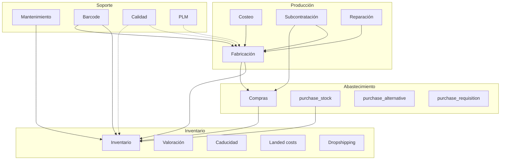
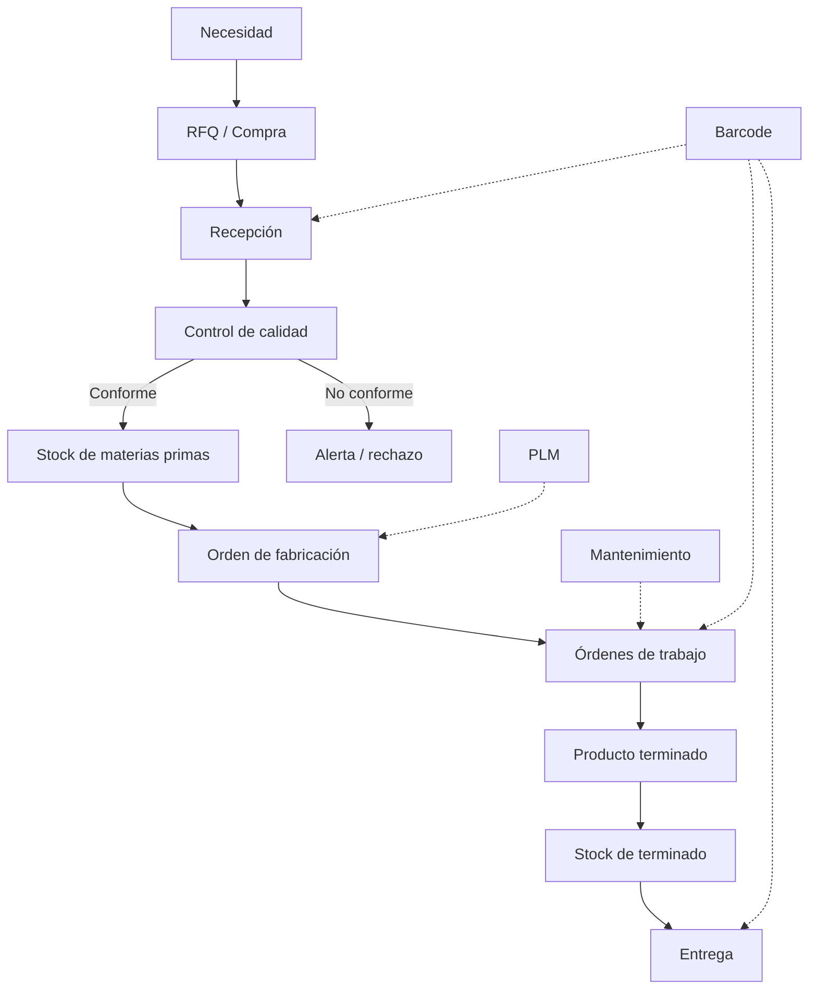

# Funcionalidades contempladas — Software de Producción y Abastecimiento

**Documento único consolidado** con el alcance funcional completo de los módulos de producción y abastecimiento.

| Dato | Valor |
|------|-------|
| Base de referencia | Odoo 20.0 (Community) + funcionalidad Enterprise documentada |
| Commit analizado | `2b504bcb3b4` (2026-08-10) |
| Módulos cubiertos | Compras, Inventario, Fabricación, Calidad, Mantenimiento, PLM y Códigos de barras |
| Funciones inventariadas | **184** |
| Uso previsto | Alcance funcional, diseño, estimación, configuración y validación |

**Convenciones:**

- ✅ **Community**: disponible en la edición Community.
- 🔶 **Enterprise**: requiere edición Enterprise o módulo equivalente.
- ⚙️ **Configuración**: requiere activar un ajuste o grupo.
- 🔗 **Integración**: depende de otro módulo.

> **Nota:** Quality, PLM y la app de escaneo `stock_barcode` son Enterprise y no están en el repositorio local. Se documentan a nivel funcional. Todo lo demás fue verificado contra el código de `addons/`.

---

## 1. Resumen de módulos

| Módulo | Prefijo | Edición | Funciones | Rol |
|--------|---------|---------|-----------|-----|
| Compras (Purchase) | `PUR` | ✅ Community | 22 | Abastecer materias primas, insumos y servicios |
| Inventario (Inventory) | `INV` | ✅ Community | 44 | Controlar almacenes, movimientos, trazabilidad y existencias |
| Fabricación (MRP) | `MRP` | ✅ Community | 41 | Transformar materias primas en producto terminado |
| Calidad (Quality) | `QC` | 🔶 Enterprise | 18 | Inspeccionar, aprobar/rechazar y gestionar no conformidades |
| Mantenimiento (Maintenance) | `MNT` | ✅ Community | 23 | Gestionar equipos, solicitudes y mantenimiento |
| PLM | `PLM` | 🔶 Enterprise | 16 | Controlar cambios de ingeniería y versiones de BOM |
| Códigos de barras (Barcode) | `BAR` | ✅ base / 🔶 app | 20 | Capturar operaciones por escáner |

**Total: 184 funciones.**

---

## 2. Arquitectura funcional

**Lectura:**

- **Compras** origina recepciones; no mueve stock por sí sola.
- **Inventario** es la capa transversal: todo termina en `stock.move` y `stock.quant`.
- **Fabricación** consume y produce usando las mismas reglas de inventario.
- **Calidad** inspecciona recepciones, entregas y operaciones.
- **Mantenimiento** protege la disponibilidad de equipos.
- **PLM** gobierna versiones de BOM y cambios técnicos.
- **Barcode** captura la ejecución, no planifica.

---

## 3. Catálogo funcional

### 3.1 Compras — Purchase (`PUR`)

**Modelos clave:** `purchase.order`, `purchase.order.line`, `product.supplierinfo`, `purchase.requisition`, `purchase.order.group`, `purchase.bill.line.match`.

**Módulos:** `purchase`, `purchase_stock`, `purchase_requisition`, `purchase_alternative`, `purchase_mrp`, `purchase_edi_ubl_bis3`.

| Código | Funcionalidad | Qué incluye | Edición |
|--------|---------------|-------------|---------|
| PUR-01 | Productos comprables y política de control | `purchase_ok`; `purchase_method` para facturar por cantidad ordenada o recibida; UoM, empaquetados y proveedores del producto. | ✅ |
| PUR-02 | Tarifas y condiciones de proveedor | `product.supplierinfo`: precio, cantidad mínima, plazo (`delay`), moneda, vigencia, descuento, nombre/código del proveedor. | ✅ |
| PUR-03 | Alta y gestión de proveedores | `supplier_rank`, avisos de compra, tasa de entrega a tiempo (`on_time_rate`); sin SRM completo. | ✅ |
| PUR-04 | Creación de RFQ | Proveedor, moneda, Incoterm, condiciones de pago, posición fiscal, destino, líneas, impuestos y analítica. | ✅ |
| PUR-05 | Generación automática de RFQ | Desde orderpoints, faltantes de fabricación, Make to Order y reglas de stock con ruta Buy. | ✅ 🔗 |
| PUR-06 | Envío y comunicación de RFQ | Correo, PDF, portal del proveedor y acuse de recibo; chatter y actividades. | ✅ |
| PUR-07 | Comparación de alternativas | Varias RFQ agrupadas (`purchase.order.group`); comparación por precio, plazo y OTD; elección por línea. | ✅ |
| PUR-08 | Fusión de RFQ | Une RFQ del mismo proveedor en estado borrador/enviada. | ✅ |
| PUR-09 | Acuerdos de compra | `purchase.requisition`: blanket order y purchase template; vigencia, líneas y órdenes generadas. | ✅ |
| PUR-10 | Aprobación de órdenes | Doble validación por importe (`po_double_validation`, `po_double_validation_amount`); estado `to approve`. | ✅ |
| PUR-11 | Confirmación de la orden | Convierte RFQ en orden; genera recepciones y movimientos de stock; vincula fabricación. | ✅ 🔗 |
| PUR-12 | Bloqueo de órdenes | `po_lock`, `locked`, botones bloquear/desbloquear; impide edición y cancelación. | ✅ |
| PUR-13 | Líneas, impuestos y analítica | Precio, descuento, impuestos, fecha prevista, distribución analítica, referencias y notas. | ✅ |
| PUR-14 | Recepción de mercancías | `stock.picking` de entrada; 1/2/3 pasos; fecha prometida y real; putaway; lotes/series. | ✅ 🔗 |
| PUR-15 | Seguimiento de cantidades y estados | `qty_received`, `qty_invoiced`, `qty_to_invoice`, `receipt_status`, `invoice_status`. | ✅ |
| PUR-16 | Facturación y conciliación | `action_create_invoice`, vista `purchase.bill.line.match`; 3-way matching automático es Enterprise. | ✅ / 🔶 |
| PUR-17 | Devoluciones, cancelaciones y backorders | Devolución al proveedor, cancelación controlada, recepción parcial y backorder, recepción manual. | ✅ |
| PUR-18 | Recordatorios y seguimiento | Recordatorio de recepción, envío masivo, actividades y acuse del proveedor. | ✅ |
| PUR-19 | Compras para fabricación y subcontratación | Componentes y kits (`purchase_mrp`), servicios de subcontratación (`mrp_subcontracting`). | ✅ 🔗 |
| PUR-20 | Compras EDI / UBL | Exportación/importación de órdenes electrónicas UBL BIS 3; PDF embebido en XML. | ✅ |
| PUR-21 | Reportes y análisis | `purchase.report`, historial de compras, comparación de precios por producto/proveedor. | ✅ |
| PUR-22 | Configuración del módulo | Aprobaciones, bloqueo, avisos, recordatorios, acuerdos, alternativas, matriz de productos, UoM. | ✅ ⚙️ |

**Notas clave:**

- La aprobación es por importe; no hay flujo multinivel por categoría sin desarrollo.
- El 3-way matching automático es Enterprise; en Community existe la vista de conciliación.
- En Odoo 20 `purchase_requisition` ya no usa “tender”; la comparación de ofertas se hace con `purchase_alternative`.
- La recepción real pertenece a Inventario.

---

### 3.2 Inventario — Inventory (`INV`)

**Modelos clave:** `stock.warehouse`, `stock.location`, `stock.picking`, `stock.picking.type`, `stock.move`, `stock.move.line`, `stock.quant`, `stock.lot`, `stock.route`, `stock.rule`, `stock.warehouse.orderpoint`, `stock.putaway.rule`, `stock.storage.category`, `stock.package`, `stock.picking.batch`, `stock.reference`.

**Módulos:** `stock`, `stock_account`, `product_expiry`, `stock_landed_costs`, `stock_dropshipping`, `stock_delivery`, `stock_maintenance`.

| Código | Funcionalidad | Qué incluye | Edición |
|--------|---------------|-------------|---------|
| INV-01 | Almacén | Multi-almacén; recepción 1/2/3 pasos; entrega 1/2/3 pasos; rutas por defecto; reabastecimiento entre almacenes. | ✅ |
| INV-02 | Ubicaciones | Jerarquía; tipos interno, vista, proveedor, cliente, pérdidas, producción y tránsito; barcode; estrategia de retiro; capacidad; inventario cíclico. | ✅ |
| INV-03 | Tipos de operación | Recepciones, entregas, internas, fabricación y dropshipping; numeración; reserva; etiquetas; barcode. | ✅ |
| INV-04 | Rutas | Buy, Manufacture, MTO, Dropship y Resupply; seleccionables por producto, categoría, almacén o tipo de paquete. | ✅ |
| INV-05 | Reglas de stock | Pull, push y pull+push; MTS, MTO y MTS-else-MTO; plazo; origen/destino; cancelación propagada. | ✅ |
| INV-06 | Putaway | Ubicación automática por producto/categoría; paquete; capacidad; sububicación. | ✅ |
| INV-07 | Categorías de almacenamiento | Peso máximo; capacidad por producto/paquete; permitir o no mezclar productos. | ✅ |
| INV-08 | Tipos de paquete | Dimensiones, peso, peso máximo, secuencia, barcode, uso y rutas. | ✅ |
| INV-09 | Estrategias de retiro | FIFO, LIFO, FEFO, ubicación más cercana y menor cantidad de paquetes. | ✅ |
| INV-10 | Nomenclaturas de código de barras | Reglas, patrones, tipos y parseo; asignación por compañía. | ✅ |
| INV-11 | Recepciones | Entrada de mercancía; lote/serie; paquete; putaway; backorder; etiquetas y albarán. | ✅ |
| INV-12 | Entregas | Reserva; preparación, empaque y entrega; control de disponibilidad; documentación. | ✅ |
| INV-13 | Transferencias internas | Movimiento entre ubicaciones internas con reserva y detalle. | ✅ |
| INV-14 | Transferencias agrupadas | `stock.picking.batch`: agrupar, reservar, validar, asignar responsable; estados. | ✅ |
| INV-15 | Reserva y disponibilidad | Métodos `at_confirm`, `by_date`, `manual`; reservar/liberar; estados disponible/esperado/retrasado. | ✅ |
| INV-16 | Backorders | Validación parcial; creación de transferencia pendiente; cadena de backorders. | ✅ |
| INV-17 | Devoluciones e intercambios | Devolución total o parcial; intercambio; vínculo con la transferencia original. | ✅ |
| INV-18 | División de transferencias | Separa líneas/cantidades en varias transferencias. | ✅ |
| INV-19 | Paquetes | Crear paquete, asignar contenido, mover completo, anidar, SSCC, historial. | ✅ |
| INV-20 | Operaciones detalladas | `stock.move.line`: producto, cantidad, ubicación, lote/serie, paquete y propietario. | ✅ |
| INV-21 | Etiquetas e impresión | Producto, lote/serie, paquete, albarán e informe de recepción; impresión automática. | ✅ |
| INV-22 | Quants y stock por ubicación | Existencia física, reservada y disponible por producto/ubicación/lote. | ✅ |
| INV-23 | Inventario físico | Conteo; establecer cantidad; establecer a cero; aplicar; historial de ajustes. | ✅ |
| INV-24 | Inventario cíclico | Frecuencia por ubicación; próxima fecha; inventario anual de compañía; fecha en quants. | ✅ |
| INV-25 | Reubicación | Mueve existencia entre ubicaciones sin transferencia formal. | ✅ |
| INV-26 | Scrap / desecho | En Odoo 20 es un `stock.move` con `is_scrap`; motivos etiquetados; reposición opcional. | ✅ |
| INV-27 | Valoración | Costo estándar, AVCO y FIFO; valoración por lote; ajustes (`product.value`); asientos contables. | ✅ 🔗 |
| INV-28 | Costos landing | `stock.landed.cost`; reparto igual, por cantidad, costo actual, peso o volumen; asiento. | ✅ |
| INV-29 | Dropshipping | Ruta y tipo de operación; entrega directa proveedor → cliente. | ✅ |
| INV-30 | Consignación | Propietario del stock (`owner_id`); separación de existencias de terceros. | ✅ |
| INV-31 | Lotes y números de serie | Tracking por lote o serie; propiedades; existencias; entregas; etiquetas. | ✅ |
| INV-32 | Fechas de caducidad | Caducidad, consumo preferente, retirada y alerta (`product_expiry`). | ✅ |
| INV-33 | FEFO | Salida por fecha de retirada más próxima; requiere caducidad y tracking. | ✅ |
| INV-34 | Reporte de trazabilidad | Historial hacia adelante y hacia atrás por lote/serie. | ✅ |
| INV-35 | Referencias de stock | `stock.reference` enlaza movimientos y transferencias de distintos documentos. | ✅ |
| INV-36 | Orderpoints | Mínimo/máximo; disparo automático/manual; demanda histórica; plazo; ruta; cantidad a pedir. | ✅ |
| INV-37 | Informe de reabastecimiento | Sugerencias; generar compra/fabricación; ajustar cantidad; snooze manual. | ✅ |
| INV-38 | Previsión de stock | Entradas/salidas futuras; stock proyectado; disponibilidad para comprometer. | ✅ |
| INV-39 | Reabastecimiento entre almacenes | Rutas automáticas entre almacenes; transferencias internas. | ✅ |
| INV-40 | Make to Order | No toma stock; dispara compra/fabricación para una necesidad concreta. | ✅ |
| INV-41 | Movimientos | Análisis de `stock.move` y `stock.move.line`; filtros y exportación. | ✅ |
| INV-42 | Stock por ubicación | Existencias detalladas por producto/ubicación/lote/propietario. | ✅ |
| INV-43 | Valoración | Reporte de valor por producto/categoría; ajustes de valoración. | ✅ |
| INV-44 | Trazabilidad | Reporte de historial de lote/serie y documentos vinculados. | ✅ |

**Notas clave:**

- No es un WMS avanzado: no hay slotting dinámico ni gestión de mano de obra.
- El inventario cíclico existe, pero es una frecuencia por ubicación; no es un motor ABC.
- La valoración y los asientos requieren `stock_account` y configuración contable.
- El scrap en Odoo 20 ya no usa el modelo clásico `stock.scrap`.

---

### 3.3 Fabricación — Manufacturing (`MRP`)

**Modelos clave:** `mrp.bom`, `mrp.bom.line`, `mrp.bom.byproduct`, `mrp.production`, `mrp.production.group`, `mrp.workorder`, `mrp.routing.workcenter`, `mrp.workcenter`, `mrp.workcenter.capacity`, `mrp.workcenter.productivity`, `mrp.unbuild`.

**Módulos:** `mrp`, `mrp_account`, `mrp_subcontracting`, `purchase_mrp`, `mrp_repair`, `mrp_product_expiry`, `mrp_landed_costs`, `mrp_delivery`.

| Código | Funcionalidad | Qué incluye | Edición |
|--------|---------------|-------------|---------|
| MRP-01 | BOM normal | Componentes, cantidades, UoM, operaciones, subproductos, plazos y notas. | ✅ |
| MRP-02 | BOM tipo kit (phantom) | Explota componentes sin orden de fabricación propia; usable en compras. | ✅ |
| MRP-03 | BOM multinivel | BOM hija por componente; explosión recursiva; MO hijas y grupo de producción. | ✅ |
| MRP-04 | Componentes y variantes | Componentes por operación; variantes; componentes opcionales; BOM por variante. | ✅ |
| MRP-05 | Subproductos | `mrp.bom.byproduct`; cantidad, operación y reparto de costo. | ✅ ⚙️ |
| MRP-06 | Operaciones y rutas | `mrp.routing.workcenter`: centro, secuencia, duración fija o calculada, costo. | ✅ ⚙️ |
| MRP-07 | Dependencias de operaciones | Bloqueo entre operaciones; validación de ciclos. | ✅ ⚙️ |
| MRP-08 | Lote y producción continua | Tamaño de lote; desbloqueo automático de la siguiente operación. | ✅ |
| MRP-09 | Plazos y preparación | `produce_delay`, `days_to_prepare_mo`; iniciar con todos o con la primera operación. | ✅ |
| MRP-10 | Creación de MO | Manual, orderpoint, venta MTO, subensamble o subcontratación. | ✅ |
| MRP-11 | Confirmación | Explota BOM, crea movimientos de componentes/terminado/subproductos y dispara aprovisionamiento. | ✅ |
| MRP-12 | Reserva y disponibilidad | Reservar/liberar componentes; estados disponible, esperado, retrasado, no disponible. | ✅ |
| MRP-13 | Capacidad de producción | Cantidad máxima producible con el stock actual de componentes. | ✅ |
| MRP-14 | Registro de producción | Cantidad producida; lote/serie; subproductos; movimientos de terminado. | ✅ |
| MRP-15 | Consumo y advertencias | Consumo real vs. teórico; asistente de diferencias; ajuste de cantidades. | ✅ |
| MRP-16 | Backorders | Producción parcial; MO pendiente; secuencia de backorder. | ✅ |
| MRP-17 | División y fusión | Separar o unir órdenes compatibles. | ✅ |
| MRP-18 | Bloqueo de cantidades | `is_locked`; evita cambios durante la ejecución; ajuste de desbloqueo. | ✅ ⚙️ |
| MRP-19 | Scrap | Desecho de componentes o producto terminado con motivo. | ✅ 🔗 |
| MRP-20 | Cierre | Marcar como hecho; consolida consumo/producción; costos; backorder. | ✅ |
| MRP-21 | Desensamblado | `mrp.unbuild`: recuperar componentes de un terminado. | ✅ |
| MRP-22 | Órdenes de trabajo | `mrp.workorder`: iniciar, pausar, finalizar, bloquear, reprogramar, registrar tiempos. | ✅ ⚙️ |
| MRP-23 | Centros de trabajo | Calendario, eficiencia, costo/hora, preparación/limpieza, etiquetas, barcode. | ✅ |
| MRP-24 | Capacidad por producto | `mrp.workcenter.capacity`: piezas por ciclo, UoM, tiempos de inicio/fin. | ✅ |
| MRP-25 | Tiempos y productividad | `mrp.workcenter.productivity`: usuario, inicio/fin, duración, pérdida. | ✅ |
| MRP-26 | Pérdidas y OEE | Categorías disponibilidad, rendimiento, calidad y productivo; OEE y objetivo. | ✅ |
| MRP-27 | Dependencias y bloqueos | Bloqueo entre órdenes de trabajo; desbloqueo al completar predecesora. | ✅ |
| MRP-28 | Centros alternativos | Sustitución de centro por saturación o avería. | ✅ |
| MRP-29 | Fechas y calendario | Fecha de inicio, fin, límite; planificar/desplanificar; vista calendario. | ✅ |
| MRP-30 | Planificación de capacidad | Carga por centro; órdenes listas, en progreso, bloqueadas y retrasadas. | ✅ |
| MRP-31 | Necesidades de componentes | Faltantes; fechas esperadas; compras o MO hijas. | ✅ 🔗 |
| MRP-32 | Reabastecimiento | Orderpoints y rutas Buy/Manufacture. | ✅ 🔗 |
| MRP-33 | Costo de la MO | Materiales, operaciones, costo extra y subproductos; valoración. | ✅ 🔗 |
| MRP-34 | Costo de operaciones | Horas reales/estimadas y tarifa del centro. | ✅ 🔗 |
| MRP-35 | Analítica | Distribución de costos a cuentas analíticas. | ✅ 🔗 |
| MRP-36 | WIP | Producción en proceso contabilizada (`wip_move_ids`). | ✅ 🔗 |
| MRP-37 | Subcontratación | BOM tipo subcontract; subcontratista; envío de componentes y recepción. | ✅ 🔗 |
| MRP-38 | Reparación | Órdenes de reparación, piezas, stock, facturación y vínculo con MO. | ✅ 🔗 |
| MRP-39 | Compras para fabricación | Componentes y kits; vínculo MO ↔ orden de compra. | ✅ 🔗 |
| MRP-40 | Reportes | Órdenes, órdenes de trabajo, OEE, pérdidas, estructura BOM y resumen de MO. | ✅ |
| MRP-41 | Configuración | Órdenes de trabajo, subproductos, desbloqueo, subcontratación; MPS/PLM/Quality son Enterprise. | ✅ ⚙️ |

**Notas clave:**

- Las órdenes de trabajo, centros, capacidad y OEE están en Community.
- La **Shop Floor táctil**, el **MPS** y la planificación avanzada son Enterprise.
- No hay APS de capacidad finita; la planificación es por fechas y carga manual.
- La integración con Calidad y Mantenimiento de centros es Enterprise.

---

### 3.4 Calidad — Quality (`QC`)

> 🔶 **Enterprise.** No disponible en el repositorio local. Documentado a nivel funcional.

**Modelos clave:** `quality.point`, `quality.check`, `quality.alert`, `quality.alert.stage`, `quality.alert.team`, `quality.alert.tag`.

| Código | Funcionalidad | Qué incluye | Edición |
|--------|---------------|-------------|---------|
| QC-01 | Puntos de control | Regla por producto/categoría, operación o tipo de transferencia; frecuencia; equipo; instrucciones. | 🔶 |
| QC-02 | Tipos de control | Instrucciones, aprobado/rechazado, medición y hoja de trabajo. | 🔶 |
| QC-03 | Criterios de aceptación | Valor mínimo/máximo, tolerancia, unidad y valores predefinidos. | 🔶 |
| QC-04 | Controles en recepciones | Inspección de compras; aprobar/rechazar; bloquear entrada; lote/serie. | 🔶 |
| QC-05 | Controles en entregas/transferencias | Verificación antes de salida o movimiento; bloqueo si falla. | 🔶 |
| QC-06 | Controles en fabricación | Control por operación; primera pieza, proceso o final; bloqueo de operación. | 🔶 |
| QC-07 | Hojas de trabajo | Formularios personalizados, secciones, firmas, fotos y documentos. | 🔶 |
| QC-08 | Ejecución de controles | Bandeja de pendientes; instrucciones; registro; evidencia; cierre. | 🔶 |
| QC-09 | Resultado y bloqueo | Aprobado, rechazado o fuera de tolerancia; bloqueo de la operación. | 🔶 |
| QC-10 | Alertas de calidad | No conformidad; producto/lote; equipo; prioridad; causa; acción; documento origen. | 🔶 |
| QC-11 | Etapas de alerta | Flujo configurable; kanban; responsables; transiciones. | 🔶 |
| QC-12 | Equipos de calidad | Miembros, alias y asignación de puntos/alertas. | 🔶 |
| QC-13 | Causa raíz y acciones | Análisis, acción inmediata, acción correctiva y verificación de eficacia. | 🔶 |
| QC-14 | Trazabilidad | Vínculo con lote/serie, recepción, MO o entrega; historial y evidencia. | 🔶 |
| QC-15 | Reportes | Controles, tasa de rechazo, alertas por etapa, defectos por causa. | 🔶 |
| QC-16 | Configuración | Activar Quality, worksheets, equipos, etapas, puntos y criterios. | 🔶 ⚙️ |
| QC-17 | Integraciones | Stock, MRP, órdenes de trabajo, documentos y barcode; integración con mantenimiento según módulos contratados. | 🔶 🔗 |
| QC-18 | Alcance y límites | No es un LIMS; criterios complejos requieren worksheets o desarrollo. | 🔶 |

**Flujo:** punto de control → control pendiente → resultado → aprobado (continúa) o rechazado (alerta → causa → acción → cierre).

---

### 3.5 Mantenimiento — Maintenance (`MNT`)

**Modelos clave:** `maintenance.equipment`, `maintenance.equipment.category`, `maintenance.team`, `maintenance.request`, `maintenance.stage`, `maintenance.mixin`.

**Módulos:** `maintenance`, `stock_maintenance`; complementos `repair` y `mrp_repair`.

| Código | Funcionalidad | Qué incluye | Edición |
|--------|---------------|-------------|---------|
| MNT-01 | Ficha de equipo | Nombre, categoría, propietario, equipo/técnico, proveedor, modelo, serie, costo, garantía, baja, notas. | ✅ |
| MNT-02 | Categorías de equipo | Agrupación; responsable por defecto; propiedades personalizadas. | ✅ |
| MNT-03 | Equipos de mantenimiento | Miembros, alias de correo y contadores de solicitudes. | ✅ |
| MNT-04 | Etapas | Pipeline configurable; plegado; aplicación por equipo. | ✅ |
| MNT-05 | Solicitudes | Equipo obligatorio; tipo; equipo/técnicos; etapa; prioridad; fechas; instrucciones; propiedades. | ✅ |
| MNT-06 | Mantenimiento correctivo | Falla no planificada; diagnóstico; reparación; cierre; alimenta MTBF/MTTR. | ✅ |
| MNT-07 | Mantenimiento preventivo | Trabajo planificado; instrucciones; ejecución; cierre. | ✅ |
| MNT-08 | Recurrencia | Intervalo en días/semanas/meses/años; indefinido o hasta fecha; genera siguiente solicitud. | ✅ |
| MNT-09 | Programación | Fecha/hora planificada; fin previsto; duración; fecha real de cierre; calendario. | ✅ |
| MNT-10 | Kanban / pipeline | Columnas por etapa; arrastrar y soltar; colores; filtros. | ✅ |
| MNT-11 | Prioridad y asignación | Prioridad 0–3; técnicos; equipo responsable. | ✅ |
| MNT-12 | Instrucciones y notas | Descripción, instrucciones HTML y chatter. | ✅ |
| MNT-13 | Cierre, cancelación y reapertura | Estado hecho; cancelar detiene recurrencia; reabrir vuelve a la primera etapa. | ✅ |
| MNT-14 | MTBF / MTTR | Tiempo medio entre fallas, tiempo medio de reparación, próximo fallo estimado. | ✅ |
| MNT-15 | Asignación y ubicación | Propietario, fecha de asignación, ubicación interna, equipos por ubicación. | ✅ 🔗 |
| MNT-16 | Garantía y costo | Costo, vencimiento de garantía, fecha de baja, proveedor. | ✅ |
| MNT-17 | Propiedades personalizadas | Campos definidos por categoría para equipo y solicitud. | ✅ |
| MNT-18 | Dashboard | Tarjetas por equipo de mantenimiento y contadores de solicitudes. | ✅ |
| MNT-19 | Reportes | Análisis de solicitudes por equipo, técnico, etapa y tipo. | ✅ |
| MNT-20 | Integración con inventario | Ubicación del equipo; botón de lote/serie coincidente; equipos por ubicación. | ✅ 🔗 |
| MNT-21 | Integración con reparaciones | Órdenes de reparación, piezas, stock, facturación y vínculo con MO. | ✅ 🔗 |
| MNT-22 | Configuración | Equipos, categorías, etapas, alias, ajustes y worksheets Enterprise. | ✅ ⚙️ |
| MNT-23 | Alcance y límites | No es un EAM/CMMS; sin repuestos dedicados, capacidad de técnicos ni contabilidad de activos. | ✅ |

**Flujo:** solicitud → equipo/etapa → correctivo o preventivo → ejecución → cierre → recurrencia y métricas.

---

### 3.6 PLM (`PLM`)

> 🔶 **Enterprise.** No disponible en el repositorio local. Documentado a nivel funcional.

**Modelos clave:** `mrp.eco`, `mrp.eco.stage`, `mrp.eco.type`, `mrp.bom` versionada.

| Código | Funcionalidad | Qué incluye | Edición |
|--------|---------------|-------------|---------|
| PLM-01 | Orden de cambio de ingeniería (ECO) | Documento con tipo, producto/BOM, etapa, responsable, prioridad, motivo y vigencia. | 🔶 |
| PLM-02 | Tipos de ECO | Clasificación del cambio (BOM, producto, operaciones, documentación) y reglas asociadas. | 🔶 |
| PLM-03 | Etapas del ECO | Flujo configurable; kanban; plegado; aprobación por etapa. | 🔶 |
| PLM-04 | Aprobaciones | Validación técnica; usuario/fecha; rechazo o solicitud de cambios; historial. | 🔶 |
| PLM-05 | Versiones de BOM | Nueva versión al aplicar el cambio; copia de la anterior; ECO asociada. | 🔶 |
| PLM-06 | Revisiones | Historial de revisiones; fecha, responsable y cambios. | 🔶 |
| PLM-07 | Cambios en componentes | Agregar/quitar/modificar componentes, cantidades, variantes y subproductos. | 🔶 |
| PLM-08 | Cambios en operaciones | Agregar/quitar operaciones, centro, tiempos, dependencias e instrucciones. | 🔶 |
| PLM-09 | Fechas de efectividad | Inicio/fin de vigencia; selección de versión vigente por fecha. | 🔶 |
| PLM-10 | Archivo de versiones | Conserva BOM anteriores; consulta histórica; reactivación controlada. | 🔶 |
| PLM-11 | Análisis de impacto | BOM y órdenes afectadas; componentes/operaciones impactados; costo estimado. | 🔶 |
| PLM-12 | Gestión documental | Planos, especificaciones y evidencias; integración con `documents`. | 🔶 🔗 |
| PLM-13 | Trazabilidad y auditoría | Quién creó/revisó/aprobó; fechas; cambios; versión resultante. | 🔶 |
| PLM-14 | Reportes | ECOs por etapa/tipo/responsable; tiempo de ciclo; versiones vigentes; impacto. | 🔶 |
| PLM-15 | Configuración | Activar PLM; tipos; etapas; secuencias; permisos; integración documental. | 🔶 ⚙️ |
| PLM-16 | Alcance y límites | No es CAD/PDM ni configurador avanzado; requiere BOM y proceso disciplinado. | 🔶 |

**Flujo:** solicitud de cambio → ECO → análisis de impacto → revisión → aprobación → aplicar → nueva versión de BOM → producción.

---

### 3.7 Códigos de barras — Barcode (`BAR`)

**Modelos clave:** `barcode.nomenclature`, `barcode.rule`; app Enterprise `stock_barcode`.

**Módulos:** `barcodes`, `barcodes_gs1_nomenclature`, `stock_barcode` (Enterprise).

| Código | Funcionalidad | Qué incluye | Edición |
|--------|---------------|-------------|---------|
| BAR-01 | Nomenclatura | Conjunto de reglas; conversión UPC/EAN; asignación por compañía. | ✅ |
| BAR-02 | Reglas | Nombre, secuencia, encoding, tipo, patrón y alias; evaluación por prioridad. | ✅ |
| BAR-03 | Tipos de regla | Alias, producto, peso, ubicación, lote, paquete; tipos GS1 adicionales. | ✅ |
| BAR-04 | Parseo | Convierte código en tipo, valor, código base y encoding; error si no coincide. | ✅ |
| BAR-05 | GS1 | GS1-128, FNC1, AI, fechas, medidas, identificadores y URIs (lgtin, sgtin, sscc). | ✅ |
| BAR-06 | Código de producto | Barcode de producto/plantilla/UoM; búsqueda y validación. | ✅ |
| BAR-07 | Código de ubicación | Barcode único por compañía; selección de origen/destino. | ✅ |
| BAR-08 | Código de lote/serie | Identificación y búsqueda de lote/serie. | ✅ |
| BAR-09 | Código de paquete | Identificación de paquete; validación SSCC; tipo de paquete. | ✅ |
| BAR-10 | Código de contacto | `res.partner.barcode`; proveedor/cliente; unicidad. | ✅ |
| BAR-11 | Validación EAN/GTIN | Formato, dígito de control y SSCC. | ✅ |
| BAR-12 | Recepciones con escáner | Seleccionar transferencia; producto, cantidad, lote, ubicación; validar; backorder. | 🔶 |
| BAR-13 | Transferencias internas con escáner | Origen, destino, producto/lote/paquete; validar. | 🔶 |
| BAR-14 | Entregas / picking con escáner | Preparar, escanear, empaquetar y validar; backorder. | 🔶 |
| BAR-15 | Conteo de inventario con escáner | Ubicación, producto/lote, cantidad; aplicar ajuste. | 🔶 |
| BAR-16 | Paquetes con escáner | Crear, asignar, mover, anidar e imprimir. | 🔶 |
| BAR-17 | Lotes/series con escáner | Escanear/crear y asignar en la operación. | 🔶 |
| BAR-18 | Fabricación con escáner | MO/orden de trabajo; componentes; consumo; terminado; cierre. | 🔶 🔗 |
| BAR-19 | Etiquetas | Producto, lote, paquete, ubicación; formatos y ZPL; impresión automática. | ✅ / 🔶 |
| BAR-20 | Configuración | Nomenclatura, reglas, GS1, operaciones, impresión y app Enterprise. | ✅ / 🔶 ⚙️ |

**Nota:** Community interpreta códigos; la ejecución por escáner es Enterprise (`stock_barcode`). Barcode no planifica ni decide: complementa Inventario, Compras y Fabricación.

---

## 4. Funcionalidades transversales

| Funcionalidad | Descripción | Módulos |
|---------------|-------------|---------|
| Multi-compañía | Registros por compañía, reglas de acceso y contabilidad separada. | Todos |
| Multi-moneda | Compras y valoración en moneda de compañía y moneda extranjera. | Compras, Inventario |
| Multi-almacén | Varios almacenes, rutas y reabastecimiento entre ellos. | Inventario, MRP |
| Multi-ubicación | Jerarquía física y virtual con tipos de uso. | Inventario |
| Trazabilidad | Lote/serie, caducidad, FEFO y reporte hacia adelante/atrás. | Inventario, MRP, Calidad |
| Unidades de medida | UoM, conversiones y empaquetados. | Todos |
| Impuestos y condiciones | Impuestos, descuentos, condiciones de pago e Incoterm. | Compras |
| Distribución analítica | Costos y compras imputados a cuentas analíticas. | Compras, MRP |
| Roles y permisos | Grupos de compras, inventario, fabricación, mantenimiento y calidad. | Todos |
| Chatter y actividades | Historial, mensajes, seguidores y tareas. | Todos |
| Portal de proveedores | Consulta y acuse de RFQ/órdenes. | Compras |
| Reportes y tableros | Vistas lista, kanban, calendario, pivote y gráficos. | Todos |
| Importación/exportación | Carga y extracción de datos en Excel/CSV. | Todos |
| Contabilidad | Asientos de inventario, facturas y valoración. | Compras, Inventario, MRP |
| Automatización | Reglas de stock, orderpoints, recurrencias y correos. | Inventario, Mantenimiento |
| Integración de calidad | Controles en recepción, entrega y fabricación. | Calidad |
| Integración de mantenimiento | Equipos, lotes/series y reparaciones. | Mantenimiento |
| Integración PLM | ECOs y versiones de BOM. | PLM |
| Barcode | Captura de operaciones logísticas y productivas. | Barcode |

---

## 5. Flujos de negocio

### 5.1 Procure-to-pay (compras)

1. Se detecta la necesidad (orderpoint, MRP, MTO o manual).
2. Se crea la RFQ y se envían alternativas a proveedores.
3. Se comparan ofertas y se elige proveedor/línea.
4. Se aprueba según importe.
5. Se confirma la orden y se genera la recepción.
6. Se recibe, se inspecciona y se almacena.
7. Se factura y se concilia con la recepción.
8. Se paga.

### 5.2 Recepción y almacenamiento

1. Llega la mercancía y se identifica la transferencia.
2. Se registra producto, cantidad, lote/serie y paquete.
3. Se aplica putaway a la ubicación correcta.
4. Se valida la recepción; si es parcial, se crea backorder.
5. El stock queda disponible para producción o venta.

### 5.3 Planificación y fabricación

1. Se define BOM, ruta, centro y capacidad.
2. Se crea la MO (manual o por necesidad).
3. Se confirman componentes y se reservan.
4. Se ejecutan operaciones y se registran tiempos.
5. Se consume material y se produce el terminado.
6. Se registra lote/serie y subproductos.
7. Se cierra la orden y se costea.
8. El terminado pasa a inventario.

### 5.4 Calidad

1. Se define el punto de control.
2. Se dispara al recibir, entregar o fabricar.
3. Se ejecuta la inspección y se registra el resultado.
4. Si falla, se bloquea y se crea una alerta.
5. Se analiza la causa y se aplica la acción correctiva.
6. Se cierra con verificación de eficacia.

### 5.5 Mantenimiento

1. Se registra el equipo y su categoría.
2. Se crea una solicitud correctiva o preventiva.
3. Se asigna equipo, técnico y prioridad.
4. Se programa y ejecuta.
5. Se cierra con fecha real.
6. Si es recurrente, se genera la siguiente solicitud.
7. Se actualizan MTBF/MTTR.

### 5.6 Ingeniería (PLM)

1. Se detecta la necesidad de cambio.
2. Se crea el ECO y se analiza el impacto.
3. Se revisa y aprueba.
4. Se aplican los cambios a la BOM/ruta.
5. Se genera una nueva versión con vigencia.
6. Se archiva la versión anterior.
7. Producción usa la versión vigente.

### 5.7 Ejecución con barcode

1. Se escanea el documento/operación.
2. Se escanea producto, lote y ubicación.
3. Se confirma la cantidad.
4. Se valida la operación.
5. Se actualiza el stock en tiempo real.

### 5.8 Flujo end-to-end

---

## 6. Matriz de cobertura Community / Enterprise

| Capacidad | Community | Enterprise |
|-----------|-----------|------------|
| Compras, inventario y MRP base | ✅ | ✅ |
| RFQ, órdenes, recepciones | ✅ | ✅ |
| Acuerdos de compra y alternativas | ✅ | ✅ |
| 3-way matching automático | ❌ | ✅ |
| Multi-almacén, rutas y putaway | ✅ | ✅ |
| Lotes/series, caducidad y FEFO | ✅ | ✅ |
| Inventario cíclico | ✅ | ✅ |
| Valoración estándar/AVCO/FIFO | ✅ | ✅ |
| Landed costs y dropshipping | ✅ | ✅ |
| BOM, MO, subproductos y costeo | ✅ | ✅ |
| Órdenes de trabajo, centros, capacidad y OEE | ✅ | ✅ |
| Shop Floor táctil | ❌ | ✅ |
| MPS (planificación maestra) | ❌ | ✅ |
| Capacidad finita / APS | ❌ | 🟡 limitado |
| Calidad (controles y alertas) | ❌ | ✅ |
| PLM / ECO / versionado de BOM | ❌ | ✅ |
| App de escaneo Barcode | ❌ | ✅ |
| Mantenimiento de equipos | ✅ | ✅ |
| Mantenimiento de centros de trabajo | ❌ | ✅ |
| Subcontratación | ✅ | ✅ |
| Reparaciones | ✅ | ✅ |

**Leyenda:** ✅ disponible · 🟡 parcial · ❌ no disponible en esa edición.

---

## 7. Datos maestros y configuración mínima

### 7.1 Datos maestros

| Dato | Módulo | Uso |
|------|--------|-----|
| Productos y variantes | Producto | Compras, stock, BOM, ventas |
| Unidades de medida y empaquetados | Producto | Cantidades y conversiones |
| Categorías de producto | Producto | Valoración, rutas y cuentas |
| Proveedores y contactos | Contactos/Compras | Compras y tarifas |
| Tarifas de proveedor | Compras | Precio y plazo |
| Almacenes y ubicaciones | Inventario | Logística |
| Tipos de operación | Inventario | Recepciones, entregas, internas |
| Rutas y reglas | Inventario | Aprovisionamiento |
| Putaway y categorías de almacenamiento | Inventario | Ubicación y capacidad |
| Estrategias de retiro | Inventario | FIFO/LIFO/FEFO |
| Lotes y series | Inventario | Trazabilidad |
| Orderpoints | Inventario | Reabastecimiento |
| BOM y subproductos | Fabricación | Composición |
| Centros y operaciones | Fabricación | Capacidad y rutas |
| Equipos y categorías | Mantenimiento | Activos |
| Puntos de control y equipos de calidad | Calidad | Inspección |
| Tipos y etapas de ECO | PLM | Cambios de ingeniería |
| Nomenclaturas y reglas de barcode | Barcode | Escaneo |

### 7.2 Orden de configuración recomendado

1. Compañía, moneda, impuestos y localización.
2. Productos, UoM, categorías y proveedores.
3. Almacenes, ubicaciones y tipos de operación.
4. Rutas, reglas, putaway y estrategias de retiro.
5. Valoración y cuentas contables.
6. BOM, operaciones y centros de trabajo.
7. Orderpoints y plazos.
8. Puntos de control de calidad.
9. Equipos y planes de mantenimiento.
10. Tipos/etapas de ECO y versiones de BOM.
11. Nomenclaturas de código de barras.
12. Roles, permisos y flujos de aprobación.
13. Pruebas integrales en staging.

---

## 8. Supuestos, exclusiones y consideraciones

### 8.1 Supuestos

- La empresa opera con al menos un almacén y un proceso productivo definido.
- Los productos almacenables se configuran con UoM y categoría correctas.
- La trazabilidad por lote/serie se define antes de operar.
- La valoración se elige antes de cargar movimientos.
- Existe disciplina de registro de tiempos y consumos.

### 8.2 Exclusiones

- No se contempla un APS de capacidad finita.
- No se contempla un SRM completo.
- No se contempla un LIMS de laboratorio.
- No se contempla un CAD/PDM.
- No se contempla un WMS avanzado con slotting o gestión de mano de obra.
- No se contempla contabilidad de activos ni depreciación.
- No se contempla un CMMS completo.

### 8.3 Consideraciones

- Los módulos Quality, PLM y la app Barcode son Enterprise.
- La calidad y el mantenimiento de centros de trabajo requieren módulos Enterprise.
- La integración con barcode de fabricación es Enterprise.
- La planificación de capacidad es manual/por fechas.
- La exactitud de los indicadores depende de la disciplina de datos.

---

## 9. Glosario de modelos

| Modelo | Descripción |
|--------|-------------|
| `purchase.order` | RFQ / orden de compra |
| `purchase.order.line` | Línea de compra |
| `product.supplierinfo` | Tarifa de proveedor |
| `purchase.requisition` | Acuerdo de compra |
| `purchase.order.group` | Grupo de RFQ alternativas |
| `stock.warehouse` | Almacén |
| `stock.location` | Ubicación |
| `stock.picking` | Transferencia |
| `stock.picking.type` | Tipo de operación |
| `stock.move` | Movimiento de stock |
| `stock.move.line` | Detalle de movimiento |
| `stock.quant` | Existencia |
| `stock.lot` | Lote / número de serie |
| `stock.route` | Ruta |
| `stock.rule` | Regla de stock |
| `stock.warehouse.orderpoint` | Punto de pedido |
| `stock.putaway.rule` | Regla de ubicación |
| `stock.storage.category` | Categoría de almacenamiento |
| `stock.package` | Paquete |
| `stock.picking.batch` | Transferencia agrupada |
| `stock.reference` | Referencia documental de stock |
| `stock.scrap.reason.tag` | Motivo de desecho |
| `mrp.bom` | Lista de materiales |
| `mrp.bom.line` | Componente de BOM |
| `mrp.bom.byproduct` | Subproducto |
| `mrp.production` | Orden de fabricación |
| `mrp.production.group` | Grupo de órdenes |
| `mrp.workorder` | Orden de trabajo |
| `mrp.routing.workcenter` | Operación de ruta |
| `mrp.workcenter` | Centro de trabajo |
| `mrp.workcenter.capacity` | Capacidad por producto |
| `mrp.workcenter.productivity` | Registro de tiempo/pérdida |
| `mrp.unbuild` | Orden de desensamblado |
| `maintenance.equipment` | Equipo |
| `maintenance.equipment.category` | Categoría de equipo |
| `maintenance.team` | Equipo de mantenimiento |
| `maintenance.request` | Solicitud de mantenimiento |
| `maintenance.stage` | Etapa de solicitud |
| `quality.point` | Punto de control |
| `quality.check` | Control ejecutado |
| `quality.alert` | Alerta de calidad |
| `quality.alert.stage` | Etapa de alerta |
| `quality.alert.team` | Equipo de calidad |
| `mrp.eco` | Orden de cambio de ingeniería |
| `mrp.eco.stage` | Etapa de ECO |
| `mrp.eco.type` | Tipo de ECO |
| `barcode.nomenclature` | Nomenclatura de códigos |
| `barcode.rule` | Regla de código de barras |

---

## 10. Checklist de alcance

### Compras

- [ ] RFQ manual y automática
- [ ] Comparación de alternativas
- [ ] Acuerdos de compra
- [ ] Aprobación por importe
- [ ] Recepción y backorders
- [ ] Facturación y conciliación
- [ ] Reportes de compra

### Inventario

- [ ] Multi-almacén y ubicaciones
- [ ] Recepciones, entregas y transferencias
- [ ] Rutas, reglas y putaway
- [ ] Lotes/series y caducidad
- [ ] Inventario físico y cíclico
- [ ] Orderpoints y reabastecimiento
- [ ] Valoración y landed costs
- [ ] Dropshipping y consignación
- [ ] Reportes de stock y trazabilidad

### Fabricación

- [ ] BOM normal, kit y multinivel
- [ ] Subproductos y operaciones
- [ ] Órdenes de fabricación y trabajo
- [ ] Centros, capacidad y OEE
- [ ] Reserva, consumo y producción
- [ ] Backorders y desensamblado
- [ ] Costeo y analítica
- [ ] Subcontratación y reparación
- [ ] Reportes de producción

### Calidad

- [ ] Puntos de control
- [ ] Inspecciones y criterios
- [ ] Controles en recepción, entrega y fabricación
- [ ] Alertas y etapas
- [ ] Causa raíz y acciones
- [ ] Reportes de calidad

### Mantenimiento

- [ ] Equipos y categorías
- [ ] Solicitudes correctivas y preventivas
- [ ] Recurrencia y programación
- [ ] MTBF/MTTR
- [ ] Integración con inventario y reparaciones
- [ ] Reportes de mantenimiento

### PLM

- [ ] ECOs y tipos
- [ ] Etapas y aprobaciones
- [ ] Versiones de BOM
- [ ] Cambios de componentes y operaciones
- [ ] Efectividad y archivo
- [ ] Impacto y auditoría

### Barcode

- [ ] Nomenclaturas y reglas
- [ ] GS1
- [ ] Códigos de producto, ubicación, lote y paquete
- [ ] Recepciones y transferencias
- [ ] Entregas y picking
- [ ] Conteo de inventario
- [ ] Fabricación con escáner
- [ ] Etiquetas

---

**Fin del documento.**
