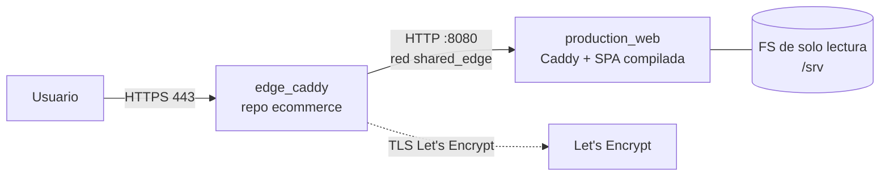

# Despliegue de PRODDSI (Suite Producción) — Docker + edge compartido

Este directorio contiene **todo** lo necesario para correr la suite en el VPS.
No hace falta instalar Node, pnpm ni servir archivos a mano en el host: la
imagen compila la SPA y la sirve con Caddy.



## Qué hay aquí

| Archivo | Para qué |
|---|---|
| `Dockerfile` | Build multi-etapa: `pnpm build` de `Interface_web/` → imagen Caddy con solo `dist/`. |
| `Caddyfile` | Servidor interno en `:8080`, sin TLS, cabeceras de seguridad y fallback de SPA. |
| `docker-compose.yml` | Un contenedor (`production_web`), loopback y red `shared_edge`. |
| `../prod.js` | Lanzador de producción (build, up, `--dns`, `--status`, `--logs`…). |
| `../prod.config.json` | Dominio, IP pública y puerto propio. |
| `../deploy/deploy.sh` | Despliegue idempotente usado por CI/CD. |

## Puertos

| Puerto | Quién | Expuesto a internet |
|---|---|---|
| `80`, `443` | `edge_caddy` (repo ecommerce) | **Sí** |
| `127.0.0.1:30440` | `production_web` → `:8080` | No (solo loopback) |

`30440` es exclusivo de este proyecto: no choca con ecommerce (`30180/30181`),
CRM (`30280/30281`), contabilidad (`30380/30381`) ni restaurantes (`30390`).

## Uso

```bash
node prod.js              # comprueba puertos, construye y levanta
node prod.js --dns        # registros DNS a crear en GoDaddy
node prod.js --status     # contenedor + DNS + HTTPS público
node prod.js --logs       # últimas 120 líneas de Caddy
node prod.js --restart    # reinicia el contenedor
node prod.js --down       # detiene y elimina el contenedor
```

Equivalente a mano:

```bash
docker compose -f docker/docker-compose.yml up -d --build
docker compose -f docker/docker-compose.yml logs -f
```

## DNS

Un único registro A, en la zona `jcti.xyz`:

| Tipo | Nombre | Datos | TTL |
|---|---|---|---|
| A | `production` | `170.254.229.68` | 600 |

El nombre resultante es **`production.jcti.xyz`**. El certificado lo emite el
edge (Let's Encrypt) automáticamente **cuando el DNS ya resuelve**; si el edge
intentó antes, se fuerza con:

```bash
docker restart edge_caddy
```

## El bloque del edge

El `Caddyfile` del edge vive en el **repo ecommerce** (`docker/edge/Caddyfile`)
y debe contener:

```caddyfile
production.jcti.xyz {
	import edge_headers
	log {
		output stdout
		format json
	}
	tls {
		issuer acme {
			dir https://acme-v02.api.letsencrypt.org/directory
			test_dir https://acme-v02.api.letsencrypt.org/directory
		}
	}
	reverse_proxy production_web:8080
}
```

Recarga sin cortar tráfico:

```bash
docker exec edge_caddy caddy reload --config /etc/caddy/Caddyfile
```

## Seguridad

- **Un solo puerto público**: 80/443 del edge. El contenedor de PRODDSI solo se
  publica en `127.0.0.1:30440` (diagnóstico) y vive en `shared_edge`.
- **Sin backend ni BD**: el sitio es estático, así que no hay superficie de API
  ni credenciales que rotar. No hay `.env` con secretos.
- **Proceso sin privilegios** (`user: 1000:1000`), `read_only: true`,
  `cap_drop: ALL`, `no-new-privileges`, `tmpfs` para `/tmp`.
- **Cabeceras**: HSTS, CSP (sin `unsafe-eval`; solo Google Fonts), `X-Frame-Options
  DENY`, `Referrer-Policy`, `Permissions-Policy`, COOP/CORP, `-Server`.
- **Cache**: `/assets/*` inmutable (hash en el nombre); `index.html` y favicon
  `no-cache` para no servir versiones viejas tras un despliegue.
- **Docker**: logs rotados (10 MB × 3), `restart: unless-stopped`.
- **Firewall del VPS**: solo TCP 80 y 443 abiertos. Nunca 30440.

## CI/CD

`.github/workflows/ci-cd.yml`:

1. **CI** (`ubuntu-latest`): `pnpm install --frozen-lockfile` + `pnpm build`
   (incluye `tsc --noEmit`).
2. **image**: construye `docker/Dockerfile` con Buildx (sin publicar).
3. **deploy** (`self-hosted`, labels `mercaldas,linux`): ejecuta
   `deploy/deploy.sh <sha>` sobre `dev`.

Registro del runner (una vez, con token de GitHub):

```bash
bash deploy/install-runner.sh <REGISTRATION_TOKEN>
```

## Troubleshooting

| Síntoma | Causa habitual | Solución |
|---|---|---|
| `502` en el dominio | contenedor caído o no está en `shared_edge` | `node prod.js --status`, `docker logs production_web` |
| `404` con página de Caddy | el edge no tiene el bloque o el Host no coincide | revisar `docker exec edge_caddy cat /etc/caddy/Caddyfile` |
| Certificado inválido / `SSL_ERROR` | DNS creado después del primer intento | `docker restart edge_caddy` |
| `port is already allocated` | otro servicio usa `30440` | `node prod.js --check-ports` y cambiar `edgePorts.http` |
| Estilos/fuentes bloqueados | CSP demasiado estricta para un recurso nuevo | ajustar `Content-Security-Policy` en `docker/Caddyfile` |
| Página vieja tras desplegar | cache del navegador en `index.html` | verificar `Cache-Control: no-cache` en `/` |

## Verificación rápida

```bash
curl -sI https://production.jcti.xyz/ | grep -i 'content-security\|strict-transport'
curl -s  https://production.jcti.xyz/ | grep -o '<title>[^<]*</title>'
curl -s  https://production.jcti.xyz/healthz -o /dev/null -w '%{http_code}\n'
```
